# Diagrams

Mermaid diagrams of the c101 agent stack: the saved workflows, the system as a whole, the life of one
request, the guard on every spawn, web-content safety, the self-tuning loop and the image pipeline. GitHub
renders them in place; they use only `flowchart`, `sequenceDiagram` and `stateDiagram-v2`. Rendered SVG copies
of diagrams 1 and 2, [all-workflows.svg](diagrams/all-workflows.svg) and
[system-overview.svg](diagrams/system-overview.svg), are there for viewers that do not render Mermaid. Labels
follow the code they summarise (`.claude/workflows/*.js`, `stack/hooks.py`, `stack/budget.py`,
`stack/injection.py`, `stack/learn/`, `config/policy.json`); where prose and code differ, the diagrams follow the
code.

| Colour | Meaning |
|---|---|
| blue | an agent produces content |
| orange | an agent judges, verifies, critiques or rules |
| green | code decides: the workflow script or a hook computes it |
| purple | synthesis and final outputs |
| red | stop, deny or early exit |
| yellow | files, configuration and stored state |
| grey | entry points and notes |

Contents:

1. [All saved workflows in one picture](#1-all-saved-workflows-in-one-picture)
2. [System overview](#2-system-overview)
3. [Request lifecycle](#3-request-lifecycle)
4. [Guard pipeline for one spawn](#4-guard-pipeline-for-one-spawn)
5. [Web-content safety](#5-web-content-safety)
6. [Self-tuning loop](#6-self-tuning-loop)
7. [Image pipeline](#7-image-pipeline)
8. [Workflows one by one](#8-workflows-one-by-one): [swarm-run](#81-swarm-run), [fanout](#82-fanout),
   [mediate](#83-mediate), [expert-panel](#84-expert-panel), [research-sweep](#85-research-sweep),
   [review-verify](#86-review-verify), [plan-tournament](#87-plan-tournament),
   [visual-iterate](#88-visual-iterate)

## 1. All saved workflows in one picture

A saved workflow is a plain JavaScript script in `.claude/workflows/` that only the main thread can launch, with
the Workflow tool or `/<name>`; Claude Code removes the Workflow tool from every subagent, so a subagent returns
the recommendation as an Open doubt instead. Every script validates its args before it starts a single agent and,
when a required field is missing or invalid, returns `{started: false, reason, next}` with a ready-to-use example.
Once a script runs, agents only produce content (solutions, ballots, findings, claims, plans, images) and the
script computes every decision: tallies, quantiles, stop rules, dedup and coverage ledgers, so each result can be
replayed from the agents' structured returns. Each row reads left to right: who produces (blue), who judges or
verifies (orange), where the script decides and what stops it (green), and what comes out (purple).
[Section 8](#8-workflows-one-by-one) draws each workflow in more detail. Source:
[Saved workflows](reference/workflows.md#saved-workflows).

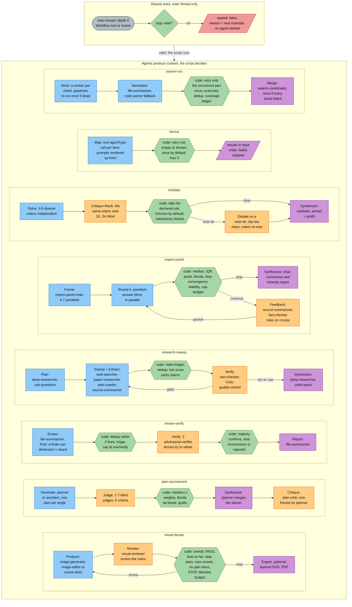

## 2. System overview

The `delegator` is the only agent that talks to the user: it runs as the main thread at depth 0, classifies each
request and sends it down the cheapest adequate route, either a saved workflow or an Agent call into one of the
nine agent groups (63 agents, nesting up to depth 8, every spawn checked by the `pre-agent` hook of diagram 4).
Each agent lists only the MCP servers it calls: the research agents use exa, jina, spider and fetch, with
playwright for `browser-operator` and the built-in computer-use server for `computer-operator`; `tester` uses
playwright; eleven experts and `architect` use context7; the image agents and `graphic-design-expert` use the image
server. Each of these connects only while its agent runs. The exception is neural-memory: the delegator carries it,
so it runs for the whole main-thread session, and `orchestrator`, `planner`, `architect`, `debugger` and `reviewer`
share that connection. Every agent preloads the three protocol skills plus at most three role skills: method skills from the core
pack, or for an expert the hub skill of its domain pack, which indexes that pack's granular skills (144 skills in
19 install packs). Any agent at any depth can hand an Open doubt to one of the doubt resolvers, budget and depth
permitting. Source: [Agent layers](reference/overview.md#agent-layers), [docs/ARCHITECTURE.md](ARCHITECTURE.md),
[docs/MCP.md](MCP.md).

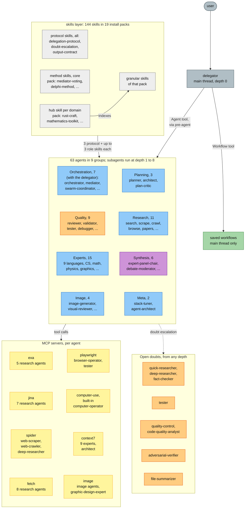

## 3. Request lifecycle

One request from start to finish, with the hook handlers in `stack/hooks.py` (run as `bin/stack hook <name>`) as
the control plane. `SessionStart` catches up on any learned values still pending (the values the learner applied at the end of the
previous session are already on disk and were loaded) and adds a status line; `UserPromptSubmit` adds the whole-tree token-budget note.
Every Agent call passes `pre-agent` (diagram 4), which prepends the `<stack-context>` header to the child's brief.
A subagent at depth n that reads the web passes `post-web` and `pre-tool` (diagram 5). The child returns the
five-section output contract and keeps long output in `.stack/out/<agent>/`. `SubagentStop` runs asynchronously,
records the effort that was in effect and ingests the session at most once a minute; `SessionEnd` detaches the
learner (diagram 6), which updates the posteriors and records the session in `history.jsonl` and, with `apply_on: "session_end"`, writes the learned values into the agent
files, for the next session to load (a running session re-reads them from its next turn). `pre-agent` records each
spawn's `maxTurns` so the limit a run was held to is known whatever happens to the file later. Every handler fails open: an error inside a hook never blocks the session, only deliberate
deny or ask decisions do. The `PreModelSwitch` guard, which keeps the main thread on its tier model, is left out.
Source: [Lifecycle of one request](reference/overview.md#lifecycle-of-one-request), [Hook wiring](reference/hooks.md#hook-wiring).

```mermaid
sequenceDiagram
    autonumber
    actor U as user
    participant H as hooks
    participant D as delegator, depth 0
    participant S as subagent, depth n
    participant W as web tool
    participant L as learner

    U->>H: bin/claude-stack starts<br/>SessionStart
    H->>L: apply pending values:<br/>maxTurns and effort in the<br/>frontmatter, changes.jsonl
    H-->>D: status line: max depth 8,<br/>missing keys, applied tuning
    U->>H: prompt<br/>UserPromptSubmit
    H-->>D: prompt + budget note:<br/>session of 10B, soft 7.5B,<br/>prompt up to 400M, soft 300M
    D->>D: classify, pick the<br/>cheapest adequate route
    D->>H: Agent call<br/>PreToolUse pre-agent
    H->>H: depth, spawn rules, taint,<br/>tokens, 128 spawns
    alt denied
        H-->>D: deny + reason: finish yourself<br/>or return an Open doubt
    else allowed
        H->>S: brief + stack-context header,<br/>per-call model and effort stripped
        S->>W: fetch, jina, exa, spider,<br/>playwright, WebFetch
        W-->>H: PostToolUse post-web<br/>scores the result
        opt score medium or high
            H-->>S: warning, agent tainted,<br/>event logged, high blocks
        end
        S->>H: Bash, file write, form typing<br/>PreToolUse pre-tool
        H-->>S: web agent: risky Bash or write<br/>denied, tainted: any risky<br/>action denied
        S-->>D: Result, Evidence, Files,<br/>Open doubts, Confidence
        S-)H: SubagentStop, async
        H-)L: record effort, ingest at most<br/>once a minute, update every<br/>30 min, no apply
    end
    D-->>U: answer in the five-section<br/>output contract
    U->>H: session ends<br/>SessionEnd
    H-)L: detached learn run
    L->>L: ingest, update, record<br/>history.jsonl; applied here,<br/>read at next load or turn
```

## 4. Guard pipeline for one spawn

What the `pre-agent` hook (PreToolUse on `Agent|Task`) does with every spawn, in the order of the code. Depth
counts from the main thread at 0, and the caller's depth comes from its `agent-<id>.meta.json`. Spawn rules come
from `config/policy.json` `spawn_rules`: a per-caller allow-list (for example `web-scraper` may call only the two
summarizers) and no orchestration agent, `expert-panel-chair` or `debate-moderator` below depth 6. A caller tainted
by flagged web content may spawn only research leaves (diagram 5). Token use is summed over the whole delegation
tree for the session and for the current prompt, and the worse of the two levels applies: below the guaranteed
floor nothing is ever throttled, `soft` tells agents to converge, `hard` leaves only the finishing agents. The
spawn counter covers the whole session. Tier enforcement strips any per-call `model` and `effort`, so every agent
runs on its tier model and learned effort. On an internal error the hook fails open and the spawn proceeds
unchanged. Source: [pre-agent](reference/hooks.md#pre-agent-depth-guard-spawn-rules-budgets-and-tier-stripping),
[Token budgets](reference/hooks.md#token-budgets), [docs/DEPTH.md](DEPTH.md).

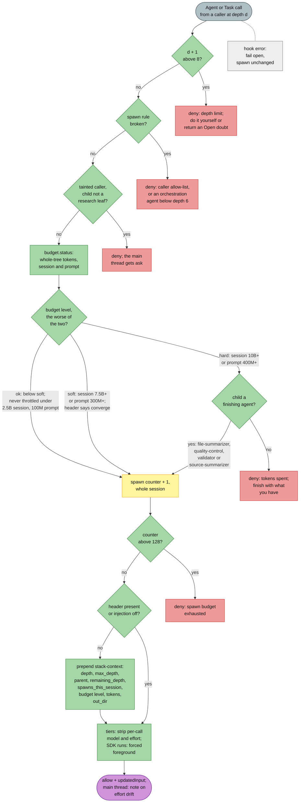

## 5. Web-content safety

Pages, search results and documents fetched from the web are untrusted, so the stack contains prompt injection
in three layers (`config/policy.json` `web_content`, `stack/injection.py`, hooks `post-web` and `pre-tool`).
Layer 1 holds whether or not anything was flagged: the agents that read web pages have no Edit or NotebookEdit,
and `pre-tool` keeps their file writes under `.stack/` and also denies them network egress, pipe-to-shell, secret
reads and `git push` from Bash. Layer 2 scores every web-tool result with weighted rules (instruction overrides,
tool-call markup, requests for secrets, smuggled characters and more): `low` passes untouched, `medium` (score 3)
adds a warning to the agent's context and logs the event (rule names, score, URL and a SHA-256, never the text),
`high` (score 6) also returns a block decision with the reason, and any flag taints the agent. Layer 3 checks the
taint before risky actions: a tainted subagent is denied, the main thread gets an ask prompt, and a tainted agent
may spawn only research leaves. The scanner is a tripwire, not a guarantee (paraphrases, other languages and text
in images get through), which is why layer 1 never depends on a flag. Source:
[Web content safety](reference/web-safety.md#web-content-safety-prompt-injection), [`stack/injection.py`](../stack/injection.py).

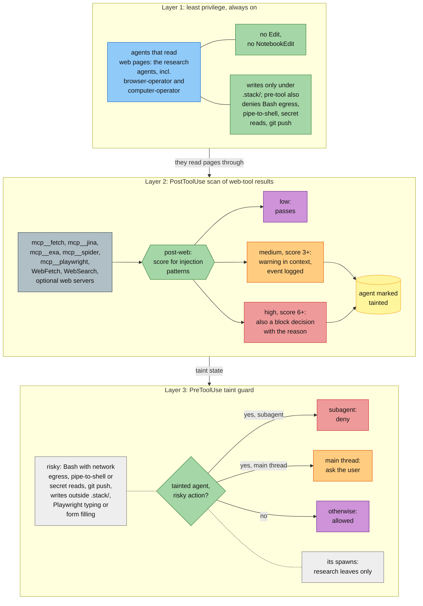

## 6. Self-tuning loop

After each session (and every 30 minutes during a long one) the learner updates what each agent's `maxTurns` and
`effort` should be, given what its runs actually needed; the end of the session writes it (`apply_on`), so the next session loads it (a running one re-reads it from its next turn) and agent
files never change while a session runs. Ingest turns the transcripts into one record per agent run. Update
fits per-agent posteriors: capped runs count as right-censored ("needed at least the cap"), so a cap that is too
low cannot lock itself in, and old runs are down-weighted by a forgetting factor chosen per agent by prequential
score. Apply writes a recommendation into the agent's frontmatter only with enough evidence and inside the bounds,
step limits and hysteresis of `config/learning.json`, and appends every change to `changes.jsonl`, so
`git diff .claude/agents` shows exactly what the learner did. The token windows feed `budgets.json`; the global
token-budget limits are only reported unless `token_budget.learn_global` is `apply`. Source:
[Bayesian self-tuning](reference/learning.md#bayesian-self-tuning), [docs/LEARNING.md](LEARNING.md).

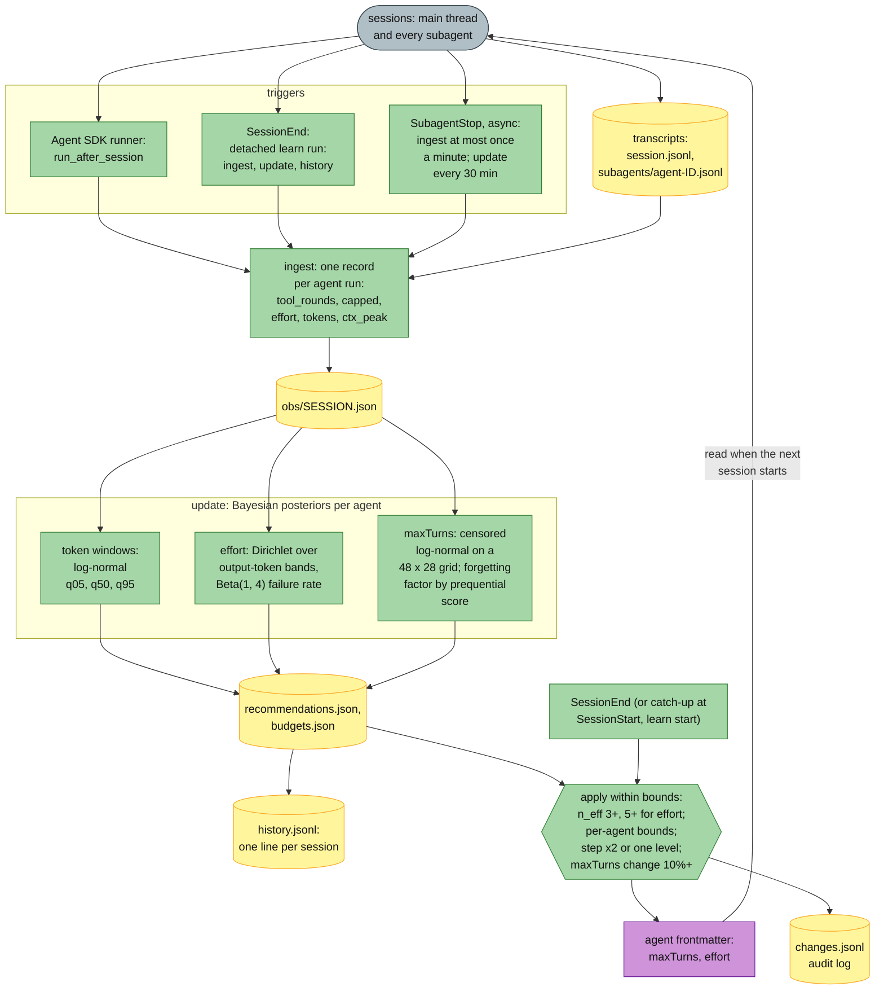

## 7. Image pipeline

The `image` MCP server (`stack_mcp/image_router/`, started by `bin/mcp-run bin/image-router`) gives each
operation its own endpoint, key and model from `~/.claude/stack.env`, with no fallbacks: an operation's tool is
listed only while that operation is configured (the env file is read at call time and watched), and the local
tools are always listed. The adapter is chosen from the URL host or `IMAGE_<OP>_API`. Post-processing restores
fidelity whatever the provider returned, and every output lands in `.stack/images/<date>/` with a JSON sidecar
that never contains keys. The producer agents send their candidates to `visual-reviewer`, which scores them
against the brief with a weighted rubric and returns PASS, REVISE with numbered revisions, or STOP; the loop ends
after round 4 at the latest. Layered SVG and layered PDF exports come last. Source:
[The image server](reference/mcp.md#the-image-server),
[The visual-reviewer agent](reference/agents.md#the-visual-reviewer-agent), [docs/MCP.md](MCP.md).

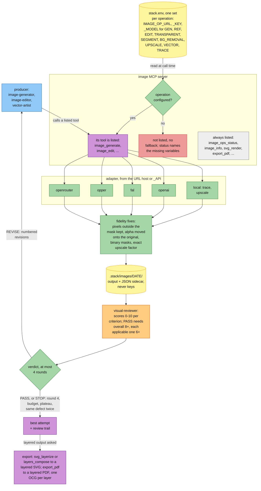

## 8. Workflows one by one

One diagram per saved workflow, with the stages, caps and stop rules each script implements. Each starts at the
shared entry of diagram 1: the args are validated before any agent starts.

### 8.1 swarm-run

One worker per shard with a fixed output contract, normalised per shard, one retry of exactly the uncovered
remainder, then exact-key dedup and a coverage ledger in code and a `swarm-coordinator` merge. Workers return
`SHARD <id> STATUS <ok|partial|failed> COVERED <n>/<m> ITEMS <k>` followed by `ITEM`, `UNCOVERED` and `XSHARD`
lines. A dead worker is re-run once with the same brief, which uses up that shard's retry. Coverage from a
remainder retry adds up (the units are disjoint); a whole-shard retry takes the better attempt, never the sum. The
nominal agent count is two per shard plus one merge. Source: [swarm-run](reference/workflows.md#swarm-run).

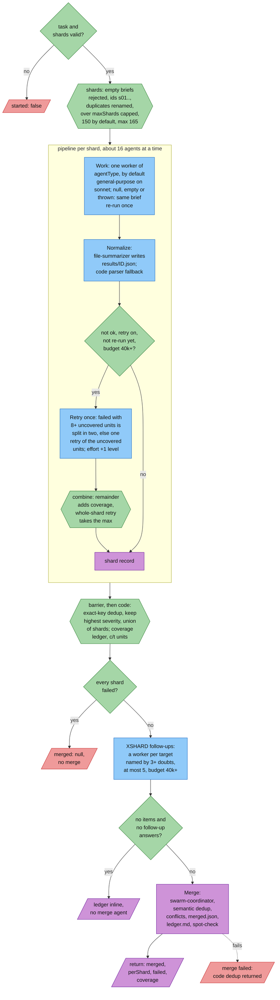

### 8.2 fanout

A generic concurrent map: one agent of one type per item, prompt rendered from a template, with optional JSON
schema results and retries of null, empty or failed calls. Every prompt is rendered before any agent starts, so a
template mistake costs nothing: a template without the item placeholder gets the item appended under `ITEM:` (a
warning), and a field path that is empty for every item stops the run. Each prompt tells the agent to write its
full deliverable to a numbered file in the output directory. The agent count lies between `N` and
`N x (1 + retry)`. Source: [fanout](reference/workflows.md#fanout).

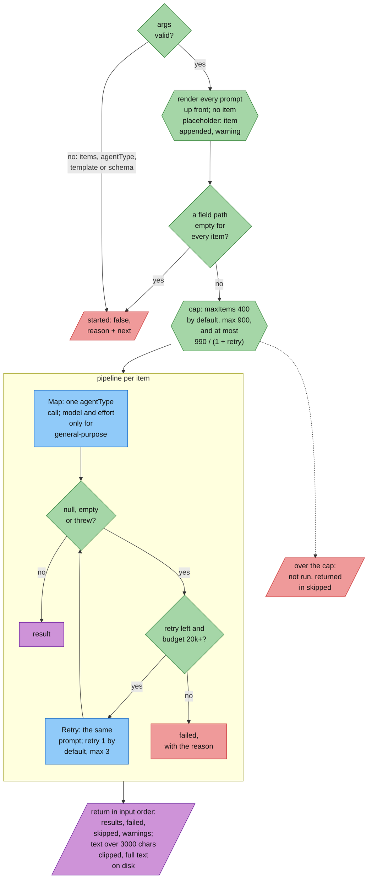

### 8.3 mediate

Diverse voters solve independently, then rank the anonymised solutions blind; the rule declared before solving
(Schulze by default) is tallied in code together with every other rule, a no-self run and a leave-one-out run per
ballot. A near-tie triggers one debate round, and `mediator` writes the final answer from the winner with grafts
from runner-up strengths. Labels `S1..Sn` follow the order of an FNV-1a hash of the normalised answer and
arguments, so a label never reveals its author. Near-tie thresholds are 0.2 for plurality, approval and Schulze
and 0.1 for Borda and the log pool. The agent count is `2V + 1`, plus `2 + V` with a debate. Source:
[mediate](reference/workflows.md#mediate).

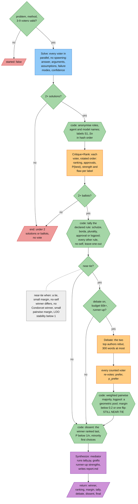

### 8.4 expert-panel

A Delphi panel: anonymous independent answers, feedback statistics computed in code, revision rounds until
convergence or stable dissent, then a chair synthesis with an explicit minority report. The question kind decides
the statistics and the stop rules: `quantity` converges when the relative IQR of the P50s is at most 0.25,
`probability` when the IQR is at most 0.10, `choice` when the modal first-choice share reaches 0.75; stability from
round 2 means the median (or the Borda leader) barely moved and at most one panelist moved materially; `open`
stops on stability alone. Rounds default to 3 (at most 4), and no new round starts below 60k tokens when a budget
is set. A shrinking spread with fewer than two new reasons is labelled convergence by conformity. Source:
[expert-panel](reference/workflows.md#expert-panel).

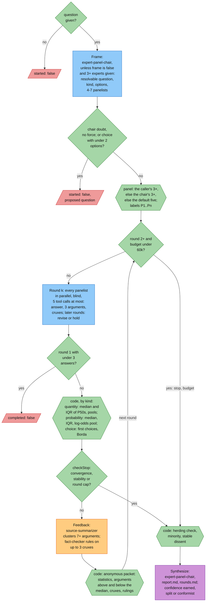

### 8.5 research-sweep

Plan, sweep each sub-question across modalities, extract cited claims, deduplicate and fact-check them in code,
loop a completeness critic until dry, then write a cited report. The depth sets the caps: `quick` runs 4
sub-questions over web and papers with 1 critic round and 8 claim checks, `standard` 6 sub-questions with crawling,
2 critic rounds and 20 checks, `exhaustive` 10 sub-questions, 4 critic rounds and 50 checks through two lenses.
Contradicted claims never appear as fact in the report, disputed claims show both sides, and single-origin key
claims and stale claims are flagged. Source: [research-sweep](reference/workflows.md#research-sweep).

```mermaid
flowchart TD
    A{"question<br/>given?"}:::calc
    X[/"started: false"/]:::halt
    PL["Plan: deep-researcher,<br/>4 searches at most:<br/>MECE sub-questions with<br/>modalities and queries"]:::agent
    CU{{"code: sort by priority,<br/>cut to the depth cap,<br/>cut ones become gaps;<br/>plan failed: one<br/>sub-question"}}:::calc

    subgraph SWP["pipeline per sub-question"]
        direction TB
        S1["search: web-searcher,<br/>Exa and Jina, and<br/>paper-researcher on<br/>arXiv and SSRN"]:::agent
        S2["crawl: web-crawler<br/>with Spider on the top<br/>domains, standard and<br/>exhaustive only"]:::agent
        S3["extract:<br/>source-summarizer:<br/>atomic cited claims,<br/>gaps, contradictions"]:::agent
        S1 --> S2 --> S3
    end

    LD{{"code, barrier: claim<br/>ledger; merge on equal<br/>numbers and Jaccard<br/>0.72+; origins =<br/>distinct domains"}}:::calc
    RK{{"code: risk = 3 key<br/>+ 2 quantitative + 2 one<br/>origin + 1 volatile + 2<br/>contradiction; check key<br/>claims or risk 3+"}}:::calc
    VF["Verify: fact-checker,<br/>primary-source lens,<br/>plus counter-evidence<br/>at exhaustive"]:::judge
    VC{{"code: verdicts combined:<br/>supported, partial,<br/>disputed, contradicted,<br/>unverifiable; staleness"}}:::calc
    BU{"critic round<br/>left, budget<br/>150k+?"}:::calc
    CR["Critic: quality-control<br/>reads coverage per<br/>sub-question, returns<br/>gaps with severity"]:::judge
    DR{"dry? no fresh<br/>non-minor gap,<br/>or verdict dry, no<br/>critical gap"}:::calc
    GQ{{"code: top gaps become<br/>sub-questions G r.i;<br/>verify cap max(2,<br/>ceil(cap / 3))"}}:::calc
    SY["Synthesize:<br/>deep-researcher writes<br/>claims.md, sources.md,<br/>the cited report"]:::out
    O[/"return: report path,<br/>key findings, flagged<br/>claims, gaps, stats"/]:::out

    A -->|no| X
    A -->|yes| PL --> CU --> SWP --> LD --> RK --> VF --> VC --> BU
    BU -->|yes| CR --> DR
    DR -->|no| GQ -->|"sweep, merge, verify"| SWP
    DR -->|yes| SY
    BU -->|no| SY
    SY --> O

    classDef agent fill:#90caf9,stroke:#1565c0,color:#111
    classDef judge fill:#ffcc80,stroke:#e65100,color:#111
    classDef calc fill:#a5d6a7,stroke:#2e7d32,color:#111
    classDef out fill:#ce93d8,stroke:#6a1b9a,color:#111
    classDef halt fill:#ef9a9a,stroke:#c62828,color:#111
```

### 8.6 review-verify

Scope the target, run one finder per dimension and shard, deduplicate, then let `votes` (default 3, always odd)
adversarial verification lenses try to refute each finding. A finding survives only when a majority of lenses
confirm it. A crashed verifier never counts as a refutation: a finding whose confirmations plus failed lenses
reach the majority is inconclusive, not rejected. The lens set comes from the finding's most specialised
dimension (security, then performance, concurrency, correctness, and so on). The final severity is the median of
the confirming verifiers' severities. The agent count is `1 + dimensions x shards + verified x votes`, plus one
report agent. Source: [review-verify](reference/workflows.md#review-verify).

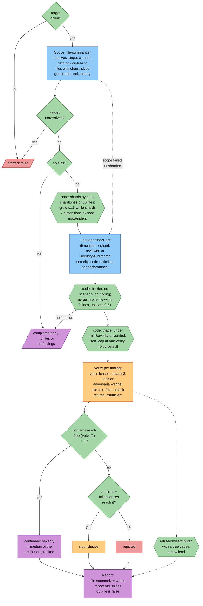

### 8.7 plan-tournament

One generator per strategic angle writes a complete plan, blind judges score every plan, the ranking is computed
in code, and the winner is merged with grafts, red-teamed once and revised once. The default angles are
mvp-first, risk-first, performance-first and user-first; the default weights are feasibility 0.25, risk 0.2, cost
0.15, verifiability 0.2 and completeness 0.2. Judge `j` sees the candidates rotated by `j` (reversed for odd `j`)
with strategy names stripped. If synthesis fails, the winner's own file is returned unmerged and not revised. The
agent count is `angles + judges + 2`, plus one when revised. Source:
[plan-tournament](reference/workflows.md#plan-tournament).

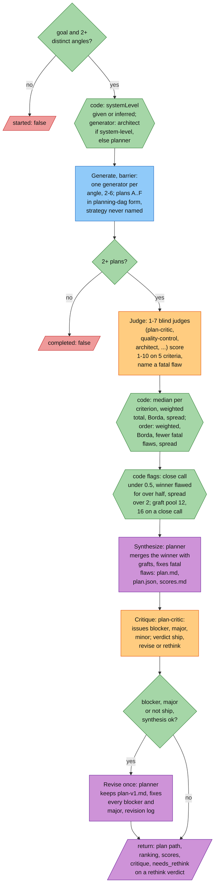

### 8.8 visual-iterate

Produce or edit a raster or vector deliverable, have `visual-reviewer` score it against the brief, hand its
revision instructions to the next round, and keep the best attempt until the rubric passes. The producer is fixed
by `kind` and `mode`: `image-generator` (image, generate), `image-editor` (image, edit), `vector-artist` (vector).
The workflow recomputes the weighted overall with the profile fixed in round 1, and PASS needs both the rubric
(overall at the threshold, default 8, every applicable criterion at 6 or more, no blocker) and the reviewer's own
PASS. A round improves only when there is no best yet, when it passes where the best did not, or when it raises
the best overall by at least 0.3; two non-improving rounds in a row stop the loop. An unconfigured operation stops
the run at once with an Open doubt naming the `IMAGE_<OP>_URL`, `_KEY` and `_MODEL` variables, never a fallback.
Source: [visual-iterate](reference/workflows.md#visual-iterate).

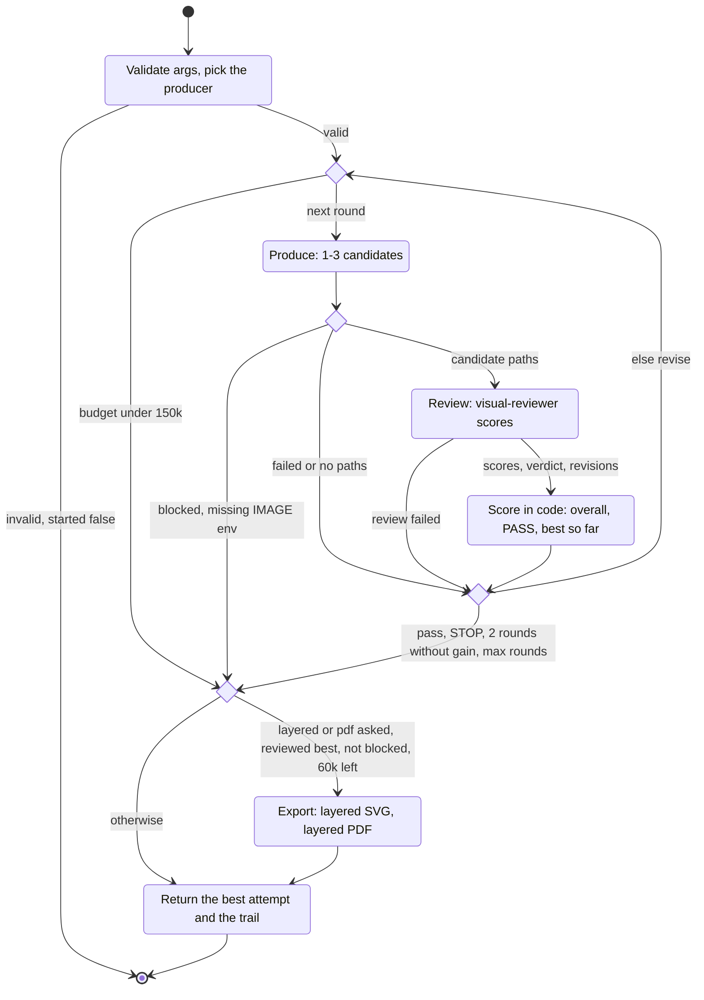
