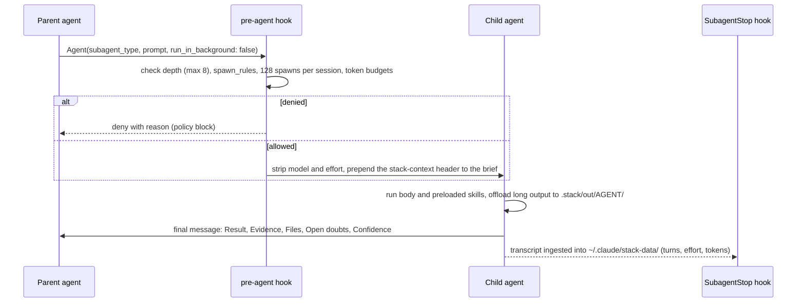
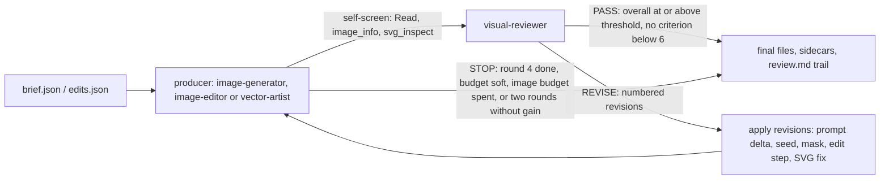

# Agents

The stack ships 63 subagents in nine groups under `.claude/agents/<group>/<name>.md`. Claude Code scans the
directory recursively, so the group directories only organise the files; the agent's identity is its `name`.
Under the Agent SDK, `stack_sdk/agents.py` loads the same files into `AgentDefinition` objects (body as
`prompt`, list fields `tools`, `disallowedTools`, `skills`, `mcpServers` normalised, keys the SDK does not
know reported as dropped, and `model` re-resolved from the agent's tier so the env overrides apply).

`bin/stack agents list --markdown` prints the live catalog (model, effort, maxTurns, MCP servers and skills per
agent) from the files themselves. How to read the tables below:

- **Tier / model** comes from `config/models.json` (`agents.<name>.tier`), rendered into the `model` key by
  `bin/stack agents tiers --apply`. Never edit `model` by hand.
- **Effort** and **maxTurns** are the initial traits from `config/models.json`. They are written only when
  missing (or with `--reset-traits`); afterwards the Bayesian learner owns them and `bin/stack learn apply`
  rewrites them in place within bounds (see [Learned traits](#learned-traits-and-bounds)), so a live
  checkout may show different values. The effort and maxTurns columns below were regenerated from the live
  frontmatter on 2026-10-26 (`bin/stack agents list --markdown` prints the current ones).
- **MCP** lists the `mcpServers` the agent declares (catalog servers from `config/mcp.servers.json`, defined
  inline in the frontmatter, or the built-in `computer-use`). An inline server connects when the agent starts and
  disconnects when it finishes ([Lazy loading](mcp.md#lazy-loading)); its tool list still costs context on every
  spawn, so agents declare only what they call.
- **Role skills** lists the preloaded skills beyond the three protocol skills that every agent preloads:
  `delegation-protocol`, `doubt-escalation`, `output-contract`.

| Tier key | Model id | Alias | Agents | Used for |
|---|---|---|---|---|
| `ADVANCED_MODEL` | `claude-opus-5-5` | `opus` | 32 | routing, orchestration, design, proofs, security, verification, judgement |
| `MEDIUM_MODEL` | `claude-sonnet-5-5` | `sonnet` | 20 | lookups, checks, operators (browser, desktop, image), well-trodden languages |
| `LOW_MODEL` | `claude-haiku-5-5` | `haiku` | 5 | mechanical fan-out, extraction, summarising |

Initial effort distribution: `low` 6, `medium` 13, `high` 30, `xhigh` 7, `max` 1 (`mathematics-expert`, "the
one place max effort pays"). The env vars `ADVANCED_MODEL`, `MEDIUM_MODEL` and `LOW_MODEL` override the model
ids (for example to trial a new release); `bin/stack agents set NAME tier=MEDIUM_MODEL` re-tiers one agent.
Callers never pass a per-call `model` or `effort`: the `pre-agent` hook strips both (`enforce_tiers: true`
in `config/policy.json`), so the only way to spend less or think harder is to pick a different agent.

## Orchestration (`.claude/agents/orchestration/`)

Coordinators. All seven belong to the `orchestration` spawn group (with `expert-panel-chair` and
`debate-moderator`), which the `pre-agent` hook refuses to start deeper than depth 6
(`spawn_rules.orchestrators_until_depth`).

| Agent | Tier / model | Effort | maxTurns | MCP | Role skills | Role and mechanics |
|---|---|---|---|---|---|---|
| `delegator` | ADVANCED / `claude-opus-5-5` | high | 900 | `neural-memory` (inline; shared with its subagents) | `orchestration-patterns`, `effort-and-model-selection` | Main thread at depth 0 (`claude --agent delegator`, `bin/claude-stack`, `bin/stack-sdk run`) and the only agent that talks to the user. Classifies each request into one of 18 classes ([Classification and route selection](overview.md#2-classification-and-route-selection)), climbs the cheapest-adequate ladder (answer directly, one leaf, one expert plus `validator`, `orchestrator` or a saved workflow, ensemble/mediator/mesh), writes a 3-8 line routing plan, dispatches self-contained briefs, keeps a route ledger in `.stack/out/delegator/<YYYYMMDD-HHMM>-ledger.md`, resolves conflicts between children by routing the disagreement (`fact-checker`, `tester`, `adversarial-verifier`) and gates moderate-stakes deliverables through `quality-control`. |
| `orchestrator` | ADVANCED / `claude-opus-5-5` | high | 900 | `neural-memory` | `planning-dag`, `orchestration-patterns`, `validation-gates` | Project executor. Writes the DAG itself for 4 nodes or fewer, otherwise gets it from `planner` (or `architect`, or parallel planners plus `mediator` when approaches compete; `plan-critic` at 8+ nodes or any irreversible node), validates every node (`id`, `owner`, `deps`, `inputs`, `write_set`, `acceptance`, `verify`, `risk`), and runs waves in which nodes with overlapping write-sets never run together (heavy nodes up to ~8 per message, light up to 20). Each node is gated by `validator`, each phase by `quality-control` (plus `reviewer`/`security-auditor` on code phases); failures climb retry, escalate (`debugger`, an ADVANCED owner), re-plan (at most two). Run directory: `.stack/out/orchestrator/<stamp>-<slug>/` with `plan.md`, `dag.json`, `ledger.md`, `nodes/<id>/`, `summary.md`. |
| `swarm-coordinator` | ADVANCED / `claude-opus-5-5` | medium | 660 | none | `swarm-execution`, `concurrent-fanout` | Coordinator mode: enumerates the universe in code (`git ls-files ':(glob)src/api/**/*.ts'`, cross-checked with `find`), shards by job type (module, size-balanced greedy largest-first, one domain per shard, one hypothesis per shard), launches workers (at most 20 homogeneous or 8 mixed calls per message), retries only the uncovered remainder once, merges in code on a declared dedup key (`(path, line, rule_id)`, canonical URL, normalised-text hash) and reconciles covered + dropped + excluded = universe in `ledger.md`. Merge mode (final stage of `/swarm-run`): no spawns, dedup and ledger only. |
| `mesh-router` | MEDIUM / `claude-sonnet-5-5` | high | 660 | none | `mesh-blackboard` | Runs a blackboard in `.stack/blackboard/<task-id>/` through `.claude/skills/mesh-blackboard/scripts/board.py` (`init`, `ids`, `index`, `open`, `set`). Specialists write typed posts (claim, evidence, question, answer, objection, decision; body at most 400 words) using pre-allocated id blocks; the router alone sets statuses and routes the open set each round (at most ~6 participants per round). Stops on T1 covered, T2 quiescent (no new substantive post for 2 rounds), T3 stalled (adjudicate the top 3 blockers once) or T4 budget (`max_rounds` 6, `max_posts` 60, spawn headroom under 20, `budget` soft/hard), then writes `FINAL.md`. |
| `ensemble-assembler` | ADVANCED / `claude-opus-5-5` | high | 540 | none | `ensemble-assembly`, `expert-synthesis` | Splits a cross-domain problem into 3-10 sub-questions, gives each exactly one owner from a discipline-to-agent table, assigns lead / specialists / challenger (team size 2-7), writes a shared `common.md` (glossary with units, shared assumptions, member output schema with interface outputs and needs), runs the team concurrently and blind to each other, checks interface fit, runs one follow-up round for mismatches, writes `roster.md`, and hands off to `cross-domain-synthesizer` (complementary outputs), `mediator` (competing answers), `expert-panel-chair` (numeric disagreement) or `adversarial-verifier`/`debate-moderator` (one contested claim). |
| `concurrent-dispatcher` | LOW / `claude-haiku-5-5` | medium | 450 | none | `concurrent-fanout` | Mechanical map with no content judgement. Inputs `items`, `agentType`, `promptTemplate` (`{{item}}`, `{{index}}`), optional `schema`, `outDir`, `retry` (default 1), `nestedSpawns` (default 0). Refuses before launching unless `N * (1 + nestedSpawns) + ceil(0.2 N) <= H / 2` with H = 128 - `spawns_this_session`; renders briefs deterministically, launches batches of min(20, items left, headroom), validates `results/<NNNN>.json` against the schema with `jq`/`python3`, retries each non-ok item once, and collates `results.json` with an `ok/total` line. A hook denial stops the run. |
| `mediator` | ADVANCED / `claude-opus-5-5` | xhigh | 540 | none | `mediator-voting`, `judge-panel`, `bayesian-aggregation` | Auditable decision among independent attempts. Run mode: `frame.md`, voting rule declared before generation (Schulze default), N = 5 diverse voters (3 cheap, 7 high stakes) solving blind, anonymisation in code (S1..Sn labelled by `shasum -a 256` of normalised text, author map in `private/map.json`), blind critique ballots, tally with `.claude/skills/mediator-voting/scripts/tally.py` plus `--method all`, `--no-self` and leave-one-voter-out robustness, one debate round on a near-tie, a fixed tie-break cascade, then synthesis from the winner with cited grafts and a dissent report. Synthesis mode (end of `/mediate`): re-checks the tally, never spawns. |

The delegator's 18 routing classes (`.claude/agents/orchestration/delegator.md`, step 1), with their default routes
and typical spawn counts, are listed in [Classification and route selection](overview.md#2-classification-and-route-selection).

The mediator tallies with `.claude/skills/mediator-voting/scripts/tally.py`, whose margins and near-tie thresholds
are the ones tabulated for the `/mediate` workflow in [mediate](workflows.md#mediate) (W = total voter weight, k = candidates,
winner w, runner-up r): plurality `(F_w - F_r) / W`; approval `(A_w - A_r) / W`; Borda `(B_w - B_r) / (W (k - 1))`;
Schulze `(p[w][r] - p[r][w]) / W` on strongest-path strengths (never negative); log pool `P(w) - P(r)`. A near-tie
(no single winner; a margin under 0.20 for plurality, approval or Schulze, or under 0.10 for Borda or log pool; no
Condorcet winner under Schulze; a leave-one-out stability below 1; or a `--no-self` winner change) triggers one
rebuttal round (at most 300 words per side) and a pairwise re-vote; if it persists, the cascade is verifiable
evidence, higher pooled `p_correct`, fewer unresolved objections after `adversarial-verifier`, cheaper to reverse.
Ties are never broken by label order, recency or a coin flip.

## Planning (`.claude/agents/planning/`)

| Agent | Tier / model | Effort | maxTurns | MCP | Role skills | Role and mechanics |
|---|---|---|---|---|---|---|
| `planner` | ADVANCED / `claude-opus-5-5` | high | 240 | `neural-memory` | `planning-dag`, `effort-and-model-selection` | Turns a goal into `<YYYYMMDD-HHMM>-<slug>.md` plus a sibling `.json` DAG: one owner, one deliverable and one verification per node; only real edges (data, resource, knowledge); falsifiable acceptance criteria; risk = likelihood x impact (1-3 each, a 6 or 9 needs a mitigation); waves, critical path and re-plan triggers; validated by `.claude/skills/planning-dag/scripts/dag.py`. Re-plan mode patches the DAG (`plan_version` + 1, previous kept as `<stem>.v<N>.json`, entry in `replan_log`). Never spawns `architect` (adds an `architect` spike node or returns an Open doubt); runs `plan-critic` once at 8+ nodes or any irreversible node. |
| `architect` | ADVANCED / `claude-opus-5-5` | xhigh | 360 | `context7`, `neural-memory` | `planning-dag`, `judge-panel`, `red-teaming` | Writes quality-attribute scenarios and capacity math with units, generates 2-4 structurally different candidates, verifies library behaviour with `mcp__context7__*`, scores against criteria, weights and 1/3/5 anchors fixed before totals, red-teams the leader (premortem), and convenes a blind judge panel (3 judges, 5 for one-way doors, aggregated by `.claude/skills/judge-panel/scripts/panel.py`) when the top two are within ~10% or the door is one-way. Output: an ADR plus candidates file, automatable fitness functions and a reversible migration (strangler fig, expand-migrate-contract). Deepens candidates with up to ~6 concurrent expert calls. |
| `plan-critic` | ADVANCED / `claude-opus-5-5` | high | 180 | none | `red-teaming`, `planning-dag` | Red-teams a plan, DAG or ADR: goal fit, recomputed capacity numbers, `dag.py` mechanical checks, two-way traceability, falsifiability of every criterion, hidden dependencies, a missing-step checklist (migration, rollback, observability, security), premortem and FMEA-lite, assumption inventory, risk ordering, over- and under-engineering passes. Returns ranked issues (location, failure scenario, severity, patch), a keep-as-is list and SHIP / REVISE / RETHINK. Severe findings under ~0.8 confidence go to `adversarial-verifier` (up to 3 per brief, 3 in flight, 6 per critique). |

## Quality (`.claude/agents/quality/`)

| Agent | Tier / model | Effort | maxTurns | MCP | Role skills | Role and mechanics |
|---|---|---|---|---|---|---|
| `adversarial-verifier` | ADVANCED / `claude-opus-5-5` | high | 48 | none | `adversarial-verification` | Takes one claim, restates it as a falsifiable proposition, enumerates at least 5 refutation hypotheses, then tries reproduction, independent derivation or the primary source. Verdicts: SURVIVES with basis `reproduced` (E5), `derivation-agrees` (E4) or `source-confirms` (E3); REFUTED with `guarded-elsewhere`, `counterexample`, `precondition-false`, or `insufficient-evidence` when it cannot settle the claim (the default for vague claims). Callers run one verifier per lens and keep a finding only if a majority do not refute it. May spawn only research leaves and `tester`. |
| `code-optimizer` | ADVANCED / `claude-opus-5-5` | high | 450 | none | `performance-optimization` | Profile, hypothesise, change, measure. Pins a measurement contract, builds a harness with the ecosystem's statistical tool, baselines at least 10 runs with a noise floor, logs hypotheses before editing, climbs an optimisation ladder, keeps only statistically real improvements with an unmodified passing test suite, and leaves a benchmark plus a proposed CI regression guard. Timed runs are serialised; parallel hypotheses get detached worktrees; headline speedups go to `adversarial-verifier`. Review mode returns `file:line` findings (S0-S3) without editing. |
| `code-quality-analyst` | MEDIUM / `claude-sonnet-5-5` | medium | 270 | none | `code-quality-metrics` | Measures first: discovers installed tools, collects NLOC, cyclomatic and cognitive complexity and duplication, joins 12-month churn with complexity into a hotspot ranking, maps dependency cycles and layering, verifies dead-code claims by repo-wide Grep, then scores and specifies refactors (named refactoring, payoff, effort, risk, order) and proposes CI ratchets. Repos over ~200k LOC or 8+ packages are sharded into up to 8 parallel self-calls. Analyses only; refactors only when asked. |
| `debugger` | ADVANCED / `claude-opus-5-5` | high | 480 | `neural-memory` | `debugging-method`, `testing-strategy` | Reproduce, minimise, localise, hypothesise, test, fix, guard, with a bug card and hypothesis log in `<out_dir>/<run>/card.md`. Writes the failing regression test before the fix, runs the full suite and writes an RCA. Up to 4 independent expensive hypotheses run in parallel on `tester` or language experts, each in its own detached worktree; it never spawns the agent type named in its `parent`. Retries, sleeps, longer timeouts and skipped tests are not fixes. |
| `quality-control` | ADVANCED / `claude-opus-5-5` | medium | 210 | none | `validation-gates`, `source-evaluation` | Final gate against the verbatim request: requirements ledger, traceability matrix (requirement, deliverable location, evidence), audit of load-bearing claims (`fact-checker` batches of up to 8, `validator`, `adversarial-verifier` for the 1-3 decisive claims). SHIP requires 0 Blockers, 0 Majors, 100% explicit-requirement coverage and every load-bearing claim verified or disclosed; anything else is FIX-FIRST with a punch list (QC-n: severity, requirement, location, evidence, fix, owner, re-check). Reports coverage and claim-verification rate. |
| `reviewer` | ADVANCED / `claude-opus-5-5` | high | 360 | `neural-memory` | `code-review-checklist`, `adversarial-verification` | Fixes scope with git, triages files by risk (authn/authz, money, persistence first), reads every hunk in context, runs the project's own tools, and writes findings as `file:line` + breaking input + severity (S0 Blocker, S1 Major, S2 Minor, S3 Nit) + fix. Every S0/S1 and every finding under ~0.8 confidence goes to `adversarial-verifier` (up to ~8 per batch). Verdict: Block, Request changes, Approve with comments, Approve. Large diffs (over ~800 lines or ~15 files) add specialist passes (`security-auditor`, `code-optimizer`, language experts) or a `/review-verify` recommendation; as a dimension pass it never recurses. |
| `security-auditor` | ADVANCED / `claude-opus-5-5` | high | 360 | none | `security-review`, `adversarial-verification` | Attack surface, threat model with trust boundaries, source-to-sink traces per injection class, authorisation per handler, secrets (gitleaks), crypto misuse, dependencies (`osv-scanner`), unsafe code, static analysers (`semgrep`) as lead generators. Each finding: CWE, `file:line`, trace, severity with reasoning, fix and test. Critical/High go to three `adversarial-verifier` calls (attacker control, mitigation on the path, impact) and survive by majority. Shards large codebases by trust boundary (up to 6 per message). Never builds exploits or touches third-party hosts. |
| `tester` | MEDIUM / `claude-sonnet-5-5` | high | 450 | `playwright`, `desktop-sandbox` | `testing-strategy`, `browser-automation`, `sandboxed-computer-use` | Learns the project's test setup, records a baseline, picks test types by risk, writes red-first tests for bugs, property tests, time-boxed fuzzing and Playwright E2E against local or staging apps, proves each new test bites by breaking the behaviour on purpose, triages flakiness with mass reruns and measures coverage of the change. Never weakens an assertion; ambiguous behaviour becomes `skip`/`xfail` plus an Open doubt. |
| `validator` | MEDIUM / `claude-sonnet-5-5` | medium | 270 | none | `validation-gates`, `testing-strategy` | Mechanical gate: environment snapshot, criteria matrix (must/should), one command per criterion, schema checks, numeric tolerance `abs(actual - expected) <= atol + rtol * abs(expected)`, invariants, diff hygiene (scope creep, leaked secrets), file properties. Per-criterion PASS / FAIL / FLAKY / BLOCKED / UNVERIFIABLE; overall PASS only if every must passes; `matrix.md` and logs under `out_dir`. Called by `orchestrator` after every implementing node. |

## Research (`.claude/agents/research/`)

| Agent | Tier / model | Effort | maxTurns | MCP | Role skills | Role and mechanics |
|---|---|---|---|---|---|---|
| `deep-researcher` | ADVANCED / `claude-opus-5-5` | max | 240 | `exa`, `jina`, `spider` | `deep-research`, `web-search-tools`, `source-evaluation` | Decomposes into 3-8 sub-questions and picks a route: `research-sweep` workflow (main thread only) for `exhaustive` or 6+ multi-modal sub-questions, in-house fan-out for 3-7, a self-sweep for 1-2 or at depth 0. Fans out `web-searcher`, `paper-researcher`, `web-crawler`, `web-scraper`, `browser-operator` per sub-question, deep-reads primary sources with `mcp__jina__read_url`, needs 2+ independent sources per key claim (`fact-checker`, 3-6 claims per call), logs contradictions, loops a completeness critique until dry, and writes `report.md` in `.stack/out/deep-researcher/<stamp>-<slug>/`. Also runs the Plan and Synthesize phases of `/research-sweep`. |
| `paper-researcher` | ADVANCED / `claude-opus-5-5` | high | 216 | `jina`, `exa` | `literature-review`, `source-evaluation` | Writes inclusion criteria to `scope.md`, searches wide in parallel, dedups, screens into `ledger.md` (default 8-15 papers read in full, up to 40 screened), reads method first, extracts equations and algorithms verbatim with anchors, traces citation lineage, builds a normalised comparison `matrix.md`, verifies the top 3-5 load-bearing claims with `fact-checker` and derivations with the mathematics/CS/physics/quantum experts, writes `report.md`. Screening digests go to `source-summarizer` (3-5 papers per call, up to 6 concurrently). |
| `quick-researcher` | MEDIUM / `claude-sonnet-5-5` | low | 60 | `exa`, `jina` | `quick-research`, `web-search-tools` | One narrow question: at most 4 searches, 2-3 sources read with `mcp__jina__read_url`, an answer of at most 200 words whose first sentence answers, every factual sentence cited with its source date, calibrated confidence. Escalates (an Open doubt with a ready brief for `deep-researcher`) instead of stretching; may spawn only research leaves. The cheapest doubt resolver for narrow factual questions. |
| `web-searcher` | MEDIUM / `claude-sonnet-5-5` | xhigh | 120 | `exa`, `jina` | `web-search-tools` | Finds sources and never writes answers: a 6-12 query portfolio across at least 3 query families, Exa and Jina searches in parallel in one message, normalisation and dedup, rerank with `mcp__jina__sort_by_relevance` plus authority and recency, a coverage check (top 15 span 3+ independent hosts, include a primary source and the contrarian view, respect the date window). Returns a ranked list (default 15) with type tags, relevance notes and a query log. |
| `fact-checker` | MEDIUM / `claude-sonnet-5-5` | medium | 36 | `exa`, `jina` | `source-evaluation`, `web-search-tools` | Atomises 1-10 claims, names the settling source before searching, checks the cited source first, runs at most 6 searches per atomic claim, and returns SUPPORTED / CONTRADICTED / UNVERIFIABLE with a short verbatim quote, URL, source date, flags and a corrected statement for contradicted claims. Articles repeating one press release count as one source. Self-shards 6-10 unrelated claims into 2-3 children; more than 10 becomes a `fanout` recommendation. |
| `web-crawler` | LOW / `claude-haiku-5-5` | medium | 360 | `spider` | `scraping-crawling` | Bounded site corpus. Defaults: seed host only, include the seed's path prefix, exclude listing/search/login trees, depth 3, page limit 100. Maps links with `mcp__spider__spider_links` before fetching, sizes batches to the MCP output cap, crawls with `spider_crawl` (markdown), persists each batch immediately, canonicalises and dedups URLs, scores relevance locally in Python, writes `index.md`, `index.jsonl`, `pages/`, `linkmap.tsv`, `crawl-log.md` with reconciled counts. Asks before crawling more than 500 pages; honours robots.txt. |
| `web-scraper` | LOW / `claude-haiku-5-5` | medium | 240 | `spider`, `jina` | `scraping-crawling` | Known URLs to structured data: raw pages saved with provenance, `extraction.json` validated against the caller's schema by a `python3 -I` script, `index.md` with a status per URL (`ok`, `skipped-robots`, `blocked`, ...) and per-field coverage. Limits: 50 pages total, 20 per paginated sequence. Stops at logins, paywalls, CAPTCHAs and bot challenges. |
| `browser-operator` | MEDIUM / `claude-sonnet-5-5` | medium | 450 | `playwright` | `browser-automation` | Drives the headless, isolated Chromium (`--caps=vision,pdf,devtools`, 1280x800, artefacts in `.stack/playwright/`) through accessibility-snapshot refs, one verified step at a time; extracts with `browser_evaluate`, caps pagination at 20 pages by default, looks for the JSON API behind the page in `browser_network_requests`, and always ends with `browser_close`. Rejects non-essential cookies, never types credentials, stops at CAPTCHAs and unapproved irreversible submits. Never runs two flows in parallel (one shared browser). |
| `computer-operator` | MEDIUM / `claude-sonnet-5-5` | medium | 450 | `computer-use` (built-in), `desktop-sandbox` | `computer-use`, `sandboxed-computer-use` | Native macOS apps when no API, MCP, CLI or AppleScript route exists: loads the tools with one ToolSearch, requests app access, prefers accessibility elements and menus over coordinates, verifies every state change on a fresh screenshot, undoes wrong actions, stops before irreversible or secret-entry steps, and releases app locks. Built-in computer use does not exist under the SDK or `claude -p`, so there it uses `mcp__peekaboo__*` if loaded (`bin/stack mcp enable peekaboo`) or returns the task as blocked. |
| `source-summarizer` | LOW / `claude-haiku-5-5` | low | 105 | `jina` | `source-evaluation` | Compresses given sources (never searches) into notes where every sentence carries `[S#]` citations with a location. Allocates about `L * r_i / sum(r)` words per source (relevance r_i in 0..3), runs a sentence-by-sentence faithfulness pass, hits the length target within 10% (default 250 words or 8 bullets). `disallowedTools: Agent`. |
| `file-summarizer` | LOW / `claude-haiku-5-5` | low | 120 | none | none | Persists oversized content to disk first (verified by byte count or hash), profiles it, extracts with type-specific recipes, builds a section index with line ranges, writes a summary of at most 40 lines with anchors, redacts secret-looking patterns in the summary only, and spot-checks at least 3 anchors with `sed -n`. `disallowedTools: Agent`. The offload target named by CONVENTIONS section 5. |

`file-summarizer`, `source-summarizer`, `quality-control` and `validator` are the `finishing_agents` in
`config/policy.json` `token_budget`: the only types that can still be spawned once a token budget reaches its
hard maximum.

## Synthesis (`.claude/agents/synthesis/`)

| Agent | Tier / model | Effort | maxTurns | MCP | Role skills | Role and mechanics |
|---|---|---|---|---|---|---|
| `cross-domain-synthesizer` | ADVANCED / `claude-opus-5-5` | xhigh | 360 | none | `expert-synthesis`, `analogical-transfer`, `bayesian-aggregation` | Integrates N expert reports into one answer: atomic claims with ids `E<k>.C<n>`, a glossary that catches false friends, an expert x assumption matrix, typed contradictions with rulings, an authority matrix per sub-question, pooled numbers instead of picked ones, emergent options from crossing one expert's methods with another's bottlenecks (labelled `[SYN]` and verified), all organised by sub-question with provenance tags. Escalates spreads wider than 10x (P90/P10) to `expert-panel-chair` and design conflicts under a stated objective to `debate-moderator`. |
| `expert-panel-chair` | ADVANCED / `claude-opus-5-5` | high | 540 | none | `delphi-method`, `bayesian-aggregation` | Delphi in three modes (chair, synthesis for `/expert-panel`, frame). 5-7 diverse panelists, round 1 independent, feedback packets computed in code (median, IQR, anonymised arguments), checkable cruxes settled between rounds (up to 4 per round), revisions must cite argument ids (`moved_because`). Stop rule: consensus = relative IQR <= 0.20 (quantities) or IQR <= 0.10 (probabilities); stable = at most 15% of panelists moved their p50 by more than 15%; never stop after round 1, cap 3 rounds, hard max 4. Reports P10/P50/P90 or a pooled probability, a minority report and a herding check. |
| `debate-moderator` | ADVANCED / `claude-opus-5-5` | high | 360 | none | `structured-debate` | Frames a decidable motion, fixes 3-6 weighted criteria with 1-5 anchors before openings, picks 2-4 debaters of equal tier, runs openings (600 words), rebuttals (500), fact rulings, cross-examination and optional closings (300), each round in one message, with evidence tags `[E:file:line]` / `[E:cmd ...]`. Three blind judges of different agent types and tiers score; high-stakes motions get a side-swap rerun. Deliverable: verdict, decision boundary, hidden assumptions, concessions, cruxes and a decision record. More than four options goes to `/mediate` instead. |
| `first-principles-decomposer` | ADVANCED / `claude-opus-5-5` | xhigh | 270 | none | `first-principles`, `triz-morphological`, `tree-of-thought` | Classifies every constraint (law, theorem, enforced contract versus convention or assumption), computes bounds from invariants with `python3 -c`, states the gap ratio G (attack conventions when G > 10, reframe when G < 2), decomposes by function, builds a morphological box, resolves contradictions with TRIZ, searches with tree-of-thought, and feasibility-checks each finalist (estimate, conventions broken, owner, falsifying experiment). A default voter of the `/mediate` workflow. |
| `analogy-mapper` | ADVANCED / `claude-opus-5-5` | high | 270 | none | `analogical-transfer` | Structure-mapping (Gentner, 1983): abstracts the target on a three-rung ladder, retrieves 6-12 candidates from at least four fields, screens by relational structure, maps survivors in tables, scores structural fidelity `SF = sum(w_r * s_r) / sum(w_r)` and transfer value TV 0-3 (keeps SF >= 0.4 and TV >= 2, ranks by SF x TV), transfers the canonical method with citation and preconditions, analyses the broken relations, and designs one cheap validation per analogy. |
| `general-chat` | MEDIUM / `claude-sonnet-5-5` | low | 105 | none | `quick-research` | Conversation, explanation, brainstorming and opinion: answer first, mental model next. Time-sensitive facts go to at most 3 `quick-researcher` calls per turn (`fact-checker` for a user's assertion); stable knowledge is answered directly. When a turn is real work it returns a handoff block with `Status: partial` instead of starting it. |

## Experts (`.claude/agents/experts/`)

Each expert is installed by its own domain pack in `config/packs.json` (`rust`, `cpp`, `go`, `haskell`,
`julia`, `java`, `kotlin`, `python`, `typescript`, `computer-graphics`, `computer-science`, `quantum`, `mathematics`, `physics`,
`graphic-design`). The preloaded role skill is the pack's `hub` skill; the pack's granular skills are
installed beside it and listed by name only (`granular_listing: "name-only"`), so they cost context only when
loaded with Skill. Every expert body has a `## Expertise` section after the mission.

| Agent | Tier / model | Effort | maxTurns | MCP | Role skills | Role and mechanics |
|---|---|---|---|---|---|---|
| `rust-expert` | ADVANCED / `claude-opus-5-5` | high | 540 | `context7` | `rust-craft` | Pins dependency facts to `Cargo.lock`, designs types and ownership first, implements in compile-checked steps, uses `thiserror` in libraries and `anyhow` in binaries, checks every `select!` branch for cancel safety, writes `// SAFETY:` invariants and runs Miri for unsafe code, benchmarks against a saved criterion baseline. Gate: `cargo fmt --all --check`, `cargo clippy --workspace --all-targets --all-features -- -D warnings`, tests. |
| `cpp-expert` | ADVANCED / `claude-opus-5-5` | high | 540 | `context7` | `cpp-craft` | Warning-clean on every available compiler, ownership visible in signatures, each suspected UB class mapped to its detector, ASan+UBSan and TSan presets, `run-clang-tidy`, Google Benchmark with `--benchmark_repetitions=10`, a failing regression test first for every bug. |
| `go-expert` | MEDIUM / `claude-sonnet-5-5` | high | 540 | `context7` | `go-craft` | Matches the module's `go` line; errors wrapped once per layer with `%w`; goroutines with an owner and an exit; table-driven tests; all four server timeouts; benchmarks with `-benchmem -count=10` through benchstat. Gate: `gofmt -l .`, `go vet ./...`, `go test -race ./...`, golangci-lint if configured. |
| `haskell-expert` | ADVANCED / `claude-opus-5-5` | high | 540 | `context7` | `haskell-craft` | Models the domain in types, writes a strictness decision per data structure, builds with `-Wall -Wcompat ...`, tests laws as properties, proves absence of space leaks with heap profiles (`-rtsopts`), reads Core on hot paths, benchmarks with tasty-bench or criterion. Gate: `cabal build all`, `cabal test all`, hlint. |
| `java-expert` | MEDIUM / `claude-sonnet-5-5` | high | 540 | `context7` | `java-craft` | Records, sealed hierarchies and pattern matching, `-Xlint:all` clean, an explicitly chosen concurrency model, GC logs and JFR before tuning flags, JMH (`-f 2 -wi 5 -i 10`, `-prof gc`). Gate: `./mvnw -B -ntp verify` or `./gradlew build` plus the configured Error Prone/SpotBugs/Checkstyle. |
| `kotlin-expert` | MEDIUM / `claude-sonnet-5-5` | high | 540 | `context7` | `kotlin-craft` | Structured concurrency with scope, owner, dispatcher and cancellation written down per coroutine; sealed states and value classes; no `!!` or `GlobalScope`; `runTest` with injected dispatchers; `DebugProbes` for hangs. Gate: `./gradlew :<module>:check` (and `allTests` for KMP targets). |
| `python-expert` | MEDIUM / `claude-sonnet-5-5` | high | 540 | `context7` | `python-craft` | Matches the declared `requires-python`; data parsed once at the boundary into dataclasses or pydantic v2 models; narrow exceptions chained with `from`; asyncio with `TaskGroup` and owned tasks; uv with a committed lockfile; py-spy or `cProfile` profiles and `pyperf compare_to` before/after. Gate: `ruff check`, `ruff format --check`, the project's type checker (mypy or pyright), `pytest`, `uv lock --check` when pyproject changed. |
| `typescript-expert` | MEDIUM / `claude-sonnet-5-5` | high | 540 | `context7` | `typescript-craft` | Types describe runtime: `unknown` at the edges until validated, discriminated unions, no unjustified casts, every promise owned (AbortSignal); module settings matched to the repo (ESM/CJS, `exports`, `moduleResolution`) and verified at runtime; a failing test first for every bug. Gate: `tsc --noEmit`, the project linter and formatter, Vitest, Jest or `node:test`, build, and for libraries attw and publint, via the lockfile's package manager. |
| `julia-expert` | MEDIUM / `claude-sonnet-5-5` | high | 540 | `context7` | `julia-craft` | Type-stable generic code, a performance ladder with a measurement per rung, ODE solver choice verified against a tighter-tolerance reference, JuMP solver by problem class (HiGHS, Ipopt, Clarabel/SCS), `isapprox` tests with explicit `rtol`/`atol`, BenchmarkTools with `$` interpolation. Gate: `Pkg.test()`, Aqua. |
| `computer-science-expert` | ADVANCED / `claude-opus-5-5` | xhigh | 450 | none | `cs-foundations` | Formalises the problem and model of computation, reduces to canonical problems before inventing, proves (invariants, exchange arguments, reductions) and checks mechanically (brute-force differential tests, TLA+ with TLC or Apalache, SMT, Lean); writes isolation anomalies as concrete interleaved histories; labels results proved, checked up to a bound, or believed. |
| `mathematics-expert` | ADVANCED / `claude-opus-5-5` | max | 540 | none | `mathematics-toolkit` | Formalises with explicit quantifiers, experiments first with exact arithmetic, picks a proof strategy by structure, writes numbered lemmas with checked hypotheses, verifies independently by computation, attacks its own proof, and labels every claim Proved, Verified numerically, Conjectured or Known. |
| `physics-expert` | ADVANCED / `claude-opus-5-5` | xhigh | 450 | none | `physics-toolkit` | Identifies the regime from the scales, Fermi-estimates first, derives with units attached (SymPy) and checks dimensions and limits, simulates with a fixed seed and a convergence study, and reports values with units and separate statistical and systematic uncertainty. |
| `quantum-computing-expert` | ADVANCED / `claude-opus-5-5` | xhigh | 450 | `context7` | `quantum-computing` | Math before circuit, simulator validation at small n, realistic noise models, transpiled hardware cost on the target basis and coupling map, QEC with Stim and PyMatching, resource estimates (logical qubits, T/Toffoli count, code distance), and an advantage checklist against the best classical algorithm, data loading and readout. |
| `computer-graphics-expert` | ADVANCED / `claude-opus-5-5` | high | 450 | `context7` | `computer-graphics` | Pins conventions (handedness, matrix order, colour space), builds a minimal repro, compiles and validates every shader it touches, verifies light-transport math numerically (furnace tests), compares images against a reference renderer (PBRT-v4, Mitsuba 3) instead of eyeballing, debugs with RenderDoc or Xcode captures, quotes timings only on named hardware. Shader ports beyond ~8 fan out as parallel self-calls. |
| `graphic-design-expert` | ADVANCED / `claude-opus-5-5` | high | 360 | `image` | `graphic-design`, `image-generation` | Art director: one direction, then a measurable spec (palette tokens with a computed WCAG contrast matrix, grid, type scale, aspect ratios) before any generation; precise briefs to `image-generator`, `image-editor` and `vector-artist`; `visual-reviewer` scoring; edits rather than regenerates at ~80% right; typesets exact text outside the generator; derives format variants by crop from one master. Calls the `image` tools itself at `remaining_depth` 0. |

The seven language experts share one delegation template:

- **Loop guard.** Never spawn the agent type named in the header's `parent`. When `parent` is a quality agent
  (`security-auditor`, `tester`, `debugger`, `code-optimizer`, `reviewer`, `adversarial-verifier`) or another
  expert, act as the consulted specialist: answer the scoped question with own tools and leaves
  (`quick-researcher`, `file-summarizer`, `fact-checker`) and return the rest as Open doubts. Every brief to a
  peer says "Do not delegate back to <name>-expert".
- **Post-implementation review.** All except `julia-expert` send `reviewer` (plus `security-auditor` only when
  untrusted input, auth, crypto or raw memory handling is touched) in one message when the diff touches
  concurrency, public API/ABI or unsafe/FFI code, or exceeds ~150 changed lines. `tester` is spawned only for
  campaigns too long for the expert's own turns, never to re-run a gate it already ran.
- **Fan-out.** Mechanical migrations go out as parallel self-calls (one item per brief, at most 20 per
  message), or as `Workflow name=fanout ...` / `name=swarm-run ...` Open doubts; a genuine design fork becomes
  `Workflow name=mediate args={problem}`.
- **Depth.** `remaining_depth` 0: no spawns, unverified items listed. 1-2: leaves only (`tester`,
  `quick-researcher`, `file-summarizer`, `fact-checker`).

## Image (`.claude/agents/image/`)

Installed by the `image` pack (with the skills `image-generation`, `image-editing`, `vector-art` and
`visual-review`). All four agents talk to the single `image` MCP server (`bin/mcp-run bin/image-router`), which
exposes one tool per configured operation and never falls back to another model: each operation's
`IMAGE_<OP>_URL`, `IMAGE_<OP>_KEY` and `IMAGE_<OP>_MODEL` in `~/.claude/stack.env` decide the endpoint and
model, and `mcp__image__image_ops_status` (always registered) reports which tools are exposed and which env
names are missing. Producers check it first and return an Open doubt naming the missing variables instead of
substituting another tool.

| Agent | Tier / model | Effort | maxTurns | MCP | Role skills | Role and mechanics |
|---|---|---|---|---|---|---|
| `image-generator` | MEDIUM / `claude-sonnet-5-5` | medium | 270 | `image` | `image-generation` | Raster from a brief through `image_generate` (GEN), `image_generate_with_references` (REF) and `image_generate_transparent` (TRANSPARENT). Job dir `.stack/images/<stamp>-<slug>` with `brief.json`, `prompt-rN.txt`, `review.md`, `index.md`; image budget default 12 (round 1 at most 6 images, later rounds at most 2, finals 1 per deliverable); fixed seeds; self-screen with Read and `image_info`, then one `visual-reviewer` per round; layered deliverables built with `layers_compose`, checked with `svg_layers`/`svg_render`, exported with `export_pdf layered: true`. Extends the server-written sidecars with the review result. |
| `image-editor` | MEDIUM / `claude-sonnet-5-5` | medium | 270 | `image` | `image-editing` | Edits with a reproducible chain in `.stack/images/<stamp>-<slug>-edit`: source copied and hashed (must stay byte-identical), `edits.json` plan, masks from `image_segment` (canonical white = edit, dilated 8-16 px), `image_edit` with `preserve_unmasked: true`, `image_remove_background` with `preserve_pixels: true`, `image_upscale`, `mask_convert`. Each step is measured (`image_info`, masktool `diff` MAE inside and outside the mask) and retried at most twice changing one variable, then the chain goes through the `visual-reviewer` loop. Order: content edits, upscale, cutout, format conversion. |
| `vector-artist` | MEDIUM / `claude-sonnet-5-5` | medium | 270 | `image` | `vector-art` | SVG that front-end engineers can inline and designers can edit: native generation with `vector_generate` or tracing with `image_vectorize` (both with optional `layered: true`), `svg_optimize`, `svg_inspect`, previews via `svg_render` at target sizes, `xmllint` validation, layers via `svg_layerize` / `layers_compose`, PDF via `export_pdf`. Vector manipulation is done by Claude editing the SVG text with Read/Edit, unless `IMAGE_VECTOR_MANIPULATION_MODEL` is set to something other than `claude`, which exposes `svg_transform`. Icon sets get a `sheet.svg` contact sheet; job dir `.stack/images/<stamp>-<slug>-svg`. |
| `visual-reviewer` | ADVANCED / `claude-opus-5-5` | high | 240 | `image` | `visual-review` | Judge only (`disallowedTools: Agent`): scores raster and SVG/PDF outputs against the brief on a seven-criterion rubric and returns PASS/FAIL plus precise revision instructions. Described in full in [The visual-reviewer agent](#the-visual-reviewer-agent). |

Image agents never spawn each other. Their spawn rules allow `visual-reviewer`, `quick-researcher` and
`file-summarizer`; multi-step pipelines (generate, edit, trace) are composed by the caller from the Open
doubts they return (for example `image-editor` for a one-word text fix in an approved image, `vector-artist`
for a logo). Besides `delegator` and `orchestrator`, which route image nodes to them, `graphic-design-expert` briefs
the image agents as executors and spawns `visual-reviewer` to judge their output. Larger jobs become `Workflow name=visual-iterate args={...}` (one deliverable that
needs many review rounds) or `Workflow name=fanout args={agentType: "image-generator", ...}` (a catalog)
Open doubts for the main thread.

## Writing (`.claude/agents/writing/`)

Installed by the `writing` pack (with the skills `fiction-craft`, `manuscript-project`, `copyediting`,
`prose-style-analysis`, `developmental-editing` and `polish`). The fiction agents work on a markdown project:
`manuscript.md` (front matter: language, POV, tense, `chapter_dir`, `chapter_pattern`), `chapters/NNN_slug.md`,
`outline.md`, `bible/`, `style-sheet.md` and `reviews/`, managed by `manuscript.py` (scaffold, validate, index,
stats, new, renumber, concat) and analysed by `prose_check.py` (style, mechanics, consistency, readability); both are
stdlib scripts in the pack's skills. Analysis agents report first (reviews with `file:line` anchors) and edit
chapters only on an explicit request, with a backup and a `diff -u`. No writing agent has an MCP server:
manuscript and message text never reach a web service (LanguageTool only through a local server).

| Agent | Tier / model | Effort | maxTurns | MCP | Role skills | Role and mechanics |
|---|---|---|---|---|---|---|
| `writing-project-builder` | MEDIUM / `claude-sonnet-5-5` | medium | 180 | none | `manuscript-project`, `fiction-craft` | Creates the default layout or a custom one, adopts and validates existing folders, adds, inserts and renumbers chapters, keeps the chapter list in `manuscript.md` current; Index step of `/manuscript-review` |
| `fiction-writer` | ADVANCED / `claude-opus-5-5` | high | 360 | none | `fiction-craft`, `manuscript-project`, `prose-style-analysis` | Drafts and revises chapters after reading the outline, bible, style sheet and neighbouring chapters; lists and records new canon; self-checks with `prose_check.py style`; writes only the chapter files its brief names |
| `manuscript-reviewer` | ADVANCED / `claude-opus-5-5` | high | 360 | none | `developmental-editing`, `fiction-craft`, `manuscript-project` | Developmental review (structure, plot logic, stakes, pacing, POV and tense, arcs, continuity against the bible) into `reviews/<stamp>-developmental.md`; Synthesize step of `/manuscript-review` |
| `copy-editor` | MEDIUM / `claude-sonnet-5-5` | medium | 300 | none | `copyediting`, `manuscript-project` | US English (Merriam-Webster, CMOS fiction defaults): spelling, homophones, dialogue punctuation, grammar, tense slips, consistency of names, terms and numbers; candidates from `prose_check.py mechanics` and `consistency`, judged in context |
| `prose-stylist` | MEDIUM / `claude-sonnet-5-5` | high | 300 | none | `prose-style-analysis`, `fiction-craft` | Show-not-tell, purple prose, generic or AI-sounding prose, filter words and weak verbs, said-bookisms, repetition and rhythm, with rewrites in the author's voice; simplification to a target reading grade on request |
| `chat-aide` | MEDIUM / `claude-sonnet-5-5` | low | 18 | none | none | Real-time check of a short message to another person (chat, email, DM): corrected message first, copy-ready, with spelling, grammar, formality, tone, politeness and clarity fixed in the writer's voice and language. A locked leaf (`disallowedTools`: Agent, Bash, Edit, Write, NotebookEdit, WebFetch, WebSearch); the `/polish <message>` skill runs it directly |

Spawn rules: `fiction-writer` may call `prose-stylist`, `copy-editor`, `manuscript-reviewer`, `file-summarizer` and
`quick-researcher` (factual questions only, never manuscript text); `manuscript-reviewer` may call `copy-editor`,
`prose-stylist`, `file-summarizer` and `quick-researcher`; the builder, `copy-editor` and `prose-stylist` may call
only `file-summarizer`; `chat-aide` spawns nothing. A whole-manuscript editorial pass is the saved workflow
[manuscript-review](workflows.md#manuscript-review).

## Meta (`.claude/agents/meta/`)

| Agent | Tier / model | Effort | maxTurns | MCP | Role skills | Role and mechanics |
|---|---|---|---|---|---|---|
| `agent-architect` | ADVANCED / `claude-opus-5-5` | high | 360 | none | `stack-authoring` | Decides between a new agent, a skill, a saved workflow, a re-tier or nothing (overlap check over existing `description:` lines; an agent that covers ~70% gets extended, not cloned), writes a design note that `plan-critic` red-teams, then writes the files to `docs/CONVENTIONS.md`: `config/models.json` entry, `bin/stack agents tiers --apply`, `bin/stack doctor`, learning bounds in `config/learning.json` when the defaults are wrong, spawn-rule wiring when allowed. Batches of 3+ artefacts go to one `agent-architect` child per artifact. |
| `stack-tuner` | MEDIUM / `claude-sonnet-5-5` | medium | 180 | none | `stack-tuning` | Operates the learner: `bin/stack learn report [--agent NAME --json]`, explains every change from the obs files with the formulas and the bound or hysteresis rule that shaped it, previews with `bin/stack learn apply --dry-run --agent NAME`, applies only when asked, edits only `agents.<name>` bounds in `config/learning.json`, and pins manual overrides with `bin/stack agents set NAME effort=... maxTurns=...`. Pipeline bugs go to `debugger`, structural fixes to `agent-architect`. |

## Spawn policy

Claude Code ignores `Agent(type)` allow-lists in a subagent's `tools`, so per-caller control lives in
`config/policy.json` `spawn_rules` and is enforced by the `pre-agent` hook. The groups (`@orchestration`, `@doubt`,
`@research_leaves`) and the full caller table with the reason for each restriction are in
[Per-caller spawn rules](delegation.md#per-caller-spawn-rules); callers without an entry may spawn any type, subject to depth,
budgets and `orchestrators_until_depth`. A denied spawn returns a reason starting with `Spawn policy:`,
`Stack depth limit reached`, `Stack spawn budget exhausted` or `Token budget exhausted`; agents treat these as policy
blocks, never retry them, and return the item as an Open doubt.

## Common agent anatomy

Every agent file follows `docs/CONVENTIONS.md` sections 2-3; `bin/stack doctor` enforces the mechanical parts
and `agent-architect` writes new agents to the same contract.

### Frontmatter

```yaml
---
name: rust-expert                 # kebab-case, equals the file stem
description: "..."                # one physical line, double-quoted, >= 40 chars
model: claude-opus-5-5            # rendered from the tier; never hand-edited
effort: high                      # low | medium | high | xhigh | max
maxTurns: 180                     # tool-use round trips
mcpServers: [{"context7": {...}}]  # inline copy from config/mcp.servers.json; built-ins (computer-use) as names
skills: [delegation-protocol, doubt-escalation, output-contract, rust-craft]
color: green                      # by group
disallowedTools: Agent            # only for pure leaves
---
```

| Key | Rule | Why |
|---|---|---|
| `name` | equals the file stem, no `:` | it is the address callers pass as `subagent_type` |
| `description` | one line, quoted, says what the agent does, "Use when ...", 2-3 trigger examples that do not collide with neighbours | drives automatic delegation; `stack/frontmatter.py` parses only a flat YAML subset (inline lists, one-line values) |
| `model` | rendered by `bin/stack agents tiers --apply`; doctor errors on any other id and on agents without a tier entry, and warns on drift | one place (the three tiers) to change models |
| `effort`, `maxTurns` | initial values from `config/models.json`; rewritten by `bin/stack learn apply` | learned from real runs |
| `mcpServers` | only servers the role calls; catalog servers as one-line JSON inline definitions written by `bin/stack agents set NAME mcpServers=a,b` or `bin/stack mcp sync`, never hand-edited; doctor errors on a missing or drifted copy | each server's tool list costs context on every spawn; inline servers load only while the agent runs |
| `skills` | the three protocol skills plus at most 3 role skills | `skills` preloads full skill text into the agent's context |
| `color` | orchestration purple, planning blue, quality red, research cyan, experts green, image pink, synthesis yellow, meta orange | visual grouping in the UI (dropped by the SDK) |
| `disallowedTools` | `Agent` only for pure leaves (`file-summarizer`, `source-summarizer`, `visual-reviewer`) | a leaf that cannot spawn cannot loop |
| `tools` | omitted, so agents inherit built-ins, Agent, Skill, Workflow and all MCP tools | a long allow-list rots; `disallowedTools` is preferred |

Stack key order is `name, description, model, effort, maxTurns, mcpServers, skills, color, disallowedTools`.
The full set of keys doctor accepts is `name`, `description`, `tools`, `disallowedTools`, `model`, `effort`,
`maxTurns`, `mcpServers`, `skills`, `memory`, `hooks`, `permissionMode`, `isolation`, `background`, `color`,
`initialPrompt`, `omitClaudeMd`, `autoCompactWindow`, `experimental`; anything else is silently ignored by
Claude Code and is a doctor error. `hooks`, `isolation`, `omitClaudeMd` and
`experimental` have no Agent SDK field and fail `bin/stack-sdk check`; `autoCompactWindow` has none either but is
ignored explicitly (`stack_sdk` parses it and sends it as `modelSettings.<model>.autoCompactWindow`); `initialPrompt` applies only when the
agent is the main thread. `autoCompactWindow` (100000..1000000): every agent starts at 600000 (`default_traits` in
`config/models.json`, capped at the tier model's `context_window`) and the learner may only raise it.

### Learned traits and bounds

`bin/stack learn apply` (or the SessionEnd learner run, by default, when `auto_apply` is true in
`config/learning.json`; see `apply_on`) rewrites `maxTurns` and `effort` within `default_bounds` (`maxTurns` [5, 1000],
`effort` [low, max]) unless an agent has its own bounds; the per-agent bounds shipped in `config/learning.json` are
listed in [Learner configuration reference](learning.md#learner-configuration-reference).

The initial `maxTurns` is deliberately moderate, about 2x a typical demanding run: the learner's prior assumes
a typical run uses `maxTurns / prior_limit_ratio` (3.0) turns, so headroom exists before evidence arrives
without inviting runaway loops.

### Body

Markdown in the second person, 120-260 lines, sections in this order:

| Section | Contents |
|---|---|
| mission paragraph | "You are the <role> of this agent stack." plus a 2-4 sentence mission |
| `## Expertise` | domain experts (and the image, meta and `paper-researcher` agents): sub-areas, tools, standard references, decision tables, pitfalls guarded against |
| `## When you are called` | expected inputs, what "done" means, when to return an Open doubt instead of guessing |
| `## Operating procedure` | numbered, concrete, tool-aware steps naming real tools (`mcp__<server>__<tool>` only for declared servers) |
| `## Delegation` | exact child agent names, what runs concurrently, which tier to pick for cheap versus hard sub-calls, behaviour at `remaining_depth` 0 and 1-2 and at `budget="soft"`/`"hard"`, how context stays lean |
| `## Quality bar` | concrete, verifiable checks run before returning |
| `## Output` | the output contract specialised for the role |
| `## Never` | role-specific hard prohibitions |

### Runtime contract every body implements



Every body implements the protocol of
[Delegation protocol, depth, doubts and context policy](delegation.md#delegation-protocol-depth-doubts-and-context-policy):

- read the [`<stack-context>` header](delegation.md#the-stack-context-header) (no header means the agent is the main thread,
  depth 0) and respect its [depth](delegation.md#depth-semantics), [spawn](delegation.md#spawn-budget) and
  [budget](delegation.md#token-budgets-as-seen-by-delegation) levels;
- launch saved workflows only from the main thread, otherwise fan out with Agent calls or return
  `Workflow name=<w> args={...}` as an Open doubt ([Concurrency and the Workflow tool](delegation.md#concurrency-and-the-workflow-tool));
- call every child whose result feeds the next step with `run_in_background: false`, and put the whole deliverable in
  the final message ([Foreground calls](delegation.md#foreground-calls-and-run_in_background));
- never spawn the agent type named in `parent` (loop guard), and keep context lean
  ([File offloading](delegation.md#file-offloading), [Context-first policy](delegation.md#context-first-policy));
- return the five-section [Output contract](delegation.md#output-contract) and send uncertainty up as Open doubts
  ([Doubt escalation](delegation.md#doubt-escalation)); irreversible actions (push, publish, delete, send, payments) are never
  performed, and subagents never call AskUserQuestion.

## The visual-reviewer agent

`.claude/agents/image/visual-reviewer.md` is the judge in the image stack's iteration loop. It exists because
producers grading their own output are lenient and vague; a separate ADVANCED-tier reviewer that cannot
generate anything (and cannot spawn) gives an independent score and turns every shortfall into an
instruction the producer can execute.

```yaml
---
name: visual-reviewer
description: "..."
model: claude-opus-5-5            # ADVANCED_MODEL in config/models.json
effort: high
maxTurns: 80
mcpServers: [{"image": {...}}]    # inline copy from config/mcp.servers.json
skills: [delegation-protocol, doubt-escalation, output-contract, visual-review]
color: pink
disallowedTools: Agent            # it judges, it does not generate
---
```

Wiring: `config/models.json` has `"visual-reviewer": {"tier": "ADVANCED_MODEL", "effort": "high",
"maxTurns": 80}`; the `image` pack in `config/packs.json` installs the agent and the `visual-review` skill
(rubric, anchors per score, artefact checklist per output type, revision-instruction patterns, stop rules);
`config/policy.json` lets `image-generator`, `image-editor` and `vector-artist` spawn it, and
`graphic-design-expert` uses it to judge its executors' output.

**Inputs** (from the producer's brief): the brief path (`brief.json` or `edits.json`) plus a 3-line intent
summary, candidate paths, the output kind (`raster`, `svg` or `pdf`), the threshold, the round number (N of
4), references with their roles, the technical spec (pixel size, alpha, layer names), what must not change
(edits), and the previous round's review path.

**How it looks at outputs.** Rasters are viewed with Read (which renders images) and measured with
`mcp__image__image_info` (size, mode, alpha, format, file size). Vectors are rendered to PNG with
`mcp__image__svg_render` and inspected with `mcp__image__svg_inspect` (well-formedness, viewBox and size,
element and path counts, palette, layers, text elements, embedded rasters, approximate complexity, flagged
problems).

**Rubric** (the `visual-review` skill). Each criterion gets an integer score 0-10 against anchors (10 nothing to fix
even after zooming every risk region; 8 client-ready; 6 usable with caveats; 4 rejected by any careful client;
2 barely related or broken; 0 missing, wrong subject, corrupt, invalid or unsafe), judged at the size the output will
be used. Every score carries evidence (a pixel box, SVG element id or PDF page/OCG plus a measurement), and a score
below 8 names at least one defect that maps to a revision. `fidelity` is scored from the brief and the pixels before
the sidecar prompt is read. Criterion-specific anchors are in the skill's `references/rubric-anchors.md`.

| Key | Criterion | What is checked | N/A when |
|---|---|---|---|
| `fidelity` | Brief fidelity | subject, count, action, setting, style, framing, mood, required and excluded elements, intended use | never |
| `composition` | Composition and hierarchy | focal point, reading order, balance, cropping, negative space, copy-safe areas | masks, upscales |
| `typography` | Typography and legibility | exact strings, spelling, glyph integrity, spacing, hierarchy, legibility at target size | no text requested or required |
| `colour` | Colour and contrast | palette against the brief or brand hex, harmony, casts; WCAG contrast for text, UI and key graphics | masks |
| `artefacts` | Artefacts | anatomy, garbling, seams, duplicates, banding, halos, chopped edges, mask speckles, jaggies, tracing noise | never |
| `technical` | Technical spec | format, dimensions and aspect (2% tolerance), alpha, size budget, SVG validity and safety, viewBox, node count, palette size, layers, PDF OCGs, mask convention, sidecar | never |
| `references` | Consistency with references | likeness, style and set consistency, faithfulness to a source image (unmasked pixels unchanged) | no reference and no source image |

Weights come from a profile chosen by the deliverable, not by the tool that made it (percent; `-` = N/A, dropped
from both sums):

| Profile | fidelity | composition | typography | colour | artefacts | technical | references |
|---|---|---|---|---|---|---|---|
| default | 25 | 15 | 10 | 10 | 15 | 15 | 10 |
| photoreal | 25 | 15 | 5 | 10 | 20 | 10 | 15 |
| illustration | 25 | 20 | 5 | 15 | 15 | 10 | 10 |
| typography / logo | 20 | 15 | 25 | 10 | 10 | 15 | 5 |
| icon / vector | 20 | 15 | 5 | 15 | 15 | 25 | 5 |
| cutout (RGBA) | 15 | 5 | - | 5 | 35 | 25 | 15 |
| mask | 30 | - | - | - | 30 | 30 | 10 |
| edit / inpaint | 25 | 10 | 5 | 10 | 20 | 10 | 20 |
| upscale | 10 | - | 5 | 10 | 35 | 20 | 20 |

Layered SVG/PDF deliverables use their content profile with `technical` +10; each file of a mixed deliverable is
scored with its own profile and the deliverable passes only when every required file passes. A brief may set its own
weights or threshold; profile, weights and threshold are fixed in round 1 and never changed to make an output pass.
Caps (hard gates) override the anchors, for example: required text misspelled -> `typography` <= 4; excluded element
present or wrong subject count -> `fidelity` <= 5; obvious anatomy error, watermark or seam -> `artefacts` <= 4;
dimensions or aspect beyond 2% -> `technical` <= 4; invalid or unsafe SVG -> `technical` = 0; layered requested but
not layered -> `technical` <= 4; pixels changed outside an edit mask -> `references` <= 4; required text pair fails
WCAG AA -> `colour` <= 5.

**Verdict rule.** Aggregated in code, never mentally:

```text
overall = round( sum(w_i * s_i) / sum(w_i), 2 )      over applicable criteria only
PASS    = overall >= threshold (default 8.0)  AND  every applicable s_i >= 6
```

A single 5 fails the round however high the overall is; an overall within 0.3 of the threshold lowers Confidence and
is stated as an Open doubt. Otherwise the verdict is REVISE or STOP:

| Condition (checked in this order) | Verdict |
|---|---|
| PASS rule met | PASS: deliver this output |
| `budget="hard"` | STOP: deliver the best so far; minimal review only |
| brief contradictory or unachievable with the exposed operations | STOP: scope doubt to the caller naming the missing env vars |
| round >= maxRounds (default 4) | STOP: deliver the best so far with the trail |
| same blocking defect after two different strategies | STOP: Open doubt (model choice or human decision) |
| overall gained < 0.3 in each of the last two rounds (plateau) | STOP: deliver the best; say what would change the outcome |
| `budget="soft"` | STOP, unless PASS is one cheap local fix away (one region edit or one SVG text edit) |
| overall < best - 0.5 (regression) | REVISE: revert to the best round's inputs and use the next strategy |
| otherwise | REVISE: apply the revisions |

The reply names the best candidate and gives numbered, ordered revision instructions (blocking first, each with an
owner, tool, region and verification) of four kinds: prompt deltas, edit instructions with regions, mask suggestions
and SVG fixes, plus a KEEP list of what must not change. Vague praise is never output; a criterion that falls short
always carries an actionable instruction. The report (`## Summary`, `## Spec`, `## Scores`, `## Findings`,
`## Revisions`, `## Keep`, `## Trend`, `## Stop recommendation`, `## Inspection artefacts`) is written to disk with a
JSON sibling.

**The loop it drives.**



The producer spawns one reviewer per round with `run_in_background: false` (the next round depends on its
instructions), never several in parallel; one reviewer call covers all candidates of that round (for edit
batches: the first item, every flagged item and a sample of at least 5 or 10%). The loop stops on PASS, after
round 4, when the header's `budget` is `soft`, when the image budget is spent, or on a plateau (the best overall
rose < 0.3 in each of the last two rounds); the best attempt is then the PASS one, else the highest overall among
rounds with no criterion below 6, else the highest overall (ties go to fewer blocking revisions, then the later
round). At `remaining_depth` 0 the producer cannot spawn the reviewer,
reviews against its own Quality bar and caps its Confidence at medium; Confidence is high only after a reviewer PASS. Layered SVG and PDF deliverables go
through the same loop with kind `svg` or `pdf`.

The same produce-review cycle runs deterministically as the saved workflow [visual-iterate](workflows.md#visual-iterate)
(main thread only); there the producer works in external review mode and never spawns its own reviewer.
