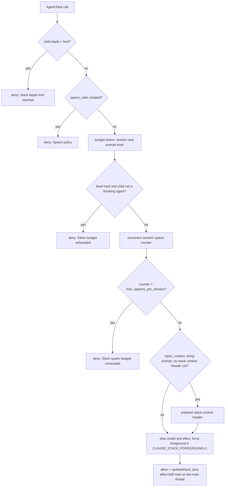

# Hooks, model tiers and enforcement

Three mechanisms keep a deep delegation tree bounded and on the intended models:

- **Hooks** (`.claude/settings.json` → `stack/hooks.py`) see every subagent spawn, every user prompt, every model
  switch and the start, end and subagent stops of every session.
- **Model tiers** (`config/models.json` → `stack/tiers.py`) decide which of three models each agent runs on, and a
  stack of enforcement layers makes that decision hold at runtime.
- **Token budgets** (`config/policy.json` → `stack/budget.py`) account for every token spent by the main thread and
  all subagents, and turn that into `ok` / `soft` / `hard` levels that the hooks act on.

## Hook wiring

All hooks are `type: "command"` hooks that call one entry point, `"$CLAUDE_PROJECT_DIR"/bin/stack hook <name>`.

| Event | Matcher | Handler | Timeout (s) | Async | Emits |
|---|---|---|---|---|---|
| `SessionStart` | (all) | `session-start` → `session_start()` | 10 | no | `additionalContext` status line; applies pending learned values |
| `PreToolUse` | `Agent\|Task` | `pre-agent` → `pre_agent()` | 10 | no | `permissionDecision` `deny`, or `allow` + `updatedInput` (+ `additionalContext`) |
| `SubagentStop` | (all) | `subagent-stop` → `subagent_stop()` | 120 | **yes** | nothing (side effects only) |
| `SessionEnd` | (all) | `session-end` → `session_end()` | 5 | no | nothing (detaches the learner) |
| `UserPromptSubmit` | (all) | `prompt-submit` → `prompt_submit()` | 20 | no | `additionalContext` budget note |
| `PreModelSwitch` | (all) | `model-switch` → `model_switch()` | 10 | no | exit code 0 (allow) or 2 + stderr reason (block) |
| `PreToolUse` | `Bash\|Write\|Edit\|MultiEdit\|NotebookEdit\|mcp__playwright__browser_type\|…fill_form\|…file_upload\|…press_key\|mcp__desktop-sandbox__(type_text\|key\|launch\|put_file\|click\|drag\|scroll\|move)\|mcp__neural-memory__.*` | `pre-tool` → `pre_tool()` | 10 | no | `permissionDecision` `deny` (web agents, tainted subagents) or `ask` (tainted main thread) |
| `PostToolUse` | `WebFetch\|WebSearch\|mcp__fetch__.*\|mcp__jina__.*\|mcp__exa__.*\|mcp__spider__.*\|mcp__playwright__.*\|…\|mcp__desktop-sandbox__.*` | `post-web` → `post_web()` | 10 | no | `additionalContext` warning (score ≥ 3), plus `decision: block` (score ≥ 6) |
| `PostToolUse` | `Agent\|Task\|Workflow` | `post-agent` → `post_agent()` | 10 | no | `additionalContext` milestone digest (main thread only) |

The call path from Claude Code to a handler:

```
Claude Code ──stdin: hook JSON──▶ bin/stack hook <name>
  bin/stack        sources bin/_pyenv.sh, cd $REPO, PYTHONPATH=$REPO, exec python -m stack.cli
  bin/_pyenv.sh    interpreter: $CLAUDE_STACK_PYTHON > $REPO/.venv/bin/python > uv run --python 3.13 > python3
  stack/cli.py     `hook NAME` subcommand → stack.hooks.main(NAME)
  stack/hooks.py   HANDLERS[NAME](payload) → JSON on stdout, or exit code + stderr
```

`stack/` is kept stdlib-only and Python 3.9-compatible so the hooks still run when `bin/_pyenv.sh` falls back to the
system `python3`.

`SubagentStop` is the only `async: true` hook: Claude Code does not wait for it, because it parses whole session
transcripts and must never delay the parent agent. Its handler returns nothing, so running it in the background loses
no output.

## Fail-open contract

`stack.hooks.main(name)` implements one rule: a broken hook must never wedge a session.

| Situation | Result |
|---|---|
| stdin is not valid JSON | payload becomes `{}`; handlers treat missing fields as "not applicable" |
| unknown handler name | `unknown hook <name>` on stderr, exit 0 |
| handler raises | `<local ISO-8601 time> <handler> <repr(exc)>` appended to `<data>/hook-errors.log`, exit 0, no output |
| handler returns `{"_exit": n, "_stderr": msg}` | `msg` on stderr, exit `n` (used only by `model-switch`) |
| handler returns a dict | JSON on stdout, exit 0 |
| handler returns `None` | no output, exit 0 (Claude Code proceeds unchanged) |

`<data>` is `$CLAUDE_STACK_DATA`, default `~/.claude/stack-data`. Because every failure maps to exit 0 with no
output, a fault in the stack degrades to plain Claude Code behaviour. The only decisions that block anything are the
explicit ones: the four `deny` reasons of `pre-agent` and the exit 2 of `model-switch`. Inside `pre-agent`, budget
accounting is wrapped in its own `try` (logged as `budget`), so a budget fault disables only the budget checks while
the depth guard and spawn rules keep working.

`stack.hooks.run_handler(name, payload)` is the same dispatch for in-process callers (the Agent SDK runner): it
returns the handler's dict or `None` and fails open the same way.

## Latency

Each command hook is a fresh Python process. Measured on the development machine with the `.venv` interpreter
(5-run average per handler, small transcript), the synchronous handlers complete in about **55 ms** wall-clock
(`session-start` 56 ms, `pre-agent` 57 ms, `prompt-submit` 55 ms, `model-switch` 54 ms); interpreter start-up and
imports dominate, and `session-end` does no work beyond starting a detached process. The parts that could grow with session size are bounded:

- budget accounting is incremental (byte offsets, see [accounting](#accounting-algorithm)), so a call reads only what
  was appended since the previous call, plus one recursive glob of `<session>/subagents/`;
- transcript ingestion runs only in the async `SubagentStop` hook (debounced to once per 60 s) and in a detached
  process after `SessionEnd`;
- the per-session state files are guarded by `fcntl.flock`; parallel `Agent` calls from one message (up to
  `CLAUDE_CODE_MAX_CONCURRENT_SUBAGENTS=20`) serialise only for the few milliseconds of the read-modify-write.

The `uv run` fallback adds resolver start-up to every call; `./install.sh` creates `.venv` so the fast path is used.

## `pre-agent`: depth guard, spawn rules, budgets and tier stripping

After every check has passed, `pre_agent` records the target agent file's `maxTurns` at that moment, keyed by the
Agent call's `tool_use_id` (`<data>/spawns/<session_id>.jsonl`, fail-open, pruned after 14 days at SessionEnd): agent
files can change during a session, so this is the limit the run was started under, and the learner prefers it
(`limit_basis: "spawn_record"`) to the file's value at stop time.

Since the web-content safety layer, `pre_agent` also checks the caller's taint between the spawn rules and
the token budget: an agent that read flagged web content may only spawn `tainted_may_spawn` agents (deny for
subagents, `ask` for the main thread). See [Web content safety](web-safety.md#web-content-safety-prompt-injection).

Fires on `PreToolUse` for the `Agent` and `Task` tools (any other `tool_name` returns `None`).

Payload fields read: `tool_name`, `tool_input` (`subagent_type`, `prompt`, `model`, `effort`, `run_in_background`),
`agent_id` and `agent_type` (present only when the caller is a subagent), `session_id`, `transcript_path`,
`prompt_id`, and `effort.level` (the caller's effort in effect).

Derived values:

| Value | Rule |
|---|---|
| parent type | `agent_type`, else `$CLAUDE_STACK_MAIN_AGENT`, else `main` |
| parent depth | `0` without `agent_id`; else `spawnDepth` from `<session>/subagents/**/agent-<agent_id>.meta.json` (written natively by Claude Code); `1` if that file is missing or unreadable |
| child depth | parent depth + 1 |
| child type | `tool_input.subagent_type`, else `general-purpose` |
| depth limit | `$CLAUDE_STACK_MAX_DEPTH`, else `$CLAUDE_CODE_MAX_SUBAGENT_SPAWN_DEPTH`, else `8` (settings set both to `8`) |

`<session>` is `transcript_path` without its `.jsonl` suffix. The checks run in this order; the first that fires
decides:



1. **Depth guard.** Denies when the child would exceed the limit. Claude Code also withholds the Agent tool at its
   own native limit; the hook adds a reason the model can act on.
2. **Spawn rules** (`config/policy.json` → `spawn_rules`). Claude Code ignores `Agent(type)` allowlists inside a
   subagent's `tools`, so the caller → allowed-children table is enforced here. `callers.<parent>` lists allowed child
   types (`*` = any, `@group` expands from `groups`); a parent without an entry may spawn anything. Independently,
   any child in `@orchestration` is denied when `child_depth > orchestrators_until_depth` (`6`), so the deepest
   levels are reserved for leaves.
3. **Token budget.** `budget.status()` is evaluated (and the incremental scan updated) on every call. At level
   `hard`, only `finishing_agents` may be spawned.
4. **Spawn budget.** The per-session counter in `<data>/sessions/<session_id>.json` (also `by_depth`, `by_type`,
   `max_depth_seen`, `updated_at`; read by `bin/stack depth`) is incremented under a lock, and the call is denied
   when it exceeds `max_spawns_per_session` (`128`; `0` disables). Denials 1–3 happen before the increment and do
   not consume spawn budget; denial 4 does, and once the budget is exceeded every further attempt is counted and
   denied. The counter's format and the fan-out sizing it drives are in [Spawn budget](delegation.md#spawn-budget).
5. **Context header.** Unless `inject_context` is `false`, the prompt is not a string, or it already starts with
   `<stack-context` (so re-entrant calls never stack headers), one line is prepended to the child's prompt; its
   format and attributes are in [The stack-context header](delegation.md#the-stack-context-header). `budget`, `prompt_tokens` and
   `session_tokens` are omitted if budget accounting failed. Every agent preloads the `delegation-protocol` skill,
   which defines how to act on each attribute.
6. **Runtime rules** (`_apply_runtime_rules`). With `enforce_tiers` (`true`) the per-call `model` and `effort` keys
   are deleted from `tool_input`. With `CLAUDE_STACK_FOREGROUND=1` (set by the SDK runner) `run_in_background` is
   forced to `false` so parents receive results before continuing. On the no-header path the hook returns `None`
   if these rules changed nothing.
7. **Effort-drift note.** See [main-thread effort drift](#6-main-thread-effort-drift-note).

The rewritten call is returned as `permissionDecision: "allow"` with `updatedInput`, so it proceeds without a
permission prompt. The four denial reasons are written so the model knows what to do next; they are listed verbatim,
with the reaction the protocol requires, in [The pre-agent hook](delegation.md#the-pre-agent-hook).

## `subagent-stop`: telemetry and mid-session learning

1. Appends `{"agent_id", "agent_type", "effort", "stop_reason", "limit_max_turns", "limit_basis", "ts"}` to `<data>/stops/<session_id>.jsonl` (only when both
   `session_id` and `agent_id` are present). The `SubagentStop` payload is the only authoritative source of the
   effort level a subagent actually ran at; the learner prefers it over the per-line transcript value.
2. Takes `<data>/learn.lock` with `LOCK_EX | LOCK_NB`. If another ingest holds it, returns: that ingest will see this
   agent too.
3. Debounce: returns if `<data>/last_ingest` is younger than `ingest_debounce_seconds` (`60`). A 500-agent workflow
   would otherwise re-parse the session 500 times; `SessionEnd` always does a final full ingest, so nothing is lost.
4. `engine.ingest_transcript(transcript_path)` (main transcript plus all subagent transcripts), then touches
   `last_ingest`.
5. If `<data>/last_update` is older than `midsession_update_minutes` (`30`), runs `engine.update()` (posteriors,
   `budgets.json`, learned global budgets), then touches `last_update`. It never applies: agent files do not change
   while a session runs; the recommendations are written when the session ends.

## `post-agent`: milestone relay

Specification: [docs/MILESTONES.md](../MILESTONES.md); code: `stack/progress.py`. Every agent can log the few events the user must hear
about (`bin/stack milestone <kind> "<text>"`), hooks add lifecycle events, and the main thread receives a digest. The pieces:

| Hook | Does |
|---|---|
| `pre-tool` (Bash) | Recognises exactly `bin/stack milestone <kind> <text>` (also `./bin/stack`, `"$CLAUDE_PROJECT_DIR"/bin/stack`) **before** the web-content and taint checks, appends the event from the payload (`session_id`, `agent_id`, `agent_type`, depth via `depth_of`) and returns nothing, so the command is never denied, also for web agents and tainted agents (their events carry `untrusted: true`). The text must be plain words or a quoted string without `$`, backticks or backslashes; anything else (a `;`, a pipe, a substitution) is not recognised: it is not recorded and goes through the normal checks |
| `pre-agent` | after the spawn is allowed: `start` event, attributed to the child, with `parent_id`, `parent_type`, `tool_use_id` |
| `subagent-stop` | `done` event before the learner work: `<type> finished` plus the first sentence of the `## Result` section of `last_assistant_message` (when the payload has none, the tail of `agent_transcript_path` is read), `(partial)` / `(blocked)` from its `Status:` line and `[stopped: <reason>]` for a stop that is not a normal end; such events are `abnormal` and never folded |
| `post-agent` | main thread only (no `agent_id`): digest of the events after the session cursor as `additionalContext`, then the cursor moves; subagents get `None` |
| `prompt-submit` | appends the digest of events not yet relayed (background agents that finished between turns) after the budget line |

State: `<data>/progress/<session_id>.jsonl` (one event per line, appended under `flock`, so parallel agents never tear a line),
`<session_id>.cursor` (byte offset already relayed, advanced under `<session_id>.cursor.lock` so concurrent hooks relay each event once).
`session-end` prunes files older than 14 days. A trailing line without a newline is left for the next relay.

Digest: the header line, then at most `digest_max_lines` (25) lines and `digest_max_chars` (2500) in the order `needs-user`, `blocker`,
`failure`, `gate`, `decision`, `deliverable`, `plan`, `milestone`, then lifecycle; the rest is counted (`+N more`).
`start`/`done` events of agents on a tier in `fold_tiers` (`low`) or at depth >= `fold_lifecycle_depth` (3) are only counted
(`+N lifecycle events of helpers and deep agents`), and a digest made only of those is not sent. Each line names the agent as
`orchestrator > python-expert` when the chain can be rebuilt from the `start` events and the subagents' `toolUseId` in their
meta files, else just the agent type. Text from untrusted agents is shown as `[data] "..."`. Config: the `milestones` block of
`config/policy.json` (`enabled`, `max_text_chars`, `digest_max_lines`, `digest_max_chars`, `fold_lifecycle_depth`, `fold_tiers`),
checked by `bin/stack doctor`.

Payload notes: a foreground `Agent` call blocks the main turn, so the digest arrives when it returns; a `run_in_background` call returns
at once, its events arrive with a later call or at the next prompt. `bin/stack milestone` itself only validates the kind and prints
`logged` inside Claude Code (the hook did the recording); without `CLAUDECODE` in the environment it appends under session `unknown`.
Read the log with `bin/stack progress [--session SID] [--all] [--follow] [--kinds k1,k2] [--json]`.

## `session-start`: status line

It applies pending learned values as a catch-up (`_apply_learned`): when
`engine.apply_on()` is `"session_end"` (the default) or `"session_start"` (`"never"` when `config/learning.json`
`enabled` or `auto_apply` is `false`) it takes `<data>/learn.lock` with `LOCK_EX | LOCK_NB` and runs `engine.apply()`.
If a previous session's detached `learn run` still holds the lock, nothing is applied and that run applies.
Exceptions go to `hook-errors.log` and never block the start. `engine.apply()` compares every value with the file as
it is now and returns only real writes, so the catch-up is silent after a SessionEnd apply. Claude Code re-reads a
changed agent file from the next turn, but its file watcher may not be running yet during startup, so a catch-up write
can wait for the next session. The primary apply is the SessionEnd one.

Returns `additionalContext` built from up to three parts:

- `Agent stack active: max delegation depth <limit>.`
- `Missing keys in ~/.claude/stack.env: <names> (those MCP servers run anonymous or fail).` — the names in
  `policy.json` `expected_keys` (`EXA_API_KEY`, `JINA_API_KEY`, `SPIDER_API_KEY`) whose value is empty or absent.
  `stack/envfile.py` parses the file without executing it; only key names are ever reported.
- `Caught up pending learned values (Claude Code reads agent files again from the next turn; a write this early in startup may only reach the next session): <agent> maxTurns=..,effort=..; ...` — the changes just applied; otherwise
- `Recently self-tuned: <agent> key=value,...; ...` — the last 5 entries of `<data>/changes.jsonl`, only if that file
  was modified within the last 7 days.

## `session-end`: detached learner

`SessionEnd` hooks share a 1.5 s budget, so the handler only starts
`<python> -m stack.cli learn run --transcript <transcript_path>` with `start_new_session=True`, stdin from
`/dev/null`, stdout and stderr appended to `<data>/learn.log`, working directory `$REPO`, and returns at once.
`learn run` waits for `<data>/learn.lock`, then `engine.run_after_session` does nothing if `config/learning.json`
`enabled` is `false`; otherwise it ingests the session, updates posteriors and records the session's summary line in
`<data>/history.jsonl` (`engine.record_session`). It applies when `apply_on` is `"session_end"` (the default), so the new values
are on disk before the next session loads agent definitions.

## `prompt-submit`: per-prompt budget note

Runs `budget.status(session_id, transcript_path, prompt_id)` and adds, as `additionalContext` to the main thread:

```
Token budget: session <used> used of <max_global> (soft <soft_global>); this prompt may use up to <max_prompt>
(soft <soft_prompt>, guaranteed <min_prompt>). Optimise for context usage, not speed.
```

If the session level is not `ok` it appends `SESSION BUDGET SOFT: converge, do not open new branches.` (or `HARD`).
Only the session level is checked here, because a prompt that has just been submitted has spent nothing yet. Numbers
use `budget.fmt()`: three significant digits with `k`, `M` or `B` (`3B`, `2.25B`, `120M`).

## Hook state files

Hooks keep their state under `<data>`: the spawn counter (`sessions/<session_id>.json`, written by `pre-agent`), the
budget scan state (`sessions/<session_id>.usage.json`, written by `pre-agent` and `prompt-submit`), the effort in
effect per finished subagent (`stops/<session_id>.jsonl`), the learner lock and debounce stamps (`learn.lock`,
`last_ingest`, `last_update`), `learn.log` from the detached learner, the per-session history (`history.jsonl`), `hook-errors.log`, and the learner's outputs.
Each file is described in [Files in `~/.claude/stack-data/`](learning.md#files-in-claudestack-data). All JSON state is written
to a `.tmp` file and moved into place with `os.replace`, and the per-session files are guarded by `.lock` files, so a
reader never sees a partial file.

## Hooks under the Agent SDK

When an SDK session does not load this repo's settings (`cwd` outside the repo, or `hooks="python"`),
`stack_sdk/hooks.py` registers the same handlers as Python callbacks through `run_handler`, each executed with
`asyncio.to_thread` so the event loop is never blocked: `pre-agent` on `PreToolUse` `Agent|Task` (30 s),
`post-agent` on `PostToolUse` `Agent|Task|Workflow` (30 s), `subagent-stop` on `SubagentStop` (120 s, result discarded) and `prompt-submit` on `UserPromptSubmit` (30 s); see
[Hooks as Python callbacks](sdk.md#hooks-as-python-callbacks). The SDK has no `SessionStart`/`SessionEnd` callbacks, so the
runner calls `engine.run_after_session` itself when the query finishes. `PreModelSwitch` is not registered there; the
SDK path pins the model in the options instead (layer 7 below).

## Model tiers

`config/models.json` is the only place that decides which model an agent runs on:

```json
{
  "tiers": {
    "ADVANCED_MODEL": { "model": "claude-opus-5-5",   "alias": "opus" },
    "MEDIUM_MODEL":   { "model": "claude-sonnet-5-5", "alias": "sonnet" },
    "LOW_MODEL":      { "model": "claude-haiku-5-5",  "alias": "haiku" }
  },
  "agents": {
    "delegator": { "tier": "ADVANCED_MODEL", "effort": "high", "maxTurns": 300,
                   "why": "routes every request; a wrong route costs more than any token saving" }
  }
}
```

- `model` is the full id rendered into agent frontmatter. An environment variable named after the tier
  (`ADVANCED_MODEL`, `MEDIUM_MODEL`, `LOW_MODEL`) overrides it, for example to trial a new release without editing
  files.
- `alias` is the family alias (`opus`, `sonnet`, `haiku`): the only form the Agent tool's per-call `model` accepts,
  and the form saved workflows use for `general-purpose` agents.
- Each agent's `effort` and `maxTurns` are **initial** traits. `maxTurns` is about twice a typical demanding run:
  enough headroom that demanding work is not cut short before the learner has evidence, without inviting runaway
  loops. They are written only when missing (or with `--reset-traits`); after that the Bayesian learner owns them.
- `why` documents the choice and is not read by code.

The 63 agents by tier, with initial effort / maxTurns:

| Tier | Model | Agents |
|---|---|---|
| `ADVANCED_MODEL` (34) | `claude-opus-5-5` | `delegator` (high/300), `orchestrator` (high/300), `swarm-coordinator` (medium/220), `ensemble-assembler` (high/180), `mediator` (xhigh/180), `planner` (high/80), `architect` (xhigh/120), `plan-critic` (high/60), `reviewer` (high/120), `adversarial-verifier` (high/90), `quality-control` (medium/70), `code-optimizer` (high/150), `security-auditor` (high/120), `debugger` (high/160), `deep-researcher` (high/240), `paper-researcher` (high/120), `computer-graphics-expert` (high/150), `computer-science-expert` (xhigh/150), `quantum-computing-expert` (xhigh/150), `rust-expert` (high/180), `cpp-expert` (high/180), `haskell-expert` (high/180), `mathematics-expert` (max/180), `physics-expert` (xhigh/150), `graphic-design-expert` (high/120), `visual-reviewer` (high/80), `cross-domain-synthesizer` (xhigh/120), `expert-panel-chair` (high/180), `debate-moderator` (high/120), `analogy-mapper` (high/90), `first-principles-decomposer` (xhigh/90), `agent-architect` (high/120), `fiction-writer` (high/120), `manuscript-reviewer` (high/120) |
| `MEDIUM_MODEL` (24) | `claude-sonnet-5-5` | `mesh-router` (high/220), `validator` (medium/90), `tester` (high/150), `code-quality-analyst` (medium/90), `quick-researcher` (low/40), `web-searcher` (low/50), `browser-operator` (medium/150), `computer-operator` (medium/150), `fact-checker` (medium/60), `go-expert` (high/180), `julia-expert` (high/180), `java-expert` (high/180), `kotlin-expert` (high/180), `python-expert` (high/180), `typescript-expert` (high/180), `image-generator` (medium/90), `image-editor` (medium/90), `vector-artist` (medium/90), `general-chat` (low/35), `stack-tuner` (medium/60), `writing-project-builder` (medium/60), `copy-editor` (medium/100), `prose-stylist` (high/100), `chat-aide` (low/6) |
| `LOW_MODEL` (5) | `claude-haiku-5-5` | `concurrent-dispatcher` (medium/150), `web-scraper` (low/80), `web-crawler` (medium/120), `source-summarizer` (low/35), `file-summarizer` (low/40) |

`stack/tiers.py`:

| Function | Behaviour |
|---|---|
| `tier_models(cfg)` | tier name → model id, environment overrides applied (`os.environ.get(name) or spec["model"]`, stripped) |
| `tier_aliases(cfg)` / `alias_models(cfg)` | tier → alias; alias → resolved model id |
| `model_for(agent)` | the agent's tier model, or `None` if it has no entry |
| `allowed_models(cfg)` | sorted set of the three tier model ids: the only models allowed anywhere |
| `sync(apply, reset_traits, only)` | per agent: set frontmatter `model` to its tier model if different; set `effort`/`maxTurns` only if the current value is missing or empty, or `reset_traits` is true. Returns the change list; writes only with `apply`. Missing agent files and unknown tiers are reported as errors |
| `set_tier(agent, tier)` | validates `tier` against `ADVANCED_MODEL`/`MEDIUM_MODEL`/`LOW_MODEL`, writes `config/models.json` atomically, then `sync(apply=True, only=[agent])` |
| `main_thread(agent)` | `{"model", "effort"}` the main thread must run with: the tier model (or the frontmatter model if the agent has no tier entry), which must be in `allowed_models()` or `ValueError`; effort from the agent's **current frontmatter**, so a learned effort change also moves the main thread |

Frontmatter edits go through `stack/frontmatter.py`, which rewrites only the changed key lines and preserves
everything else byte for byte.

Commands:

| Command | Effect | Exit code |
|---|---|---|
| `bin/stack agents tiers` | dry run: prints `tiers: ADVANCED_MODEL=…, MEDIUM_MODEL=…, LOW_MODEL=…` and each pending change, or `all agents already match their tiers` | 1 if any agent errored |
| `bin/stack agents tiers --apply [--reset-traits]` | writes the changes; `--reset-traits` also resets `effort`/`maxTurns` to the initial traits | 1 if any agent errored |
| `bin/stack agents set NAME tier=MEDIUM_MODEL` | `set_tier` (config + frontmatter in one step) | 2 on an unknown tier |
| `bin/stack agents set NAME model=ID` | allowed only if `ID` is in `allowed_models()`; `bin/stack doctor` then warns that it differs from the tier, and the next `tiers --apply` reverts it | 2 if not a tier model |
| `bin/stack agents set NAME key=value ...` | `tier=` is applied first, then the other editable keys: `tier`, `model`, `effort`, `maxTurns`, `mcpServers`, `skills`, `color`, `autoCompactWindow`, `tools`, `disallowedTools`, `description`, `memory`, `permissionMode`, `isolation`, `background`; `key=` removes the key; `mcpServers`/`skills` take comma lists; the agent file is re-validated afterwards | 2 for a non-editable key, 1 on validation errors |
| `bin/stack agents main-args NAME` | prints the launcher pin, e.g. `--agent delegator --model claude-opus-5-5 --effort high` (`--effort` omitted if the agent has none) | non-zero if the agent is unknown or not on a tier model |

## Enforcement layers

Tier assignments are enforced at seven independent points, so no single path (a caller's per-call argument, a
`/model` command, a launcher flag, an edited agent file) can move work off its tier.

| # | Layer | Where | What it stops | Deliberate escape hatch |
|---|---|---|---|---|
| 1 | frontmatter rendering + doctor | `stack/tiers.py`, `stack/doctor.py` | agent files on non-tier models | none (fix `config/models.json`) |
| 2 | Claude Code model allowlist | `.claude/settings.json` | any model outside the three ids | edit the settings |
| 3 | per-call stripping | `pre-agent` hook | `model`/`effort` on an `Agent` call | `enforce_tiers: false` |
| 4 | pinned launcher | `bin/claude-stack` | `--agent`, `--model`, `--effort` overrides | `STACK_MAIN_AGENT`, or run `claude` directly |
| 5 | model-switch guard | `PreModelSwitch` hook | `/model` switches away from the pinned or allowed models | `CLAUDE_STACK_ALLOW_MODEL_SWITCH=1` |
| 6 | effort-drift note | `pre-agent` hook | silent main-thread `/effort` changes (flagged, not blocked) | — |
| 7 | SDK options | `stack_sdk/options.py` | the same, for programmatic runs | `--agent none` with a tier `--model` |

### 1. Frontmatter rendering and doctor checks

`bin/stack agents tiers --apply` writes each agent's tier model into its frontmatter `model`; agent files are never
edited by hand for `model`. `bin/stack doctor` (`check_tiers`) reports an agent file without an entry in
`config/models.json`, an entry with an unknown or missing tier, or a frontmatter `model` outside `allowed_models()` as
an error, and a tier model that is not the agent's own tier, or a tier entry for an agent that does not exist, as a
warning (run `tiers --apply`). `check_workflows` also rejects any `model: '…'` in `.claude/workflows/*.js` that is
neither a tier alias (`opus`/`sonnet`/`haiku`) nor a tier model id. All checkers are listed in [Doctor](installation.md#doctor).

### 2. Claude Code model allowlist

```json
"availableModels": ["claude-opus-5-5", "claude-sonnet-5-5", "claude-haiku-5-5"],
"enforceAvailableModels": true
```

Claude Code itself then refuses models outside the list. In project, user and local settings `availableModels` matches
by prefix (a listed id also admits a later id that extends it), and `enforceAvailableModels` is read only while no
managed settings exist. Exact matching needs `"availableModelsMatch": "exact"`, which Claude Code honours **only from
managed settings** (anywhere else it is ignored with a warning, as is `deniedModels`; `bin/stack doctor` warns about
both). `bin/stack managed-settings` prints the exact allowlist rendered from the tiers, and
`sudo bin/stack managed-settings --install` merges it into the OS managed-settings file (macOS
`/Library/Application Support/ClaudeCode/managed-settings.json`, Linux and WSL `/etc/claude-code/managed-settings.json`,
Windows `C:\Program Files\ClaudeCode\managed-settings.json`), keeping any other keys there. Managed settings apply to
every Claude Code session on the machine. This list is a static copy of the tier ids: when a tier's model changes (in `config/models.json` or
through an `ADVANCED_MODEL`/`MEDIUM_MODEL`/`LOW_MODEL` override), update `availableModels` as well, or Claude Code
will refuse the new id. `bin/stack doctor` does not compare the two. The SDK path (layer 7) computes the list from
`tiers.allowed_models()` and so follows overrides automatically.

### 3. Per-call stripping in `pre-agent`

While `config/policy.json` `enforce_tiers` is `true` (also the default when the key is absent), the hook deletes
`model` and `effort` from every `Agent`/`Task` call before it runs, on both the header and the no-header path. A
per-call `model` would override the agent's tier and a per-call `effort` would override its learned effort, so a
caller that wants cheaper or stronger work must pick a different agent (for example `file-summarizer` or
`quick-researcher` instead of an `ADVANCED_MODEL` agent). The removal is silent; the `effort-and-model-selection`
skill tells agents not to pass either key.

### 4. Pinned launcher: `bin/claude-stack`

```bash
agent="${STACK_MAIN_AGENT:-delegator}"
# --model, --model=*, --effort, --effort=*, --agent, --agent=*  → message on stderr, exit 2
read -r -a pin <<< "$("$here/stack" agents main-args "$agent")"
export CLAUDE_STACK_MAIN_AGENT="$agent"
exec claude "${pin[@]}" "$@"
```

The main-thread agent comes from `STACK_MAIN_AGENT` (default `delegator`); its model and effort come from
`bin/stack agents main-args`, which is `tiers.main_thread()`. Any of the three refused flags exits with status 2 and
points at `bin/stack agents set <agent> tier=ADVANCED_MODEL|MEDIUM_MODEL|LOW_MODEL`. All other arguments, such as
`-p "question"`, pass through to `claude`. The exported `CLAUDE_STACK_MAIN_AGENT` is how layers 5 and 6 and the
`pre-agent` parent type know which agent the main thread is.

### 5. `PreModelSwitch` guard

`model_switch()` reads the target from `to_model` (or `requested_model`) and decides:

```python
if os.environ.get("CLAUDE_STACK_ALLOW_MODEL_SWITCH") == "1":
    allow
main = CLAUDE_STACK_MAIN_AGENT unless unset or "main"
if main:   ok = (to == tiers.main_thread(main)["model"])            # pinned: exactly its tier model
else:      ok = any(to == m or to.startswith(m + "-") or to.startswith(m + "[")
                    for m in tiers.allowed_models())               # any tier model, incl. dated ids and [1m]
```

| Outcome | Exit code | stderr |
|---|---|---|
| allowed (or override set) | 0 | — |
| blocked, main agent pinned | 2 | `Model switch to '<to>' blocked: the main thread runs <agent> on its tier model <model>. Change the tier in config/models.json (bin/stack agents set <agent> tier=...) or set CLAUDE_STACK_ALLOW_MODEL_SWITCH=1 for this session.` |
| blocked, no main agent | 2 | `... only the tier models <ids> are allowed. ...` |
| handler error | 0 | — (fail open, logged) |

Exit code 2 is Claude Code's blocking hook result: the switch does not happen and the stderr text is shown as the
reason. `CLAUDE_STACK_ALLOW_MODEL_SWITCH=1` must be in the environment Claude Code was started with; it is the one
supported way to leave the tier for a session.

### 6. Main-thread effort drift note

Hooks cannot block `/effort`. Instead, on every main-thread spawn (no `agent_id`) while a main agent is set,
`pre-agent` compares the payload's `effort.level` with `tiers.main_thread(main)["effort"]`. If they differ, the
allowed result carries:

```
Stack policy: the delegator main thread must run at effort high (now low). Run /effort high.
```

as `additionalContext`, so the main thread is told about the drift at its next delegation. The note is attached on
the header-injection path, which every normal spawn takes.

### 7. Agent SDK options

`stack_sdk/options.py` `build_options()` applies the same policy without relying on any settings file:

- passes `settings` as the JSON string of `{"availableModels": tiers.allowed_models(), "enforceAvailableModels": true}`
  (`availableModelsMatch` would be ignored in `--settings`; exact matching comes from managed settings, layer 2);
- raises `ValueError` if any loaded agent's model is not a tier model;
- with a main agent (default `delegator`), refuses `model`/`effort` overrides and pins both from
  `tiers.main_thread()`; with `--agent none`, accepts only a `--model` from `allowed_models()`;
- sets `CLAUDE_STACK_MAIN_AGENT` and, for foreground runs, `CLAUDE_STACK_FOREGROUND=1`, which layer 3's runtime rules
  read.

The code and the failure cases are in [Model allowlist and main-thread pinning](sdk.md#model-allowlist-and-main-thread-pinning).

### Installing enforcement for every project: `--enforce-models`

`./install.sh --enforce-models` (`stack/install.py` `enforce_models_global`) writes three things into
`~/.claude/settings.json`, after a backup, and installs nothing else:

- `availableModels`, rendered from `config/models.json` (so tier overrides are picked up when you re-run it): Claude Code
  refuses any model outside the list, matching by prefix (a listed `claude-opus-5-5` also admits a later id that extends
  it);
- `enforceAvailableModels: true`, which Claude Code reads there only while no managed settings exist;
- the `PreModelSwitch` guard (`"$HOME"/.claude/stack/bin/stack hook model-switch`), the strongest lever: it blocks
  switches to non-tier models, and when a stack main agent runs (`bin/claude-stack`) it pins the main thread to that
  agent's exact tier model, so even a longer id that extends it is refused.

It also drops an `availableModelsMatch` there, which Claude Code would ignore. Re-running is idempotent and
`./install.sh --no-enforce-models` removes all of it. Combined with `--user` (`merge_settings`, which merges this
repo's `env` and other hooks), the result is the same; without `--enforce-models`, `--user` skips the guard and the
model keys, so other projects keep their own model choices while still getting the depth guard, budgets and learning.
For exact matching of every model, also run `sudo bin/stack managed-settings --install` (layer 2).

## Token budgets

Budgets cover the whole delegation tree (the main thread plus every subagent at every depth) in two scopes: the
**session** and the current **user prompt** (one `promptId`). One weighted count is used for both:

```
tokens = input + cache_creation + output + cache_read_weight × cache_read
```

`cache_read_weight` is `1.0`, so cached context counts in full: the goal is to keep context lean, not only to
save money.

### Limits

From `config/policy.json` → `token_budget` (the same values are the code defaults in `stack/budget.py`):

| Scope | `min` (guaranteed) | `soft` (converge) | `max` (hard) | Learned ceiling |
|---|---|---|---|---|
| Session | `min_global_tokens` 2,500,000,000 | `soft_global_tokens` 7,500,000,000 | `max_global_tokens` 10,000,000,000 | 2× configured |
| Prompt | `min_prompt_tokens` 100,000,000 | `soft_prompt_tokens` 300,000,000 | `max_prompt_tokens` 400,000,000 | 2× configured |

Other keys: `finishing_agents` = `file-summarizer`, `quality-control`, `validator`, `source-summarizer`;
`learn_global` = `report`. Keys starting with `_` are ignored.

### Levels

```python
def level(used, lo, soft, hi):
    if used < lo:   return "ok"     # below the guarantee: never throttled
    if used >= hi:  return "hard"
    if used >= soft: return "soft"
    return "ok"
```

`status()` computes the session level and the prompt level (prompt usage is the bucket for the payload's
`prompt_id`, `0` if none) and reports the worse of the two as `level`. The `min` check comes first, so a demanding
task always gets at least the guaranteed amount even if `soft` or `max` were configured lower.

| Level | `<stack-context>` | `UserPromptSubmit` note | Spawns | Expected agent behaviour (`delegation-protocol`) |
|---|---|---|---|---|
| `ok` | `budget="ok"` | totals only | allowed | normal rules |
| `soft` | `budget="soft"` | `SESSION BUDGET SOFT: converge, do not open new branches.` (session scope) | allowed | open no new exploratory branches; finish, verify, report |
| `hard` | `budget="hard"` | `SESSION BUDGET HARD: …` (session scope) | denied unless the child is a finishing agent | wrap up with what you have, offload, list gaps as Open doubts |

The finishing agents stay available at `hard` because they are what an agent needs to finish cleanly: offload and
digest large output (`file-summarizer`, `source-summarizer`) and gate or validate what already exists
(`quality-control`, `validator`).

### Accounting algorithm

`budget.session_usage(session_id, transcript_path)` keeps a state file `<data>/sessions/<session_id>.usage.json`,
updated under an exclusive `flock` on `<…>.usage.json.lock`:

```json
{
  "files":   { "<path>": { "offset": 18234, "prompt": "<promptId>", "mid": "<message.id>", "out": 812, "chars": 2920 } },
  "session": { "input": 0, "cache_creation": 0, "cache_read": 0, "output": 0 },
  "prompts": { "<promptId>": { "input": 0, "cache_creation": 0, "cache_read": 0, "output": 0 } },
  "updated_at": 1760000000.0
}
```

Files scanned: the main transcript plus, sorted, every `<session>/subagents/**/agent-*.jsonl` (nested workflow
directories included). For each file:

1. **Incremental byte offsets.** If the size is below the stored `offset`, the file was truncated or rotated: its
   state is reset and it is rescanned from 0. If the size equals the offset, it is skipped. Otherwise only the bytes
   after the offset are read, and only up to the last newline; `offset` advances to just past that newline, so a
   record still being written is read in full on a later call and never counted twice. Lines that are not valid JSON
   are skipped.
2. **Prompt attribution.** Any record carrying `promptId` (only user records do) sets the file's current prompt.
   Each assistant response is attributed to the most recent `promptId` in the same file, or `unknown`. A subagent
   transcript starts with a user record carrying the parent prompt's `promptId`, so subagent spend is charged to the
   user prompt that started the tree.
3. **`message.id` dedup.** Claude Code writes one JSONL record per content block of a response, each repeating the
   response's `usage`. The response key is `message.id` (fallback `requestId`, then `uuid`). Only when it differs
   from the file's previous key are `input_tokens`, `cache_creation_input_tokens` and `cache_read_input_tokens`
   added (to the session and to the prompt bucket), and the per-response `out`/`chars` counters reset. Summing every
   record instead would multiply input tokens by the number of blocks.
4. **Output placeholder estimation.** Subagent (sidechain) records often carry streaming placeholders such as
   `output_tokens: 2`. The scanner adds up content length over all records of the response (`text` and `thinking`
   string lengths, and the compact JSON of `tool_use.input`) and takes
   `output = max(reported output_tokens, ceil(chars / 3.6))`. Only the positive change against the response's
   previous `out` is added, so output never decreases and never double counts.

The state is written to a `.tmp` file and moved into place with `os.replace`. Worked example (from
`tests/test_budget.py`):

```
main  s.jsonl   user promptId=P1
                assistant m1  in=10 cache_read=1000 cache_creation=100 out=50
                assistant m1  in=10 cache_read=1000 cache_creation=100 out=80   same response: input not re-added, output 50→80
                user promptId=P2
                assistant m2  in=5  cache_read=2000 out=20
sub   agent-a   user promptId=P2
                assistant s1  in=3  cache_read=500  out=2, text = 360 chars → max(2, ceil(360/3.6)) = 100

P1 = 10 + 1000 + 100 + 80                    = 1,190
P2 = (5 + 2000 + 20) + (3 + 500 + 100)       = 2,628
```

### Learned limits (raise-only)

`budget.limits()` uses a learned value only when it is **greater** than the configured one. The configured limits
are floors chosen for demanding work: history may raise them when real sessions keep running into them, never lower
them, and never past twice the configured value, so one outlier session cannot blow the budget open; `min_*` limits
are never learned. The fit, the formulas and where the learned values are stored are in
[Global token budgets](learning.md#global-token-budgets).

Under the Agent SDK, `task_budget.total` is set to `max_prompt_tokens` (400,000,000) as the API's pacing hint; the
hard session and prompt limits are still enforced by the `pre-agent` hook.

Every setting and environment variable these mechanisms read is listed in
[Configuration reference](installation.md#configuration-reference) and [Environment variables](installation.md#environment-variables).
