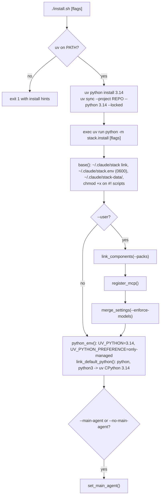

# Installation, packs, CLI and configuration reference

This section covers everything outside the agents themselves: how the stack is installed and wired into
`~/.claude`, how install packs select skills and agents, every command-line entry point, every configuration key,
where runtime state lives, how the stack is tested and validated, and what to do when something breaks.

## Requirements

| Requirement | Why |
|---|---|
| macOS or Linux, `bash` | every launcher in `bin/` is a bash script; hooks use `fcntl` file locks |
| [uv](https://docs.astral.sh/uv/) | installs CPython 3.14 and the locked dependencies (`pyproject.toml`, `uv.lock`); `install.sh` exits 1 without it |
| Node 18+ (`node`, `npx`) | the Playwright MCP server (`npx @playwright/mcp@latest`), several optional servers, the workflow syntax check in `bin/stack doctor` and `tests/test_workflows.py` |
| Claude Code CLI (`claude`) | the runtime; `--user` installs register `.mcp.json` servers (none by default) through `claude mcp add-json` |

Python dependencies (`pyproject.toml`, project `claude-stack` 0.1.0, `requires-python >= 3.13`): `mcp>=2.3,<3`,
`httpx>=0.27`, `pillow>=11.0`, `claude-agent-sdk>=0.2.168`, `resvg-py>=0.5`, `svglib>=2.3`, `reportlab>=4.4.3`,
`pikepdf>=10`, `vtracer>=0.6.15`; dev group `pytest>=8`. The `stack/` package itself is stdlib-only and stays
3.9-compatible, because it runs inside hooks that must never fail on a missing import.

## Installation

```bash
./install.sh                                  # base install (this repo is the project)
./install.sh --user                           # + agents, skills, workflows, MCP servers and hooks in every project
./install.sh --user --packs rust,quantum      # + only these packs (core and requirements always included)
./install.sh --enforce-models                 # tier-model allowlist + model-switch guard in every project (nothing else)
./install.sh --no-enforce-models              # undo --enforce-models
./install.sh --main-agent                     # + delegator as the main thread of every session
./install.sh --no-main-agent                  # undo --main-agent
./install.sh --no-python-default              # remove the default-Python env keys from ~/.claude/settings.json
./install.sh --dry-run --user                 # print what would change
```



`install.sh` prepends `~/.local/bin`, `/opt/homebrew/bin` and `/usr/local/bin` to `PATH`, reads the version from
`.python-version` (`3.14`), runs `uv python install 3.14`, then `uv sync --project <repo> --python 3.14 --locked` (without `--locked` when there is
no `uv.lock`), warns when `node` is missing, and finally `exec`s `stack/install.py` with all of its arguments.
`bin/stack install [flags]` calls the same `stack.install.main` without the uv bootstrap.

| Flag | Requires | Effect |
|---|---|---|
| *(none)* | | base install and the default Python (below) |
| `--user` | | link components, register `.mcp.json` servers at user scope (none by default), merge env and hooks into `~/.claude/settings.json` |
| `--packs a,b` | `--user` | link only these packs plus `core` and their `requires`; default is every pack. Ignored without `--user` |
| `--enforce-models` | | restrict every project to the tier models from `~/.claude/settings.json`: `availableModels` (rendered from `config/models.json`), `enforceAvailableModels` and the `PreModelSwitch` guard; drops an ignored `availableModelsMatch`. Works alone (installs nothing else) or with `--user`; backup written first. Exact matching for every model needs `sudo bin/stack managed-settings --install` |
| `--no-enforce-models` | | remove those keys and the guard again |
| `--main-agent` | | set `"agent": "delegator"` in `~/.claude/settings.json` (wins if both main-agent flags are given) |
| `--no-main-agent` | | remove the `agent` key |
| `--no-python-default` | | remove `UV_PYTHON` and `UV_PYTHON_PREFERENCE` from `~/.claude/settings.json` `env` and skip the `python`/`python3` links (links made earlier stay) |
| `--dry-run` | | `install.sh` prints the uv commands instead of running them; `stack.install` prints every action prefixed `[dry-run]` and writes nothing under `~/.claude` (the final `uv run` still creates or syncs `.venv`, as uv always does) |

**Base install** (always, idempotent):

| Path | Action | Why |
|---|---|---|
| `~/.claude/stack` | symlink to the repo; relinked when it points elsewhere; skipped with a message when a real file or directory is there | a stable absolute path that user-scope hooks and MCP entries can reference regardless of where the repo lives |
| `~/.claude/stack.env` | copied from `config/stack.env.example` with mode `0600` when missing; otherwise only tightened to `0600` when group/other bits are set | the only place secrets live |
| `~/.claude/stack-data/` | created when missing | learner and hook state (see [Runtime state](#runtime-state)) |
| repo scripts | `chmod +x` (where readable) on every file that starts with `#!` and is not executable | zip downloads and copies drop the bit; hooks and MCP entries run `bin/*` directly and fail with `Permission denied` |

**Default Python** (every run unless `--no-python-default`, idempotent): uv's CPython from `.python-version`
(`3.14`) becomes the interpreter of every Claude Code session, in every project:

| Where | Action | Effect |
|---|---|---|
| `~/.claude/settings.json` `env` | `UV_PYTHON=3.14`, `UV_PYTHON_PREFERENCE=only-managed` (overwrites other values; backup kept) | every `uv`/`uvx` command Claude runs uses uv's CPython 3.14, never the macOS or Homebrew interpreter. It overrides project pins too: in a project whose `requires-python` excludes 3.14, pass `--python X.Y` (explicit flags win) |
| uv's bin directory (`uv python dir --bin`, normally `~/.local/bin`) | `uv python install --default 3.14`: `python`, `python3` and `python3.14` link to uv's CPython 3.14; skipped when both already point there | plain `python3` / `python` resolve to it wherever that directory comes first on `PATH` (also in your own shell) |

The project's own `.claude/settings.json` carries the same two `env` keys, so sessions in this repository get
them even without a user-scope install.

When no action was needed the installer prints `nothing to do; already installed`; it always ends with
`next: fill ~/.claude/stack.env, then bin/stack keys and bin/stack doctor`.

**`--user`: component links.** `link_components` resolves the selected packs (`stack/packs.py`) and creates one
symlink per component; existing correct links are left alone, foreign files are never overwritten:

| Source | User-scope link |
|---|---|
| `.claude/agents/<group>/<name>.md` (agents of the selected packs) | `~/.claude/agents/stack/<group>/<name>.md` |
| `.claude/skills/<name>/` (skills of the selected packs) | `~/.claude/skills/<name>` |
| `.claude/workflows/*.js` (always all) | `~/.claude/workflows/<file>.js` |

Links are only added or redirected, never removed, so a later run with fewer packs leaves the earlier links in
place (see [Troubleshooting](#troubleshooting)).

**`--user`: MCP registration and path rewriting.** The stack servers in `config/mcp.servers.json` are not
registered: they travel inline in the linked agent files and load lazily inside them, with launchers that fall back
to `~/.claude/stack` ([Lazy loading](mcp.md#lazy-loading)). `register_mcp` prints that, with a hint to remove
stale user-scope registrations from earlier installs (`claude mcp remove --scope user <name>`). Inline servers in
`~/.claude/agents/` load without the project trust check. For every server in `.mcp.json` (none by default; an
optional server after `bin/stack mcp enable`), keys starting with `_` are
dropped, both project placeholders are rewritten to the absolute `~/.claude/stack` path, and the entry is
registered with `claude mcp remove --scope user <name>` followed by `claude mcp add-json --scope user <name> '<json>'`.
The rewrite is needed because in another project `${CLAUDE_PROJECT_DIR}` points at that project, which has no
`bin/mcp-run` or `bin/mcp-headers`.

```
project (.mcp.json)                                     user scope (~/.claude.json)
"${CLAUDE_PROJECT_DIR:-.}/bin/mcp-run"               -> "/Users/<you>/.claude/stack/bin/mcp-run"
"\"${CLAUDE_PROJECT_DIR:-$HOME/.claude/stack}/bin/mcp-headers\" fal"
                                                     -> "\"/Users/<you>/.claude/stack/bin/mcp-headers\" fal"
```

Without `claude` on `PATH` the installer prints the exact `claude mcp add-json --scope user ...` command per
server instead. `stack_sdk/mcp.py` performs the equivalent rewrite (to the repo's absolute path) for SDK sessions
outside the repo.

**`--user`: settings merge** into `~/.claude/settings.json`:

* `env`: each key of the project `env` is added with `setdefault`, so values you already set win (except
  `UV_PYTHON` and `UV_PYTHON_PREFERENCE`, which the default-Python step then sets).
* `hooks`: for every event, previous stack hook groups (any command containing `/.claude/stack/bin/stack hook`)
  are removed and the project groups are appended with `"$CLAUDE_PROJECT_DIR"/bin/stack` rewritten to
  `"$HOME"/.claude/stack/bin/stack`. `PreModelSwitch` is skipped unless `--enforce-models`.
* `availableModels`, `enforceAvailableModels`: copied only with `--enforce-models`, so
  other projects are not restricted to the tier models unless you ask for it.
* Not merged: `permissions` (including the two `deny` rules that keep `~/.claude/stack.env` unreadable),
  `enabledMcpjsonServers` and `$schema`. Copy the deny rules into your user settings if you want them everywhere.

**Backups.** Every write to `~/.claude/settings.json` (`--user`, `--main-agent`, `--no-main-agent`, the default-Python
step) first copies
the current file to `~/.claude/settings.json.bak-<unix-seconds>`, then writes a `.tmp` file and renames it over
the original, so an interrupted install never leaves a half-written settings file. `--user` rewrites the file (and
takes a new backup) on every run.

**`--main-agent` versus `bin/claude-stack`.** `--main-agent` only sets `"agent": "delegator"`. `bin/claude-stack`
additionally pins the main thread's model and effort (`--model`, `--effort`) and exports
`CLAUDE_STACK_MAIN_AGENT`, which the hooks use for the model-switch pin, the effort-drift note and main-thread
learning. Prefer `bin/claude-stack` inside this repo.

**Removing the user-scope install** (no command does this for you): restore a `settings.json.bak-*` or delete the
stack hook groups and the `agent` key; run `claude mcp remove --scope user <name>` for any server an install
registered (earlier versions registered `playwright`, `exa`, `jina`, `spider`, `context7` and `image`); delete the links that point into the repo
(`find ~/.claude/agents/stack ~/.claude/skills ~/.claude/workflows -type l -lname "$(pwd -P)/*" -print`, then the
same with `-delete`); remove `~/.claude/stack`. `~/.claude/stack.env` and `~/.claude/stack-data/` are yours to keep
or delete.

## Install packs

A pack is a named group of skills and agents (`config/packs.json`, logic in `stack/packs.py`). Packs exist so a
machine or project can carry only the domains it needs: every listed skill costs context in every session, while
a disabled pack costs nothing.

Skills come in three layers: the protocol skills preloaded into every agent (`delegation-protocol`,
`doubt-escalation`, `output-contract`); method and hub skills (orchestration patterns, voting, Delphi, debate,
red-teaming, research, testing, review, and one hub per domain that routes to its granular skills); and granular
skills, focused single-purpose playbooks (for example Rust async with Tokio, zero-downtime migrations, SQL query
tuning, OKLCH palettes, Kotlin coroutines and Flow, variational quantum algorithms) that are loaded on demand and
listed by name only, so they cost almost no context until used. Each skill is `.claude/skills/<name>/SKILL.md` plus optional
`references/`, `scripts/`, `examples/` and `assets/`.

* **`core`** is always installed and everything requires it: the three protocol skills, orchestration, decision
  and synthesis methods, research, quality gates, self-tuning, and every agent that is not a domain specialist.
* **Domain packs** hold a **hub** skill (the entry point that routes to the right playbook), the domain's
  **granular** skills (focused single-purpose playbooks) and the domain expert agent.
* **Skill-only packs** (`coding-core`, `python`, `typescript`, `devops`) hold granular playbooks without an agent;
  `coding-core` carries the `coding-general` hub that routes to all four, and the other three require it.
* A skill is **granular** when it belongs to a pack, is not any pack's `hub`, and is not preloaded by any agent's
  `skills:` frontmatter (`packs.granular()`). Hubs and preloaded skills always keep their full listing.

| Pack | Requires (besides `core`) | Hub | Agents |
|---|---|---|---|
| `core` | | | 38 orchestration, planning, quality, research, synthesis and meta agents |
| `image` | | | `image-generator`, `image-editor`, `vector-artist`, `visual-reviewer` (skills `image-generation`, `image-editing`, `vector-art`, `visual-review`) |
| `rust` / `cpp` / `go` / `haskell` | | `rust-craft` / `cpp-craft` / `go-craft` / `haskell-craft` | `rust-expert` / `cpp-expert` / `go-expert` / `haskell-expert` |
| `julia` / `java` / `kotlin` | | `julia-craft` / `java-craft` / `kotlin-craft` | `julia-expert` / `java-expert` / `kotlin-expert` |
| `computer-graphics` | | `computer-graphics` | `computer-graphics-expert` |
| `computer-science` | | `cs-foundations` | `computer-science-expert` |
| `quantum` | | `quantum-computing` | `quantum-computing-expert` |
| `mathematics` | | `mathematics-toolkit` | `mathematics-expert` |
| `physics` | | `physics-toolkit` | `physics-expert` |
| `graphic-design` | `image` | `graphic-design` | `graphic-design-expert` |
| `writing` | | `fiction-craft` | `writing-project-builder`, `fiction-writer`, `manuscript-reviewer`, `copy-editor`, `prose-stylist`, `chat-aide` (skills `manuscript-project`, `copyediting`, `prose-style-analysis`, `developmental-editing`, `polish`; workflow `/manuscript-review`) |
| `coding-core` | | `coding-general` | language-agnostic playbooks: git, refactoring, codemods, API contracts, SQL tuning, migrations, regex, resilience, dependency upgrades, docs/ADRs |
| `python` | `coding-core` | `python-craft` | `python-expert` (Python 3.13 with uv: packaging, typing, asyncio, pytest, performance) |
| `typescript` | `coding-core` | `typescript-craft` | `typescript-expert` (TypeScript/Node/Bun: strict typing, tsconfig, testing, runtime patterns) |
| `devops` | `coding-core` | | containers, CI/CD, shell robustness, observability |

Granular skills shipped today (169, plus the `coding-general` hub). Each hub ends with a "Granular skills"
routing table naming them; hubs keep their full original text.

| Hub | Granular skills |
|---|---|
| `coding-general` | `git-advanced-workflows`, `refactoring-playbook`, `codemod-automation`, `api-contract-design`, `sql-query-tuning`, `zero-downtime-migrations`, `regex-engineering`, `resilience-patterns`, `dependency-upgrades`, `docs-and-adr-writing`, `ci-pipelines`, `container-images`, `shell-scripting`, `observability-instrumentation` |
| `python-craft` | `python-uv-packaging`, `python-typing`, `python-asyncio`, `pytest-patterns`, `fastapi-pydantic-services`, `python-performance-profiling` |
| `typescript-craft` | `typescript-strict-types`, `typescript-build-config`, `typescript-testing-vitest`, `node-runtime-patterns`, `react-typescript-components` |
| `rust-craft` | `rust-ownership-lifetimes`, `rust-traits-generics`, `rust-error-handling`, `rust-async-tokio`, `rust-unsafe-soundness`, `rust-ffi-bindings`, `rust-performance`, `rust-testing-fuzzing`, `cargo-workspaces-features`, `rust-axum-services` |
| `cpp-craft` | `cpp-memory-raii`, `cpp-templates-concepts`, `cpp-concurrency-atomics`, `cpp-ub-sanitizers`, `cmake-presets`, `cpp-simd-performance`, `cpp-testing-fuzzing` |
| `go-craft` | `go-concurrency-context`, `go-interfaces-generics`, `go-error-handling`, `go-profiling-pprof`, `go-testing-fuzzing`, `go-http-services`, `go-modules-tooling` |
| `haskell-craft` | `haskell-type-level`, `haskell-effects`, `haskell-concurrency-stm`, `haskell-testing-properties`, `haskell-cabal-builds`, `haskell-performance-space-leaks` |
| `julia-craft` | `julia-type-stability`, `julia-performance-allocations`, `julia-sciml-diffeq`, `julia-optimization-jump`, `julia-gpu`, `julia-packages-environments`, `julia-ml-flux-lux` |
| `java-craft` | `java-modern-language`, `java-virtual-threads`, `java-jvm-tuning-jfr`, `java-build-maven-gradle`, `java-testing-junit`, `java-spring-boot`, `java-quarkus` |
| `kotlin-craft` | `kotlin-multiplatform`, `kotlin-compose`, `kotlin-gradle-builds`, `kotlin-testing`, `kotlin-java-interop`, `kotlin-coroutines-flow` |
| `graphic-design` | `logo-design-process`, `type-scale-systems`, `oklch-palette-ramps`, `icon-system-design`, `brand-guidelines-system`, `design-tokens-dtcg`, `ui-mockup-hifi`, `chart-design-encoding`, `print-prepress-pdfx`, `visual-accessibility-audit`, `layout-grids-posters-editorial`, `social-asset-kit`, `image-brief-writing` |
| `vector-art` | `svg-hand-authoring` |
| `image-editing` | `photo-retouch-composite` |
| `mathematics-toolkit` | `inequality-proving`, `matrix-decompositions-conditioning`, `probability-distributions-limits`, `statistical-inference-bayesian`, `combinatorics-generating-functions`, `number-theory-modular`, `real-complex-analysis`, `ode-pde-analytic-methods`, `numerical-error-analysis`, `optimization-convex-nonconvex`, `sympy-symbolic-verification`, `lean4-mathlib-formalization`, `proof-techniques-and-writing`, `graph-theory-probabilistic-method` |
| `physics-toolkit` | `lagrangian-hamiltonian-mechanics`, `physics-ode-integrators`, `pde-discretization-stability`, `em-field-solvers-fdtd-fem`, `quantum-mechanics-methods`, `schrodinger-numerics`, `statmech-monte-carlo`, `molecular-dynamics-setup`, `fluid-dynamics-cfd`, `optics-wave-propagation`, `uncertainty-propagation-fitting`, `simulation-verification-validation`, `dimensional-analysis-units`, `tight-binding-band-structure`, `relativity-calculations` |
| `quantum-computing` | `quantum-circuit-decomposition`, `qiskit-transpilation`, `qiskit-primitives-runtime`, `pennylane-differentiable`, `quantum-algorithm-primitives`, `variational-quantum-algorithms`, `quantum-measurement-estimation`, `stabilizer-codes-surface-code`, `stim-qec-decoding`, `quantum-noise-mitigation`, `quantum-resource-estimation`, `quantum-chemistry-mapping`, `quantum-circuit-simulators`, `hamiltonian-simulation-methods`, `cudaq-gpu-kernels`, `cirq-workflows` |
| `computer-graphics` | `pbr-microfacet-brdf`, `importance-sampling-mis-restir`, `path-tracer-implementation`, `bvh-build-traversal`, `raster-pipeline-architecture`, `realtime-shadows`, `realtime-global-illumination`, `vulkan-setup-synchronization`, `webgpu-wgsl`, `metal-apple-gpu`, `gpu-debugging-profiling`, `mesh-processing`, `sdf-modeling-raymarching`, `color-pipeline-tonemapping`, `gpu-compute-patterns`, `denoising-taa-upscaling`, `skeletal-animation-skinning` |
| `cs-foundations` | `algorithm-design-paradigms`, `dynamic-programming-patterns`, `graph-algorithms`, `string-algorithms`, `data-structure-selection`, `np-hardness-reductions`, `amortized-recurrence-analysis`, `randomized-algorithms-sketches`, `concurrent-data-structures`, `distributed-consensus-consistency`, `compiler-construction`, `type-systems-inference`, `formal-verification-tla-dafny`, `caching-and-system-tradeoffs`, `database-transactions-isolation`, `automata-regular-languages` |

The complete taxonomy (168 granular skills with outlines, packs and hubs, including the eight topics first
dropped and later restored) is in `config/skill-taxonomy.json`. All 168 skills of the taxonomy are written. The skills were checked by their
writers (doctor, targeted fact checks) but have not had the independent verification pass.

<details>
<summary>Contents of <code>core</code></summary>

Skills: `adversarial-verification`, `analogical-transfer`, `bayesian-aggregation`, `browser-automation`,
`code-quality-metrics`, `code-review-checklist`, `computer-use`, `concurrent-fanout`, `debugging-method`,
`deep-research`, `delegation-protocol`, `delphi-method`, `doubt-escalation`, `effort-and-model-selection`,
`ensemble-assembly`, `expert-synthesis`, `first-principles`, `judge-panel`, `literature-review`, `mediator-voting`,
`mesh-blackboard`, `orchestration-patterns`, `output-contract`, `performance-optimization`, `planning-dag`,
`quick-research`, `red-teaming`, `sandboxed-computer-use`, `scraping-crawling`, `security-review`, `source-evaluation`, `stack-authoring`,
`stack-tuning`, `structured-debate`, `swarm-execution`, `testing-strategy`, `tree-of-thought`, `triz-morphological`,
`validation-gates`, `web-search-tools`.

Agents: `adversarial-verifier`, `agent-architect`, `analogy-mapper`, `architect`, `browser-operator`,
`code-optimizer`, `code-quality-analyst`, `computer-operator`, `concurrent-dispatcher`, `cross-domain-synthesizer`,
`debate-moderator`, `debugger`, `deep-researcher`, `delegator`, `ensemble-assembler`, `expert-panel-chair`,
`fact-checker`, `file-summarizer`, `first-principles-decomposer`, `general-chat`, `mediator`, `mesh-router`,
`orchestrator`, `paper-researcher`, `plan-critic`, `planner`, `quality-control`, `quick-researcher`, `reviewer`,
`security-auditor`, `source-summarizer`, `stack-tuner`, `swarm-coordinator`, `tester`, `validator`, `web-crawler`,
`web-scraper`, `web-searcher`.

</details>

**Resolution.** `packs.resolve(selected)` does a depth-first walk: `core` first, then each selected pack after its
`requires`, each pack once; `all` expands to every pack; an unknown name raises
`unknown pack 'x' (known: ...)`. Example: `resolve(["graphic-design"])` = `["core", "image", "graphic-design"]`.

**Project scope** (this repo): `bin/stack packs apply --only rust,quantum` computes `skillOverrides` and writes
them to `.claude/settings.local.json` (gitignored, per user):

| Skill | Override | Effect in Claude Code |
|---|---|---|
| skill of a pack that is not enabled | `"off"` | not listed, not invocable |
| granular skill of an enabled pack (when `granular_listing` is `"name-only"`) | `"name-only"` | listed by name without its description; loaded in full when used |
| hub, preloaded or other enabled skill | *(no entry)* | listed normally |

The file is merged, not replaced: overrides for skills that no pack manages are kept, managed ones are recomputed,
and `stackPacks` records the resolved pack list for reference. Run `/reload-skills` (or restart) afterwards.
`bin/stack packs apply --all` re-enables everything (granular skills stay name-only). Agents are not affected at
project scope.

**User scope**: `./install.sh --user --packs rust,quantum` links only the skills and agents of the resolved packs
into `~/.claude` (no overrides are written there).

**Invariants** (checked by `bin/stack doctor` and `tests/test_packs.py`): every skill directory belongs to at least
one pack; every listed skill and agent exists; every `requires` names a pack; a `hub` is one of its pack's skills;
no `core` agent preloads a non-core skill (that would break a core-only install); preloaded skills are never
`name-only`.

## CLI reference

### `bin/stack`

Runs `python -m stack.cli` from the repo root (`cd "$REPO"`) with the interpreter chosen by `bin/_pyenv.sh`.
Relative path arguments therefore resolve against the repo, not your shell's directory. The same entry point is
installed as the `stack` script (`[project.scripts]` in `pyproject.toml`).

| Command | Flags | What it does | Exit |
|---|---|---|---|
| `doctor` | `--json` | validate agents, tiers, packs, skills, workflows, MCP and settings (see [Doctor](#doctor)); prints `warn ...`/`ERROR ...` lines and a summary, or `{"errors": [...], "warnings": [...]}` | 1 if any error |
| `agents list` | `--json` \| `--markdown` | catalog: group, name, model, effort, maxTurns, MCP servers (`--json` adds skills, `autoCompactWindow`, description, path; `--markdown` prints a table with skills) | 0 |
| `agents set NAME key=value ...` | | edit one agent (rules below) | 0; 1 for an unknown agent or when doctor finds errors in that file; 2 on bad input |
| `agents tiers` | `--apply`, `--reset-traits` | render tier models into frontmatter; dry run unless `--apply`; `--reset-traits` also rewrites `effort`/`maxTurns` to the initial values in `config/models.json` | 1 if an agent file or tier is missing |
| `agents main-args NAME` | | print `--agent NAME --model <tier id> [--effort <level>]` (used by `bin/claude-stack`) | 0 |
| `keys` | | print the env-file path (`present`/`MISSING`) and `set`/`missing` for `expected_keys` and `optional_keys` of `config/policy.json`; never prints values | 0 |
| `learn ingest` | `--transcript P` \| `--all` `[--since-days N]` | turn transcripts into observations; without `--transcript` every transcript under `$CLAUDE_PROJECTS_ROOT` is read, optionally only those modified in the last N days | 0 |
| `learn update` | `--agent A` (repeatable) | recompute posteriors into `recommendations.json` and `budgets.json` | 0 |
| `learn apply` | `--dry-run`, `--agent A` | write recommended `maxTurns`, `effort`, `autoCompactWindow` into managed agents; log to `changes.jsonl` | 0 |
| `learn report` | `--agent A`, `--json` | table: agent, n, gamma, maxTurns cur->rec, effort cur->rec, P(fail), output tokens [min..max] | 1 if no recommendations yet |
| `learn run` | `--transcript P` | ingest + update + record the session in `history.jsonl` under `learn.lock` (waits); applies with `apply_on: "session_end"` (the default); the SessionEnd job; prints JSON | 0 |
| `learn start` | | apply pending learned values now (the SessionStart catch-up) | 0 |
| `learn history` | `--agent A`, `--since-days N`, `--by week\|day\|session`, `--json` | per-agent trend rows per period: sessions, runs, turns50, max turns, cap rate, tool errors, maxTurns and effort cur->rec; `--json` adds tokens per run | 0 |
| `hook NAME` | | run a hook handler on the JSON read from stdin: `pre-agent`, `subagent-stop`, `session-start`, `session-end`, `prompt-submit`, `model-switch`; fail-open | 0; `model-switch` exits 2 to block |
| `depth` | `[SESSION_ID]` (prefix) | spawn statistics of the last 10 sessions: spawns, max depth, spawns per depth | 0 |
| `packs list` | | name, skill count, agent count, extra requirements, description | 0 |
| `packs apply` | `--only a,b` \| `--all`, `--dry-run` | write `skillOverrides` for this project | 2 without `--only`/`--all` |
| `mcp list` | | lazy (`config/mcp.servers.json`), active (`.mcp.json`) and optional (`config/mcp.optional.json`) servers with URL or command, plus `_note` | 0 |
| `mcp sync` | `--dry-run` | re-render the inline catalog servers in agent `mcpServers` from `config/mcp.servers.json`; `--dry-run` only lists out-of-date files | 1 with `--dry-run` if any file is out of date |
| `managed-settings` | `--install`, `--path FILE` | print the exact tier-model allowlist (`availableModels`, `availableModelsMatch: exact`, `enforceAvailableModels`); `--install` merges it into the OS managed-settings file, keeping other keys (needs an administrator: `sudo bin/stack managed-settings --install`) | 1 when the file is not writable |
| `mcp enable NAME` | | copy the optional entry (minus `_` keys) into `.mcp.json` (session-wide, not lazy), add NAME to `enabledMcpjsonServers` and `mcp__NAME` to `permissions.allow` in `.claude/settings.json` | 1 for an unknown server |
| `mcp disable NAME` | | remove the entry from `.mcp.json`, `enabledMcpjsonServers` and `permissions.allow` | 0 |
| `install ...` | installer flags | same as `install.sh` without the uv bootstrap | 0 |

`agents set` applies `tier=ADVANCED_MODEL|MEDIUM_MODEL|LOW_MODEL` first (it writes `config/models.json` and
re-renders that agent's `model`, with the initial `effort`/`maxTurns` only if missing), then the other keys. The
editable keys, the `model=` rule and the exit codes are in the commands table of [Model tiers](hooks.md#model-tiers); edits
are line-level and preserve the body and every other key byte for byte (`stack/frontmatter.py`), then doctor's
agent checks run on the file.

```bash
bin/stack agents set rust-expert tier=ADVANCED_MODEL effort=xhigh mcpServers=context7,exa
bin/stack agents tiers                   # dry run: what would change
ADVANCED_MODEL=claude-opus-5-6 bin/stack agents tiers --apply   # trial a new id (also update availableModels)
bin/stack learn ingest --all --since-days 14 && bin/stack learn update && bin/stack learn report
```

### `bin/stack-sdk`

Runs `python -m stack_sdk` (no `cd`; `--cwd` defaults to the current directory). The placement logic and every
flag are explained in [Claude Agent SDK integration](sdk.md#claude-agent-sdk-integration).

| Command | Flags (default) | What it does |
|---|---|---|
| `run PROMPT` | `--agent NAME` (`delegator`; `none` = no main agent), `--cwd DIR`, `--agents-source auto\|filesystem\|programmatic` (`auto`), `--hooks auto\|settings\|python\|none` (`auto`), `--permission-mode default\|acceptEdits\|plan\|bypassPermissions\|dontAsk\|auto` (`dontAsk`), `--model ID` and `--effort low..max` (only with `--agent none`; model must be a tier model), `--max-budget-usd X`, `--task-budget TOKENS` (`max_prompt_tokens`), `--background`, `--cli system\|bundled` (`system`), `--json` | run one query; prints assistant text (or a JSON summary with `session_id`, `subtype`, `is_error`, `terminal_reason`, `num_turns`, `duration_ms`, `total_cost_usd`, `model_usage`, `result`); afterwards feeds the session transcript to the learner. Exit 1 on an error result |
| `agents` | `--json` | every agent as an SDK `AgentDefinition`: model, effort, maxTurns, MCP servers, skills, disallowed tools, prompt size, frontmatter keys dropped |
| `check` | `--cwd DIR` (home) | build options for the in-repo and the elsewhere placement without an API call; fails on build errors, empty prompts or descriptions, or frontmatter keys other than `color` that the SDK cannot model |
| `mcp` | | the MCP server map as resolved for out-of-repo sessions (no secrets) |

`run` prints `stopped at max_turns: ...` or `stopped at max_budget_usd: ...` on stderr for those terminal subtypes.

### `bin/claude-stack`

Starts interactive or headless Claude Code with the main-thread agent pinned:
`claude --agent <agent> --model <tier id> --effort <level> "$@"`, where the agent is `$STACK_MAIN_AGENT`
(default `delegator`), the model comes from its tier and the effort from its (learned) frontmatter. It exports
`CLAUDE_STACK_MAIN_AGENT` for the hooks. `--model`, `--effort` and `--agent` (with or without `=`) are refused with
exit 2 because the tier list is authoritative; every other argument (for example `-p "question"`) passes through
([Pinned launcher](hooks.md#4-pinned-launcher-binclaude-stack)).

### `bin/desktop-sandbox`

Launches the `desktop-sandbox` MCP server (`python -m stack_mcp.desktop_sandbox`, Python 3.14 via `_pyenv.sh`) with
the repo on `PYTHONPATH`. Agents' inline entries start it through `bin/mcp-run --only DESKTOP_SANDBOX_`, so it
receives only `DESKTOP_SANDBOX_*` settings and no API keys. `--check` prints the container runtime, the image and
the apps baked into the image and the limits (exit 1 when the runtime or image is missing). `--build` builds the
image from `stack_mcp/desktop_sandbox/image/`, with `--profile operator|tester|recommended` (package sets in
`image/profiles.json`, listed by `--list-profiles`), `--packages "..."` for extra validated Debian packages and
`--base <image>@sha256:...` to pin the base; it is the only step that needs network, and agents never run it. See
[The desktop-sandbox server](mcp.md#the-desktop-sandbox-server).

### `bin/image-router`

Launches the `image` MCP server (`python -m stack_mcp.image_router`, stdio JSON-RPC on stdout, logs on stderr)
with the repo on `PYTHONPATH`; arguments pass through. It does not `cd`, so relative output paths resolve against the
project Claude Code runs in. It reads `$CLAUDE_STACK_ENV` itself on every call and falls back to the environment,
which `bin/mcp-run` fills when an agent's inline `image` entry starts it; operation tools are registered only for operations whose `IMAGE_<OP>_URL`, `_KEY` and `_MODEL` are set (see
[The image server](mcp.md#the-image-server)), and `image_ops_status` reports what is missing.

### `bin/mcp-run`

`bin/mcp-run <command> [args...]` loads `$CLAUDE_STACK_ENV` (default `~/.claude/stack.env`) into the environment
and `exec`s the command; with no arguments it prints usage and exits 64. The file is parsed, never sourced, with the
grammar in [File format and parser rules](mcp.md#file-format-and-parser-rules); variables already set in the environment
win unless `STACK_ENV_OVERRIDE=1`, and `~/.local/bin`, `/opt/homebrew/bin` and `/usr/local/bin` are prepended to
`PATH`. `stack/envfile.py` implements the same rules in Python (`tests/test_hooks.py` checks they agree).

### `bin/mcp-headers`

`headersHelper` for remote servers: `bin/mcp-headers <service>` (or `$CLAUDE_CODE_MCP_SERVER_NAME`) prints one JSON
object of auth headers built from `$CLAUDE_STACK_ENV`, on every connection (10 s limit). The services, headers and
key names, and why the helper reads the file itself, are in
[Delivering keys](mcp.md#delivering-keys-binmcp-run-and-headershelper).

### `bin/neural-memory-mcp`

Launches the `neural-memory` MCP server: pinned `neural-memory==4.62.0` through `uvx --python 3.14 --from …`,
command `nmem-mcp`, stdio, no key. `NEURALMEMORY_DIR` defaults to `${CLAUDE_STACK_DATA:-~/.claude/stack-data}/neural-memory`.
On first use it writes the config (version check off, `minimal` tool tier) and brain itself, without the hooks
the package would add to `~/.claude/settings.json`, and exits 1 if that setup fails; every start re-asserts
`version_check_enabled = false`. Setup logs go to stderr. See [NeuralMemory](mcp.md#neuralmemory).

### `bin/_pyenv.sh`

Sourced by `bin/stack`, `bin/stack-sdk` and `bin/image-router`. It follows symlinks to find the real repo (so
`~/.claude/stack/bin/stack` works) and picks the interpreter in this order: `$CLAUDE_STACK_PYTHON`, then
`<repo>/.venv/bin/python` (fast path created by `uv sync`), then `uv run --quiet --project <repo> --python 3.14
python`, then system `python3` with a warning. The fallback keeps hooks working without the uv environment; the MCP
server and the SDK runner need it.

## Configuration reference

All configuration is JSON in the repo; `_doc` keys are free-text documentation and are ignored by code. Secrets
never appear in any of these files.

### `config/models.json`

The single place that decides which model each agent runs on, plus each agent's initial traits.
`bin/stack agents tiers --apply` renders it into frontmatter.

| Key | Default | Meaning |
|---|---|---|
| `tiers.ADVANCED_MODEL.model` | `claude-opus-5-5` | model id for the tier; overridden by the environment variable of the same name |
| `tiers.MEDIUM_MODEL.model` | `claude-sonnet-5-5` | as above |
| `tiers.LOW_MODEL.model` | `claude-haiku-5-5` | as above |
| `tiers.<TIER>.alias` | `opus`, `sonnet`, `haiku` | family alias; the only form the Agent tool's per-call `model` accepts, and an accepted `model:` literal in workflows |
| `agents.<name>.tier` | | one of the three tier names; `model` in frontmatter is always rendered from it |
| `agents.<name>.effort` | | initial effort; written only when the frontmatter has none, or with `--reset-traits` |
| `agents.<name>.maxTurns` | | initial step allowance (about 2x a demanding run); same write rule. Afterwards the learner owns `effort` and `maxTurns` |
| `agents.<name>.why` | | one-line rationale; documentation only |

The initial traits per agent are listed by tier in [Model tiers](hooks.md#model-tiers) and per agent in [Agents](agents.md#agents).

### `config/policy.json`

Runtime policy enforced by the hooks (`stack/hooks.py`, `stack/budget.py`). The `pre-agent` hook evaluates, in
order: depth limit, `spawn_rules`, `token_budget` hard limit, `max_spawns_per_session`; an allowed spawn then gets
the `<stack-context>` header and the tier rules.

| Key | Default | Meaning |
|---|---|---|
| `max_spawns_per_session` | `128` | subagent spawns per session before new spawns are denied (runaway fan-out guard); `0` disables |
| `inject_context` | `true` | prepend `<stack-context depth max_depth parent remaining_depth spawns_this_session budget prompt_tokens session_tokens out_dir/>` to every child prompt |
| `midsession_update_minutes` | `30` | minimum interval between posterior updates triggered from `SubagentStop` (recommendations only; never applies) |
| `ingest_debounce_seconds` | `60` | minimum interval between transcript ingests from `SubagentStop`; SessionEnd always does a full ingest |
| `expected_keys` | `EXA_API_KEY`, `JINA_API_KEY`, `SPIDER_API_KEY` | reported by `bin/stack keys` and, when missing, in the SessionStart context |
| `optional_keys` | `IMAGE_<OP>_URL/_KEY/_MODEL` for `GEN`, `REF`, `EDIT`, `TRANSPARENT`, `SEGMENT`, `BG_REMOVAL`, `UPSCALE`, `VECTOR`, `TRACE`; `CONTEXT7_API_KEY`, `FIRECRAWL_API_KEY`, `TAVILY_API_KEY`, `BRAVE_API_KEY` | reported by `bin/stack keys` under `optional:` |
| `spawn_rules.orchestrators_until_depth` | `6` | agents in `@orchestration` are not started at a depth greater than this; deep levels are for leaves |
| `spawn_rules.groups.orchestration` | `delegator`, `orchestrator`, `swarm-coordinator`, `mesh-router`, `ensemble-assembler`, `concurrent-dispatcher`, `mediator`, `expert-panel-chair`, `debate-moderator` | named group, referenced as `@orchestration` |
| `spawn_rules.groups.doubt` | `quick-researcher`, `deep-researcher`, `fact-checker`, `tester`, `quality-control`, `code-quality-analyst`, `adversarial-verifier`, `file-summarizer` | `@doubt` |
| `spawn_rules.groups.research_leaves` | `quick-researcher`, `web-searcher`, `web-scraper`, `web-crawler`, `browser-operator`, `fact-checker`, `source-summarizer`, `file-summarizer`, `paper-researcher` | `@research_leaves` |
| `spawn_rules.callers.<caller>` | see [Per-caller spawn rules](delegation.md#per-caller-spawn-rules) | allowed child types for that caller (`*` = any, `@group` expands); callers not listed may spawn anything. Enforced here because Claude Code ignores `Agent(type)` lists in a subagent's `tools` |
| `token_budget.cache_read_weight` | `1.0` | weight of cache-read tokens in the effective count |
| `token_budget.min_global_tokens` / `soft_global_tokens` / `max_global_tokens` | `2500000000` / `7500000000` / `10000000000` | session scope: never throttled below min; converge at soft; deny new spawns at max |
| `token_budget.min_prompt_tokens` / `soft_prompt_tokens` / `max_prompt_tokens` | `100000000` / `300000000` / `400000000` | same per user prompt (`promptId`); `max_prompt_tokens` is also the SDK `task_budget` |
| `token_budget.finishing_agents` | `file-summarizer`, `quality-control`, `validator`, `source-summarizer` | still spawnable at the hard limit so work can be wrapped up |
| `token_budget.learn_global` | `"report"` | `"report"`: `learn update` only recommends raised limits; `"apply"`: `budgets.json` `_global.applied` raises the effective limits |
| `context_policy.offload_lines` / `offload_chars` | `60` / `3000` | replies longer than this go to `.stack/out/<agent>/` with a summary returned (convention via `output-contract`) |
| `context_policy.prefer_fresh_context_reads` | `true` | heavy reading happens in fresh-context subagents rather than the caller's window (convention) |
| `enforce_tiers` | `true` | strip per-call `model` and `effort` from every Agent/Task call so tiers and learned effort hold |

The token accounting, the levels and the raise-only learned limits are in [Token budgets](hooks.md#token-budgets) and
[Global token budgets](learning.md#global-token-budgets); the `spawn_rules.callers` table, with the reason for each entry, is in
[Per-caller spawn rules](delegation.md#per-caller-spawn-rules).

### `config/learning.json`

Bayesian self-tuning (`stack/learn/`).

Every key, its default and meaning, and the per-agent bounds are in
[Learner configuration reference](learning.md#learner-configuration-reference). `apply_on` (`"session_end"`, the
default, `"session_start"` or `"never"`) sets when learned values are written; agent files never change mid-session
and values written at session end are what the next session loads (a running session re-reads a changed file from its next turn).
`"auto_apply": false` or `"enabled": false` stops all changes (`enabled: false` also makes `learn run` a no-op);
`learn: false` in an agent's bounds freezes that agent.

### `config/packs.json`

| Key | Default | Meaning |
|---|---|---|
| `granular_listing` | `"name-only"` | `"name-only"`: `packs apply` lists granular skills of enabled packs by name only; `"on"`: full listing |
| `packs.<name>.description` | | shown by `bin/stack packs list` |
| `packs.<name>.requires` | `[]` | packs installed first (transitively); `core` is implied for every pack |
| `packs.<name>.hub` | | the pack's hub skill; must be in `skills`; never listed name-only |
| `packs.<name>.skills` | | skill directory names under `.claude/skills/` |
| `packs.<name>.agents` | | agent names (frontmatter `name`) |

### `.claude/settings.json`

| Key | Value | Meaning |
|---|---|---|
| `$schema` | `https://json.schemastore.org/claude-code-settings.json` | editor validation |
| `env.CLAUDE_CODE_MAX_SUBAGENT_SPAWN_DEPTH` | `"8"` | Claude Code's native nesting limit (default 3) |
| `env.CLAUDE_STACK_MAX_DEPTH` | `"8"` | the stack's own depth guard; doctor warns when it differs from the above |
| `env.CLAUDE_CODE_MAX_CONCURRENT_SUBAGENTS` | `"20"` | parallel Agent calls per message |
| `env.CLAUDE_CODE_WORKFLOW_MAX_CONCURRENT_AGENTS` | `"16"` | concurrent agents inside a saved workflow |
| `env.MAX_MCP_OUTPUT_TOKENS` | `"40000"` | cap on a single MCP tool result |
| `env.UV_PYTHON` | `"3.14"` | every `uv`/`uvx` command in the session uses uv's CPython 3.14; doctor errors when it differs from `.python-version` |
| `env.UV_PYTHON_PREFERENCE` | `"only-managed"` | uv never picks the system or Homebrew Python |
| `availableModels` | `claude-opus-5-5`, `claude-sonnet-5-5`, `claude-haiku-5-5` | the only models allowed in this project |
| `enforceAvailableModels` | `true` | Claude Code enforces the list (prefix matching here; exact matching only via managed settings: `bin/stack managed-settings`) |
| `enabledMcpjsonServers` | `[]` | `.mcp.json` servers approved without a prompt (catalog servers are not `.mcp.json` servers); maintained by `bin/stack mcp enable/disable` |
| `permissions.allow` | `Bash(bin/stack *)`, `Bash(./bin/stack *)`, `mcp__exa`, `mcp__jina`, `mcp__spider`, `mcp__image`, `mcp__context7`, `mcp__desktop-sandbox`, `mcp__fetch`, `mcp__neural-memory`, and `Workflow(<name>)` for `swarm-run`, `fanout`, `mediate`, `expert-panel`, `research-sweep`, `review-verify`, `plan-tournament` and `visual-iterate` | pre-approved tools (Playwright tools still ask) |
| `permissions.deny` | `Read(~/.claude/stack.env)`, `Bash(cat ~/.claude/stack.env*)` | keep secrets out of every context |
| `hooks.SessionStart` | `bin/stack hook session-start`, timeout 10 | apply pending learned values; status line: depth, missing keys, applied or recent self-tuning |
| `hooks.PreToolUse` (matcher `Agent\|Task`) | `bin/stack hook pre-agent`, timeout 10 | depth guard, spawn rules, budgets, context header, tier enforcement |
| `hooks.SubagentStop` | `bin/stack hook subagent-stop`, `async: true`, timeout 120 | record effort, debounced ingest, periodic update |
| `hooks.SessionEnd` | `bin/stack hook session-end`, timeout 5 | detach `bin/stack learn run` (ingest, update, history) in the background |
| `hooks.UserPromptSubmit` | `bin/stack hook prompt-submit`, timeout 20 | token-budget note for the main thread |
| `hooks.PreModelSwitch` | `bin/stack hook model-switch`, timeout 10 | block switches to non-tier models (and away from the main agent's tier model) |

Every hook command is `"$CLAUDE_PROJECT_DIR"/bin/stack hook <name>`.

`.claude/settings.local.json` (gitignored) is written only by `bin/stack packs apply`: `skillOverrides`
(`{"<skill>": "off" | "name-only"}`) and `stackPacks` (resolved pack list, informational).

### Other configuration files

| File | Contents |
|---|---|
| `.mcp.json` | session-wide project MCP servers: `{"mcpServers": {}}`; only `bin/stack mcp enable` adds to it |
| `config/mcp.servers.json` | the stack's MCP server catalog (`{"_doc": …, "servers": {name: config}}`), inlined into agents by `bin/stack mcp sync`: `playwright` (stdio `npx -y @playwright/mcp@latest --headless --isolated --caps=vision,pdf,devtools --output-dir=.stack/playwright --viewport-size=1280x800`), `exa`, `jina`, `spider`, `context7` (http with `headersHelper`), `image`, `fetch` (stdio via `sh -c` and `bin/mcp-run`), `neural-memory` (stdio via `sh -c` and `bin/neural-memory-mcp`) |
| `config/mcp.optional.json` | `mcpServers.<name>` entries (`type`, `url`/`headersHelper` or `command`/`args`, `_note`) for `fal`, `fal-oauth`, `replicate`, `recraft`, `flux`, `runware`, `peekaboo`, `firecrawl`, `tavily`, `brave-search`, `markitdown` |
| `config/image-ops.json` | per image operation: env names, tool, adapter request-mapping notes, default output format; no secrets and no model choices |
| `config/stack.env.example` | template for `~/.claude/stack.env`: web keys (`EXA_API_KEY`, `JINA_API_KEY`, `SPIDER_API_KEY`, `CONTEXT7_API_KEY`), `IMAGE_<OP>_URL/_KEY/_MODEL` blocks (optional `_API`, `_PARAMS`), optional fallback keys |
| `config/stack.env.fal.example` | alternative template when every image operation runs on fal: each op points at `https://queue.fal.run` with a verified fal endpoint (GEN `fal-ai/nano-banana-2.1`, REF/EDIT `fal-ai/nano-banana-2.1/edit`, TRANSPARENT `fal-ai/gpt-image-1/text-to-image`, SEGMENT `fal-ai/sam-3/image`, BG_REMOVAL `fal-ai/bria/background/remove`, UPSCALE `fal-ai/topaz/upscale/image`, VECTOR `fal-ai/recraft/v4.1/text-to-vector`, TRACE `fal-ai/recraft/vectorize`), the fal key repeated per op (no shared-key fallback), SVG manipulation left to `claude`. Copy it to `~/.claude/stack.env` (mode 600) and replace `your-fal-key` |
| `pyproject.toml` | dependencies, scripts (`stack`, `image-router`, `desktop-sandbox`, `stack-sdk`), `[tool.pytest.ini_options] testpaths = ["tests", "stack_mcp"]` |
| `.python-version` | `3.14` |

### Environment variables

| Variable | Read by | Default | Effect |
|---|---|---|---|
| `CLAUDE_STACK_ENV` | `envfile.py`, `mcp-run`, `mcp-headers`, image server | `~/.claude/stack.env` | location of the key file |
| `STACK_ENV_OVERRIDE` | `mcp-run` | `0` | `1`: file values replace variables already in the environment |
| `CLAUDE_STACK_DATA` | `paths.data_dir()` | `~/.claude/stack-data` | learner and hook state |
| `CLAUDE_PROJECTS_ROOT` | `paths.projects_root()` | `~/.claude/projects` | transcripts read by `learn ingest` and the SDK runner |
| `CLAUDE_STACK_PYTHON` | `_pyenv.sh` | unset | interpreter for the `bin/` launchers |
| `UV_PYTHON`, `UV_PYTHON_PREFERENCE` | uv | `3.14`, `only-managed` from settings `env` | interpreter request for every uv command Claude runs (an explicit `--python` wins) |
| `ADVANCED_MODEL`, `MEDIUM_MODEL`, `LOW_MODEL` | `stack/tiers.py` | unset | override a tier's model id everywhere the stack renders or checks models |
| `CLAUDE_STACK_MAX_DEPTH`, then `CLAUDE_CODE_MAX_SUBAGENT_SPAWN_DEPTH` | `hooks.max_depth()` | `8` | depth limit of the guard |
| `STACK_MAIN_AGENT` | `bin/claude-stack` | `delegator` | agent to pin as the main thread |
| `CLAUDE_STACK_MAIN_AGENT` | hooks, learner | set by `claude-stack` and `stack-sdk` | main-thread agent: parent name in headers, model pin, effort-drift note, `agent_type` of main-thread observations |
| `CLAUDE_STACK_ALLOW_MODEL_SWITCH` | `model-switch` hook | unset | `1`: allow any `/model` switch for this session |
| `CLAUDE_STACK_FOREGROUND` | `pre-agent` hook | `1` under `stack-sdk` | force `run_in_background: false` on Agent calls |
| `CLAUDE_CODE_DISABLE_BACKGROUND_TASKS`, `CLAUDE_CODE_PRINT_BG_WAIT_CEILING_MS` | Claude Code | `1`, `0` under `stack-sdk` | foreground subagents; never drop long workflows at exit |
| `CLAUDE_CODE_MCP_SERVER_NAME` | `mcp-headers` | set by Claude Code | service name when no argument is given |
| `CLAUDE_PROJECT_DIR` | `paths.agent_dirs()`, image server | set by Claude Code | first directory searched for agent files; the image server's project directory (relative paths, `.stack/images/`) |
| `IMAGE_ROUTER_HTTP_RETRIES`, `IMAGE_ROUTER_BACKOFF_SCALE`, `IMAGE_ROUTER_FAL_TIMEOUT` | image server | `3`, `1`, `900` | HTTP retries per request; multiplier on every retry and poll sleep (tests use `0`); seconds before a fal queue request is cancelled |

## Runtime state

Nothing below is committed: `.stack/` and `.claude/settings.local.json` are gitignored, and everything else lives
under `~/.claude`.

| Path | Writer | Contents |
|---|---|---|
| `.stack/out/<agent>/` | any agent (`out_dir` in its header) | offloaded long outputs; only a summary and the path travel back |
| `.stack/out/<workflow>/<slug><runTag>/` | saved workflows (`swarm-run`, `fanout`, `mediate`, `expert-panel`, `research-sweep`, `review-verify`, `plan-tournament`, `visual-iterate`) | per-run artefacts; `research-sweep` writes its report to `.stack/out/research-sweep/<slug>.md` unless `outFile` is given |
| `.stack/blackboard/<task-id>/` | `mesh-router` and mesh participants | `GOAL.md`, `board.md`, `posts/NNNN-<agent>-<type>.md`, `rounds.json`, `FINAL.md`; task id `<YYYYMMDD-HHMM>-<slug>` |
| `.stack/images/<YYYYMMDD>/` | `image` MCP server | outputs with a JSON sidecar each (operation, adapter, URL host, model tag, prompt, parameters; never keys) |
| `.stack/images/<stamp>-<slug>[-edit\|-svg]/`, `.stack/images/visual-iterate/<slug>/` | image agents, `visual-iterate` | job directories (`brief.json` or `edits.json`, `prompt-rN.txt`, `review.md`, `index.md`); `visual-iterate` exports go to `final/` |
| `.stack/cache/fal-schemas/` | `image` MCP server (fal adapter) | endpoint OpenAPI schemas, cached for 7 days |
| `.stack/playwright/` | Playwright MCP | screenshots, PDFs, traces |
| `.stack/calibration/ledger.jsonl` | synthesis and aggregation agents | resolved forecasts used for calibration weights |
| `~/.claude/stack` | installer | symlink to the repo |
| `~/.claude/stack.env` | you | API keys and image endpoints (mode 0600; denied to Read) |
| `~/.claude/stack-data/` (`obs/`, `recommendations.json`, `budgets.json`, `history.jsonl`, `changes.jsonl`, `stops/`, `spawns/`, `sessions/`, `last_ingest`, `last_update`, `learn.lock`, `learn.log`, `hook-errors.log`) | learner and hooks | described file by file in [Files in `~/.claude/stack-data/`](learning.md#files-in-claudestack-data) |
| `~/.claude/projects/<project>/<session>.jsonl`, `<session>/subagents/**/agent-<id>.jsonl` + `.meta.json` | Claude Code | transcripts the learner and the budget scanner read (`spawnDepth`, `agentType`) |
| `~/.claude/settings.json` (+ `.bak-<unix-seconds>`) | installer with `--user`, `--main-agent`, `--no-main-agent` | merged env and hooks; optional model allowlist and `agent` |
| `~/.claude/agents/stack/`, `~/.claude/skills/<name>`, `~/.claude/workflows/<name>.js` | installer with `--user` | symlinks into the repo |

## Repository layout

```
c101/
├── install.sh              installer: uv bootstrap, then python -m stack.install
├── pyproject.toml uv.lock  Python 3.14 project and locked dependencies   .python-version  3.14
├── CLAUDE.md               project memory: conventions, test commands, secret rules
├── .github/workflows/      ci.yml: doctor + both test suites on push and pull request
├── .mcp.json               session-wide project MCP servers (empty; stack servers are in config/mcp.servers.json)
├── .gitignore              .stack/, .claude-flow/ (third-party plugin state), settings.local.json, *.env, caches, .venv/
├── .claude/
│   ├── settings.json       env, model allowlist, MCP approvals, permissions, hooks
│   ├── agents/<group>/     subagents: orchestration, planning, quality, research, experts, synthesis, image, writing, meta
│   ├── skills/<name>/      SKILL.md + references/ + scripts/ (hubs, granular, protocols, methods)
│   └── workflows/*.js      saved workflows (main thread only)
├── bin/                    stack, stack-sdk, claude-stack, image-router, desktop-sandbox, neural-memory-mcp, mcp-run, mcp-headers, _pyenv.sh
├── config/                 models, policy, learning, packs, image-ops, mcp.servers, mcp.optional (JSON); stack.env.example
├── stack/                  stdlib-only tooling (runs inside hooks)
│   ├── cli.py install.py packs.py doctor.py hooks.py budget.py tiers.py paths.py envfile.py frontmatter.py mcpcat.py
│   └── learn/              ingest.py (transcripts), engine.py (pipeline), model.py (recommendations), bayes.py (posteriors)
├── stack_mcp/image_router/ image MCP server: server and tools, per-protocol adapters (providers/), imaging and
│                           masks, output io and sidecars, SVG layers, PDF export, tests/
├── stack_mcp/desktop_sandbox/ desktop-sandbox MCP server (sandboxed computer use): server, guard, runtime,
│                           image/ (Dockerfile, entrypoint), tests/
├── stack_sdk/              Agent SDK bridge: __main__ (CLI), options, agents, hooks, mcp
├── docs/                   ARCHITECTURE, CONVENTIONS, DEPTH, DIAGRAMS, LEARNING, MCP, SDK; diagrams/ (SVG)
│   └── reference/          full reference manual, one file per README section
└── tests/                  unittest suites, wf_harness.mjs, workflow_args.json
```

## Testing

```bash
uv run --python 3.14 python -m unittest discover -s tests   # stack tooling, hooks, learner, packs, SDK, workflows
uv run --python 3.14 pytest stack_mcp -q                    # image MCP server
uv run --python 3.14 pytest                                 # both (testpaths = tests, stack_mcp)
bin/stack doctor                                            # must report 0 errors
bin/stack-sdk check                                         # SDK options for both placements, no API call
```

CI (`.github/workflows/ci.yml`) runs the doctor and both suites on every push to `main` and every pull
request, on Python 3.14 and Node 22, with no secrets.

Every test module imports `tests/stackenv.py` first, which removes environment variables that would leak a
developer shell's or a container's settings into the hooks under test: every `CLAUDE_STACK_*`, the tier
variables (`ADVANCED_MODEL`, `MEDIUM_MODEL`, `LOW_MODEL`), `CLAUDE_CODE_MAX_SUBAGENT_SPAWN_DEPTH`,
`CLAUDE_PROJECT_DIR`, `CLAUDE_PROJECTS_ROOT`, `ANTHROPIC_API_KEY` / `ANTHROPIC_AUTH_TOKEN` and
`ENABLE_TOOL_SEARCH`. A test that needs one sets it explicitly.

Every suite that touches state points `CLAUDE_STACK_DATA` at a temporary directory, so tests never modify
`~/.claude/stack-data`.

| Suite | Cases |
|---|---|
| `tests/test_budget.py` | `BudgetTests`: totals and per-prompt attribution, incremental scan counts appended lines once, a partial line waits for its newline, level thresholds, policy values; `HardLimitHookTests`: at the hard limit only finishing agents may be spawned |
| `tests/test_hooks.py` | `DepthGuardTests` (through `bin/stack hook`): depth-1 header for main-thread spawns, nested depth from `meta.json`, deny beyond max depth, spawn rules for leaf callers, no orchestrators below `orchestrators_until_depth`, SubagentStop records effort, header not duplicated, other tools ignored, fail-open on garbage input; `ModelSwitchTests`: only tier models, main thread pinned; `EnvFileTests`: parse rules, and `bin/mcp-run` agrees with `stack/envfile.py` |
| `tests/test_learning.py` | `BayesTests`: log-normal parameter recovery, censoring pushes estimates up, predictive CDF/quantile inverse, normal tail log-survival, Beta quantile, Dirichlet covering, drift detection by forgetting, effective window; `ModelTests`: raise `maxTurns` when capped, lower for short runs, converge then hold, de-escalate effort one level for tiny outputs, escalate on failures, bounds respected, no data; `IngestTests`: session ingest; `FrontmatterTests`: parse, set preserves body and other keys, delete a key |
| `tests/test_mcpcat.py` | `InlineServerTests`: inline frontmatter round trip, drift detection, every repo agent's catalog servers inline and current, catalog servers not in `.mcp.json` (not session-wide) |
| `tests/test_packs.py` | `PackTests`: core always first and requirements ordered, unknown pack rejected, every skill and agent in a pack, overrides switch off unselected domains only, preloaded skills never name-only; `TierTests`: allowed models are the three tiers, every agent on an allowed model, delegator pinned to `claude-opus-5-5`/`high` |
| `tests/test_sdk.py` | skipped unless `claude_agent_sdk` imports (run under uv). `SdkAgentTests` and `SdkOptionsTests`; each test and what it asserts is in [SDK tests](sdk.md#sdk-tests) |
| `tests/test_workflows.py` | skipped without `node`. Each `.claude/workflows/*.js` runs in `tests/wf_harness.mjs` ([Dry-run harness](workflows.md#dry-run-harness)): with no args it must return `{started: false}` without spawning an agent, and each fixture in `tests/workflow_args.json` must complete with at least one agent call and an object result under seeds 1, 2 and 3 |
| `stack_mcp/image_router/tests/` (pytest) | per-operation env parsing and API detection, tool exposure (`svg_transform` hidden while manipulation is `claude`), not-configured errors, each adapter's request shape (headers, body, data URIs, multipart parts) and response parsing against `httpx.MockTransport`, mask normalisation and the masked composite, `svg_inspect`/`svg_layerize`/`layers_compose` on fixtures (z-order and appearance preserved), `export_pdf` with Optional Content Groups (checked with pikepdf) and a non-layered PDF, `svg_render` dimensions, stdio end-to-end (initialize, tools/list, `image_ops_status`, an unconfigured-operation error), no secrets in sidecars or errors |
| `stack_mcp/desktop_sandbox/tests/` (pytest) | input guard (secret refusal, keysym grammar, bounds, credential files, symlink escapes), hardened `run` flags and minimal CLI environment, exchange sanitizing, orphan reaping, settings clamping, and the full tool cycle against a fake container CLI (budget, one sandbox per server, audit without typed text, teardown on exit); no Docker needed |

## Doctor

`bin/stack doctor` (`stack/doctor.py`) exists because Claude Code silently ignores unknown or misspelled
frontmatter keys: a typo such as `maxturns` would do nothing without failing. Checkers run in this order; a crashing
checker is reported as `<checker>: checker crashed: ...` and the others still run. It does not test MCP
connectivity or key values (use `/mcp` and `bin/stack keys`).

| Checker | Errors | Warnings |
|---|---|---|
| agents (`.claude/agents/**.md`) | unparsable frontmatter; missing, invalid (`:`, leading `-`, over 256 chars) or duplicate `name`; `description` under 40 chars; keys outside `name, description, tools, disallowedTools, model, effort, maxTurns, mcpServers, skills, memory, hooks, permissionMode, isolation, background, color, initialPrompt, omitClaudeMd, autoCompactWindow, experimental`; unknown model alias (not `claude-*`); effort not in `low..max`; `maxTurns` not 1..3000; `autoCompactWindow` not 100000..1000000; color not in `red, blue, green, yellow, purple, orange, pink, cyan`; a `mcpServers` name not in `.mcp.json`, `config/mcp.servers.json` or the built-ins `computer-use`, `claude-in-chrome`; an inline entry not in the catalog; a catalog server referenced by name or an inline copy that differs from the catalog (`run bin/stack mcp sync`); missing skills; body under 600 chars | file stem differs from `name`; unrecognised tool names; no `## Output` section |
| tiers (`config/models.json`) | unreadable file; a missing tier; agent without an entry; unknown tier; frontmatter `model` not one of the tier models | `model` differs from its tier (run `agents tiers --apply`); entry for an unknown agent |
| packs (`config/packs.json`) | unknown `requires`; missing skill or agent; `hub` not in `skills`; a skill in no pack; a core agent preloading a non-core skill | |
| skills (`.claude/skills/<name>/SKILL.md`) | no `SKILL.md`; `name` differs from the directory; description under 40 chars; unknown keys (allowed: `name, description, when_to_use, argument-hint, arguments, disable-model-invocation, user-invocable, allowed-tools, disallowed-tools, model, effort, context, agent, background, hooks, paths, shell, metadata, license, compatibility`); bad effort; `context` other than `fork`; body under 400 chars; broken links into `references/`, `scripts/`, `examples/`, `assets/` | over 500 lines |
| workflows (`.claude/workflows/*.js`) | first statement not `export const meta`; `Date.now()`, `Math.random()` or `new Date()`; any import; `model:` literal not a tier alias or id; unknown `agentType` literal; with `node`: meta not a pure literal (no templates, spreads or calls) or not evaluable, body not parsable as an async function, missing `name`/`description`, duplicate name, name `deep-research` (bundled) or equal to a skill name | `phase()` title missing from `meta.phases`; `node` not found (syntax check skipped) |
| MCP (`.mcp.json`, `config/mcp.servers.json`) | unreadable `.mcp.json`; catalog missing, unreadable or empty; remote server without `url`; `bin/mcp-headers` or `bin/mcp-run` not executable; stdio without `command`; a `${CLAUDE_PROJECT_DIR:-.}/` or `"$d"/<path>` argument pointing at a missing file; unknown `type` | a server in both files (the `.mcp.json` copy connects for the whole session and defeats lazy loading); `alwaysLoad: true` |
| settings | unreadable `.claude/settings.json`; a `bin/stack hook <name>` with no handler; `env.UV_PYTHON` differs from `.python-version` | `env.ENABLE_TOOL_SEARCH` is `false`; the two depth variables differ; `config/learning.json` bounds for an unknown agent |
| executables | a repo file that starts with `#!` but is not executable | |
| auth | | `ANTHROPIC_API_KEY` or `ANTHROPIC_AUTH_TOKEN` set in the environment, or an `apiKeyHelper` / `env.ANTHROPIC_API_KEY` in project, local or user settings: Claude Code would bill the API instead of your subscription; `availableModelsMatch` or `deniedModels` in those files (honoured only from managed settings) |

The summary line reads `N error(s), M warning(s); A agents, S skills, W workflows, P MCP servers` (P counts catalog
and `.mcp.json` servers). Message-by-message
causes and fixes are in `.claude/skills/stack-authoring/references/doctor-errors.md`.

## Troubleshooting

| Symptom | Cause | Fix |
|---|---|---|
| `uv is required but was not found` | uv missing from `PATH` | `brew install uv` or `curl -LsSf https://astral.sh/uv/install.sh \| sh`, then rerun `./install.sh` |
| `uv sync --locked` fails | `pyproject.toml` changed without relocking | `uv lock`, then rerun the installer |
| `stack: uv not found and <repo>/.venv missing ...` | launchers fell back to system `python3` | run `./install.sh`; hooks keep working meanwhile, the image server and SDK runner do not |
| hooks fail with `Permission denied`, or doctor: `starts with #! but is not executable` | executable bits lost (zip download, copy, an editor that rewrites files) | rerun `./install.sh` (restores them), then commit the modes with `git update-index --chmod=+x <file>` |
| `The requested interpreter resolved to Python 3.14 ..., which is incompatible with the project's Python requirement` | `UV_PYTHON=3.14` from the default-Python step overrides that project's pin | pass the project's version explicitly (`uv run --python 3.12 ...`), or `./install.sh --no-python-default` |
| `skip <path>: exists and is not a symlink` | a real file or directory occupies a link target | move it away and rerun |
| `claude CLI not on PATH; add manually: ...` or `failed to register <name>` | `claude` missing, or `claude mcp add-json` rejected the entry | install the CLI, or run the printed command yourself |
| user-scope servers or hooks fail after moving the repo | `~/.claude/stack` points at the old location | rerun `./install.sh` (relinks) |
| unselected skills still present in other projects after `--packs` | earlier, broader `--user` runs left their links | delete the extra links under `~/.claude/skills/` and `~/.claude/agents/stack/` |
| depth limit is 3 in other projects | your `~/.claude/settings.json` already had the env key; `setdefault` keeps it | set `CLAUDE_CODE_MAX_SUBAGENT_SPAWN_DEPTH` and `CLAUDE_STACK_MAX_DEPTH` to `8` there |
| project MCP servers do not appear | not yet approved, or the server list changed | `/mcp` inside Claude Code; restart after `bin/stack mcp enable/disable` |
| an agent's MCP tools are missing in this repo | inline servers in a project's `.claude/agents/` load only after the folder is trusted | accept the trust dialog once; catalog servers never show in `/mcp` of the main thread, only inside the agent |
| remote server runs anonymously or returns 401 | key missing or empty (`bin/mcp-headers` sends `{}`) | `bin/stack keys`; fill `~/.claude/stack.env`; reconnect via `/mcp` |
| `npx`/`uvx` not found when a server starts | minimal `PATH` in the MCP launch environment | servers started through `bin/mcp-run` get `~/.local/bin`, `/opt/homebrew/bin` and `/usr/local/bin` prepended; `playwright` and `peekaboo` call `npx` directly, so it must be on the `PATH` Claude Code starts with (or use an absolute `command`) |
| an `image_*` tool is missing | its operation lacks `IMAGE_<OP>_URL`, `_KEY` or `_MODEL` | call `image_ops_status` for the missing names, edit `~/.claude/stack.env`, reconnect the `image` server via `/mcp` |
| doctor: `mcpServers references unknown server` | an agent references a disabled or optional server | `bin/stack mcp enable <name>` or `bin/stack agents set <agent> mcpServers=...` |
| doctor: `inline definition of MCP server '...' is missing or differs` | `config/mcp.servers.json` changed, or an agent names a catalog server as a plain string | `bin/stack mcp sync` |
| `Stack depth limit reached` / `Spawn policy: ...` / `Stack spawn budget exhausted` / `Token budget exhausted` | `pre-agent` denied the spawn by design | do the work in the caller or return an Open doubt; adjust `CLAUDE_STACK_MAX_DEPTH`, `spawn_rules`, `max_spawns_per_session` or `token_budget` if the limit is wrong |
| `Model switch to ... blocked` | `PreModelSwitch` keeps the tiers authoritative | change the tier (`bin/stack agents set <agent> tier=...`) or set `CLAUDE_STACK_ALLOW_MODEL_SWITCH=1` for the session |
| `claude-stack: --model is not allowed` | the main thread is pinned | change the agent's tier, or run `claude` directly |
| `the <agent> main thread must run at effort <level>` | `/effort` changed the main thread's effort (hooks cannot block it) | run the `/effort` command the note names |
| a new model id set through `ADVANCED_MODEL` is rejected interactively | `availableModels` in `.claude/settings.json` is an exact list | add the id there as well |
| hooks seem to do nothing | they fail open on internal errors | `tail ~/.claude/stack-data/hook-errors.log` |
| learner changes nothing | `auto_apply`/`enabled` false, `apply_on: "never"`, no session ended since the update (`apply_on: "session_end"`), fewer than 3 (turns) or 5 (effort) effective runs, `learn: false`, or inside the hysteresis band | `bin/stack learn report` shows the reason per agent |
| `no recommendations yet` | nothing ingested | `bin/stack learn ingest --all && bin/stack learn update` |
| `ingested 0 agent runs` with `--transcript` | relative path resolved against the repo (`bin/stack` runs from there) | pass an absolute path |
| skills still listed after `packs apply` | skill list cached by the session | `/reload-skills` or restart |
| `stack-sdk run --model` refused | a main agent is set and its model is pinned | add `--agent none`, or change the tier |
| `bin/stack-sdk check` reports dropped keys | frontmatter keys the SDK's `AgentDefinition` cannot represent (only `color` is tolerated) | remove the key or move its intent into the body |
| workflow tests skipped, doctor warns `node not found` | no `node` on `PATH` | install Node 18+ |
