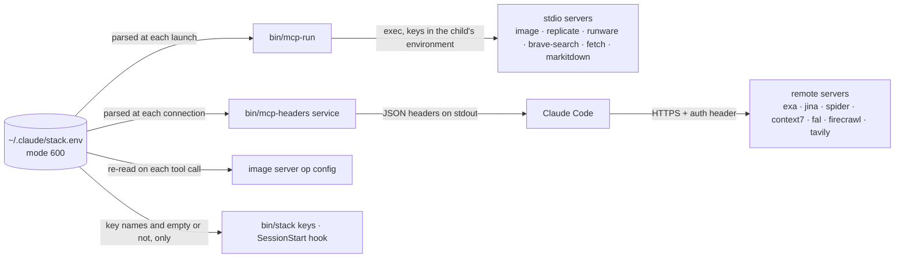

# MCP servers, keys and the image server

The stack talks to the outside world through MCP servers: six remote or stdio servers for browsing, fetching,
search, crawling and library docs, a project memory (`neural-memory`), one in-house server for images and vectors (`image`), and twelve optional servers that
can be switched on per project. The stack servers are defined in `config/mcp.servers.json` and connect only inside
the agents that use them ([Lazy loading](#lazy-loading)). Every credential lives in one file outside the repository and reaches a
server by one of two routes: the stdio launcher `bin/mcp-run` or the HTTP header helper `bin/mcp-headers`.

## Where keys live

Secrets live only in `~/.claude/stack.env`. Set `CLAUDE_STACK_ENV` to use another path; every reader below
honours it.

- `./install.sh` (`stack/install.py` `base()`) copies `config/stack.env.example` to `~/.claude/stack.env` if the
  file does not exist and sets mode `600`. If the file exists with any group or other permission bit set
  (`mode & 0o077`), it tightens the mode back to `600`.
- `.gitignore` excludes `*.env` and `.env*` (except `config/stack.env.example`). `.claude/settings.json` denies
  `Read(~/.claude/stack.env)` and `Bash(cat ~/.claude/stack.env*)`, so agents cannot read the file through their
  own tools.
- `config/mcp.servers.json` (and its inline copies in agent frontmatter), `.mcp.json`, `config/mcp.optional.json`
  and `.claude/settings.json` contain no key values and no `${VAR}`
  placeholders for keys. They contain only launcher paths and service names.



## File format and parser rules

The file is **parsed, never sourced**, so a line in it can never execute code. There are four readers, and they
implement the same grammar: `stack/envfile.py` (Python tooling), its copy `parse_env_text()` in
`stack_mcp/image_router/config.py` (the image server), `bin/mcp-run` and the `getkey()` function in
`bin/mcp-headers` (both bash).

1. Leading whitespace is stripped. Empty lines and lines starting with `#` are skipped.
2. An optional `export ` prefix is removed.
3. The line must contain `=`. The key is everything before the first `=` and must match
   `^[A-Za-z_][A-Za-z0-9_]*$`, so `KEY = v` (with a space) and `1KEY=v` are ignored.
4. If the whole value is wrapped in matching `"…"` or `'…'`, the quotes are removed and the content is kept
   verbatim, `#` included.
5. Otherwise an inline comment is cut at the first whitespace followed by `#`, and surrounding whitespace is trimmed.

| Line | Value |
|---|---|
| `export B=exported` | `exported` |
| `C="a # b"` | `a # b` |
| `E=abc # note` | `abc` |
| `F=abc#note` | `abc#note` (no whitespace before `#`) |
| `G="abc" # note` | `"abc"`: the quotes are kept, because a quoted value must span the whole remainder of the line |
| `I=` | empty, which every reader treats as "not set" |

The readers disagree only when a key appears more than once. `envfile.parse()` and the image server's parser keep
the **last** value.
`bin/mcp-run` keeps the **first non-empty** value. `bin/mcp-headers` uses the **first** matching line, even if that
line is empty. Define each key exactly once.

## Delivering keys: `bin/mcp-run` and `headersHelper`

**stdio servers** start as `bin/mcp-run <command> [args…]`. The script:

1. Prepends `$HOME/.local/bin:/opt/homebrew/bin:/usr/local/bin` to `PATH`, because the PATH that Claude Code passes
   may lack `uv`, `uvx` and Homebrew's `npx`. This is why the keyless `fetch` and `markitdown` servers also launch
   through it.
2. Parses the env file and `export`s each key, but only if that variable is unset or empty in the inherited
   environment. With `STACK_ENV_OVERRIDE=1`, file values replace inherited ones.
3. Runs `exec "$@"`. The server replaces the launcher process and holds the keys only in its own environment. Run
   without arguments, the script prints `usage: mcp-run <command> [args...]` and exits with code `64`.

**Remote (http) servers** carry a `headersHelper` command instead of `headers`.

```json
"headersHelper": "d=\"${CLAUDE_PROJECT_DIR:-$PWD}\"; [ -x \"$d/bin/mcp-headers\" ] || d=\"$HOME/.claude/stack\"; exec \"$d/bin/mcp-headers\" exa"
```

Claude Code runs the helper on every connection, with a 10-second limit, and before running it strips
credential-looking variables from the environment. The helper therefore reads the env file itself and prints one
JSON object. The service comes from `$1`, or from `CLAUDE_CODE_MCP_SERVER_NAME` if no argument is given.

| Service | Header | Key |
|---|---|---|
| `exa` | `x-api-key: <value>` | `EXA_API_KEY` |
| `fal` | `Authorization: Key <value>` | `FAL_KEY` |
| `jina` | `Authorization: Bearer <value>` | `JINA_API_KEY` |
| `spider` | `Authorization: Bearer <value>` | `SPIDER_API_KEY` |
| `context7` | `Authorization: Bearer <value>` | `CONTEXT7_API_KEY` |
| `firecrawl` | `Authorization: Bearer <value>` | `FIRECRAWL_API_KEY` |
| `tavily` | `Authorization: Bearer <value>` | `TAVILY_API_KEY` |

If the key is missing or empty, the helper prints `{}`, so services with an anonymous tier (Exa, Jina's `read_url`,
Context7) still connect. For an unknown service it writes `mcp-headers: unknown service '<name>'` to stderr and
prints `{}`. Values are JSON-escaped (backslash and double quote).

**Why keys never reach argv or settings.** Process arguments are visible to every local user through `ps`, and
settings files are committed, so neither is used. The alternative, `"headers": {"x-api-key": "${EXA_API_KEY}"}`,
would need the key in Claude Code's own environment. Every Bash command and child process an agent starts would
inherit it, and some credential-like variables expand to empty inside remote `url`/`headers`. With the helper and
the launcher, a key exists only inside the one server process or HTTP connection that uses it.

**Paths.** Stack servers (`config/mcp.servers.json`) find their launcher with
`d="${CLAUDE_PROJECT_DIR:-$PWD}"; [ -x "$d/bin/mcp-run" ] || d="$HOME/.claude/stack"`: stdio servers run
`sh -c '…; exec "$d/bin/mcp-run" …'` and `headersHelper` uses the same lookup for `bin/mcp-headers`, so they work in
the repository and from a `--user` install. `~/.claude/stack` is the symlink to the repository that `install.sh`
creates. Optional servers use `${CLAUDE_PROJECT_DIR:-.}` for stdio commands and
`${CLAUDE_PROJECT_DIR:-$HOME/.claude/stack}` for header helpers. `./install.sh --user` registers only `.mcp.json`
servers at user scope (none by default, so an optional server only after `bin/stack mcp enable`), after replacing
both placeholders with the absolute `~/.claude/stack` path and dropping keys that start with `_` (the commands and
an example are in [Installation](installation.md#installation)). The Agent SDK rewrites the same placeholders to the
repository path ([MCP servers outside the repository](sdk.md#mcp-servers-outside-the-repository)).

## Checking keys: `bin/stack keys`

`bin/stack keys` (`cmd_keys` in `stack/cli.py`) prints the env-file path with `present` or `MISSING`. It then prints
each `expected_keys` entry from `config/policy.json` as `set` or `missing`, followed by an `optional:` block for
`optional_keys`. A key counts as set only when its value is non-empty (`envfile.missing()`). The command reads only
the file, never `os.environ`, and never prints a value.

- `expected_keys`: `EXA_API_KEY`, `JINA_API_KEY`, `SPIDER_API_KEY`. The `SessionStart` hook names any that are
  missing in its context line: "Missing keys in ~/.claude/stack.env: … (those MCP servers run anonymous or fail)."
- `optional_keys`: the `IMAGE_<OP>_URL` / `_KEY` / `_MODEL` triples for `GEN`, `REF`, `EDIT`, `TRANSPARENT`,
  `SEGMENT`, `BG_REMOVAL`, `UPSCALE`, `VECTOR` and `TRACE`, plus `CONTEXT7_API_KEY`, `FIRECRAWL_API_KEY`,
  `TAVILY_API_KEY` and `BRAVE_API_KEY`.

`REPLICATE_API_TOKEN` is not in the template, and `FAL_KEY` appears there only as a commented-out line. Add or
uncomment them before you enable the `replicate` or `fal` optional server.

## Stack servers (`config/mcp.servers.json`)

The eight servers are not in `.mcp.json` (it is `{"mcpServers": {}}`); each is defined once in the catalog
`config/mcp.servers.json` (`{"_doc": …, "servers": {name: config}}`) and copied inline into the agents that use it
([Lazy loading](#lazy-loading)). `enabledMcpjsonServers` in `.claude/settings.json` is therefore `[]`.
Tool names are unchanged (`mcp__<server>__<tool>`), so `permissions.allow` still contains
`mcp__exa`, `mcp__jina`, `mcp__spider`, `mcp__image`, `mcp__context7`, `mcp__desktop-sandbox`, `mcp__fetch` and `mcp__neural-memory`. Playwright is absent from that list, so its
browser actions still ask for permission. `MAX_MCP_OUTPUT_TOKENS` is raised to `40000` in the settings `env` block.

| Server | Transport and endpoint | Key | Tools (`mcp__<server>__…`) | Used by |
|---|---|---|---|---|
| `playwright` | stdio `npx -y @playwright/mcp@latest --headless --isolated --caps=vision,pdf,devtools --output-dir=.stack/playwright --viewport-size=1280x800` | none | `browser_navigate`, `browser_snapshot`, `browser_click`, `browser_type`, `browser_fill_form`, `browser_take_screenshot`, `browser_network_requests`, `browser_evaluate`, `browser_tabs`, …; `vision`: `browser_mouse_*_xy`; `pdf`: `browser_pdf_save`; `devtools`: tracing and video | `browser-operator`, `tester` |
| `exa` | http `https://mcp.exa.ai/mcp?tools=web_search_exa,web_fetch_exa,web_search_advanced_exa,agent_run` | `EXA_API_KEY` (anonymous works with rate limits; `agent_run` needs the key) | the four named in `?tools=`, which replaces Exa's two-tool default | `quick-researcher`, `deep-researcher`, `web-searcher`, `fact-checker`, `paper-researcher` |
| `jina` | http `https://mcp.jina.ai/v1` | `JINA_API_KEY` (`read_url` and `capture_screenshot_url` work without it) | `read_url`, `search_web`, `search_arxiv`, `search_ssrn`, `search_images`, `extract_pdf`, `sort_by_relevance`, `deduplicate_strings`, `capture_screenshot_url`, `guess_datetime_url`, `primer`, `search_jina_blog` | researchers, `source-summarizer`, `web-scraper` |
| `fetch` | stdio `mcp-run uvx --python 3.14 mcp-server-fetch` (official server) | none (free) | `fetch(url, max_length=5000, start_index=0, raw=false)`: one URL to markdown, or raw text/JSON with `raw`; honours robots.txt | the eight research agents (`quick-researcher`, `deep-researcher`, `web-searcher`, `web-scraper`, `web-crawler`, `fact-checker`, `paper-researcher`, `source-summarizer`) as the first rung of the free-first ladder |
| `spider` | http `https://mcp.spider.cloud/mcp` | `SPIDER_API_KEY` (required) | `spider_crawl`, `spider_scrape`, `spider_search`, `spider_links`, `spider_screenshot`, `spider_transform`, `spider_get_credits`, `spider_ai_*`, `spider_browser_*` | `web-scraper`, `web-crawler`, `deep-researcher` |
| `context7` | http `https://mcp.context7.com/mcp` | `CONTEXT7_API_KEY` (optional, raises rate limits) | `resolve-library-id`, `query-docs` | language and domain experts, `architect` |
| `neural-memory` | stdio `sh -c '…; exec "$d/bin/neural-memory-mcp"'` (`neural-memory==4.62.0` via `uvx --python 3.14`, command `nmem-mcp`) | none | minimal tier: `nmem_recall`, `nmem_context`, `nmem_recap` (read), `nmem_remember` (write); see [NeuralMemory](#neuralmemory) | `orchestrator`, `planner`, `architect`, `debugger`, `reviewer` |
| `desktop-sandbox` | stdio `sh -c '…; exec "$d/bin/mcp-run" --only DESKTOP_SANDBOX_ "$d"/bin/desktop-sandbox'` | none (the `--only` filter exports no keys) | see [The desktop-sandbox server](#the-desktop-sandbox-server) | `computer-operator`, `tester` |
| `image` | stdio `sh -c '…; exec "$d/bin/mcp-run" "$d"/bin/image-router'` | `IMAGE_<OP>_KEY` per operation | see [The image server](#the-image-server) | `image-generator`, `image-editor`, `vector-artist`, `visual-reviewer`, `graphic-design-expert` |

**Free first.** For a URL already in hand, agents read it with `fetch` (free, no key) and escalate only when it
cannot do the job: `jina` `read_url`/`extract_pdf` for PDFs, passage questions or 2-5 URLs per call (metered with a
key), `spider` for JavaScript-rendered or bot-protected pages and crawls (paid), Playwright for interaction. Long
pages are paged with `start_index` rather than handed to a paid reader. The ladder lives in the `web-search-tools`
skill and in each research agent's operating procedure.

Host computer use is not in the catalog. The built-in `computer-use` server, enabled once through `/mcp`, is
used by `computer-operator`. `bin/stack doctor` treats `computer-use` and `claude-in-chrome` as known built-ins
(`BUILTIN_MCP`) when it checks agents' `mcpServers` lists; built-ins stay plain names there. Sandboxed computer use
is in the catalog as `desktop-sandbox`.

### The desktop-sandbox server

`desktop-sandbox` (`stack_mcp/desktop_sandbox/`, Python 3.14 under uv, `mcp` 2.x) is sandboxed computer use. It
drives a disposable Linux desktop (Xvfb, openbox, xdotool) in a container that the server starts on
`sandbox_start` and removes on `sandbox_stop`, after the idle timeout, at the hard lifetime, and when the server
exits. The server exits when its agent finishes, because the server is inline in the frontmatter of
`computer-operator` and `tester` only. Its 15 tool schemas stay deferred until the agent loads the ones it needs
with `ToolSearch select:` (skill `sandboxed-computer-use`, section 2).

| Control | Value |
|---|---|
| Container flags (fixed; no tool argument changes them) | `--network none` (or `bridge` only if the user sets `DESKTOP_SANDBOX_NETWORK=bridge`), `--read-only`, tmpfs `/tmp` and home, `--cap-drop ALL`, `--security-opt no-new-privileges`, non-root `--user`, `--pids-limit 512`, memory = swap = 2g, 2 CPUs, one writable bind mount `.stack/sandbox/<id>/exchange` → `/exchange` (plus read-only generated `/etc/passwd` and `/etc/group` so the host uid has an account), no Docker socket, no devices |
| Image | `stack_mcp/desktop_sandbox/image/` (Debian slim, setuid bits stripped, tini; the container's main process `sleep MAX_LIFETIME` enforces the lifetime). Built only by the user: `bin/desktop-sandbox --build --profile operator|tester|recommended` (sets in `image/profiles.json`; the image is labelled with its package list, reported by `--check` and `sandbox_status`); further apps via `--packages "libreoffice-calc firefox-esr"` (validated Debian package names); pin the base with `--base <image>@sha256:...` for reviewed builds |
| Keys | `bin/mcp-run --only DESKTOP_SANDBOX_` exports no other variable; the container CLI runs with a minimal environment; the container gets only `SCREEN`, `MAX_LIFETIME`, `HOME`, `DISPLAY` |
| Input guard | `type_text` and `launch` refuse private keys, provider keys and tokens, JWTs, Luhn-valid card numbers and high-entropy strings; key combos must be X keysyms; coordinates must lie on screen; `put_file` copies only project files that are not credential-like, up to 64 MB, with `O_EXCL` and `O_NOFOLLOW` |
| Exchange hygiene | symlinks, devices and FIFOs the sandbox plants in `/exchange` are deleted before every listing, `put_file` and stop; setuid bits are stripped |
| Budgets | 600 input actions, 10 min idle, 30 min lifetime (`DESKTOP_SANDBOX_MAX_ACTIONS`, `_IDLE_MINUTES`, `_MAX_MINUTES`, all clamped) |
| Hooks | `post-web` scans every text result; `pre-tool` covers every input tool (`type_text`, `key`, `launch`, `put_file`, `click`, `drag`, `scroll`, `move`), so a tainted agent can only observe and stop |
| Audit | `.stack/sandbox/<id>/audit.jsonl`: tool, arguments (typed text as length and SHA-256 prefix), ok, duration |

`bin/desktop-sandbox --check` prints the runtime, image and limits. The full threat model is in
`.claude/skills/sandboxed-computer-use/references/security-model.md`.

### Lazy loading

An agent's `mcpServers` frontmatter carries each catalog server as an inline definition, written as a one-line JSON
flow list (JSON is valid YAML flow syntax, so Claude Code reads it natively; `stack/frontmatter.py` parses and
writes it with `json`):

```yaml
mcpServers: [{"exa": {"type": "http", "url": "https://mcp.exa.ai/mcp?tools=…", "headersHelper": "d=…; exec \"$d/bin/mcp-headers\" exa"}}, {"fetch": {"type": "stdio", "command": "sh", "args": ["-c", "…"]}}]
```

Per the [subagent docs](https://code.claude.com/docs/en/sub-agents), "Inline servers defined here are connected when
the subagent starts ... and disconnected when it finishes", while "String references share the parent session's
connection", and with inline-only servers "The subagent gets the tools; the parent conversation doesn't". Every
stack server therefore connects only while an agent that needs it runs and is unloaded when that agent finishes;
the main thread (`delegator`) has no MCP tools and delegates. Tool search (deferred tool schemas, on by default;
`ENABLE_TOOL_SEARCH`) additionally defers the schemas the agent does load.

- **Trust.** Inline servers in a project's `.claude/agents/` load only after the folder is trusted (accept the
  trust dialog once). Inline servers in `~/.claude/agents/` (what `./install.sh --user` symlinks) and SDK
  programmatic agents load without the trust check.
- **Location.** Launchers fall back from `$CLAUDE_PROJECT_DIR`/`$PWD` to `~/.claude/stack` (see **Paths** above),
  so the same inline copy works in the repository and from a `--user` install. Keys still reach servers only through
  `bin/mcp-run` and `bin/mcp-headers`.
- **Sync.** `stack/mcpcat.py` owns the catalog. `bin/stack mcp sync` re-renders the inline copies in every agent
  file from it; `--dry-run` lists out-of-date files and exits 1 if there are any.
  `bin/stack agents set NAME mcpServers=a,b` writes catalog servers inline automatically. Never add a stack server
  to `.mcp.json`: that copy connects for the whole session and defeats lazy loading.

### NeuralMemory

`neural-memory` is an associative memory graph that keeps cross-session project knowledge. `bin/neural-memory-mcp`
runs the pinned `neural-memory==4.62.0` (`uvx --python 3.14 --from …`, command `nmem-mcp`, stdio) with data in
`NEURALMEMORY_DIR`, default `${CLAUDE_STACK_DATA:-~/.claude/stack-data}/neural-memory`. It needs no key.

- **No settings edits.** The package's own first start injects hooks into `~/.claude/settings.json` (unless its
  plugin is installed). The launcher initialises config and brain itself, without hooks, so the server always
  takes its already-initialised path; if that setup fails it refuses to start.
- **Lean tool list.** The launcher sets `version_check_enabled = false` (re-asserted on every start, because the
  package's config writer omits it) and the `minimal` tool tier, so only four tools are listed: `nmem_recall`,
  `nmem_context`, `nmem_recap` and `nmem_remember`. The other ~60 tools (forget, edit, import, train, sync,
  backup, licensing, …) are not listed, and Claude Code calls only listed tools.
- **Who gets it: the main thread, shared.** `neural-memory` is a *shared* server (`"shared": {"neural-memory":
  "delegator"}` in `config/mcp.servers.json`). Only the `delegator` carries it inline, so it starts once when the
  delegator runs as the main thread (`bin/claude-stack`, `claude --agent delegator`, `bin/stack-sdk run`) and
  stays up for that session. `orchestrator`, `planner`, `architect`, `debugger` and `reviewer` reference it by
  name and share that connection, so there is one server process and one SQLite writer per session. Sessions
  without the delegator as the main thread have no memory, and those agents carry on without it. Each of the six
  has a `## Memory` body section: recall at the start and treat results as leads to verify; remember a few durable
  facts; never store secrets, personal data or web text. Web-reading agents do not get it (a stored injection would
  persist across sessions). Under the SDK with programmatic agents (no `--agent`), the runner passes the main
  agent's inline servers as session servers so the sharing works the same way.
- **Taint guard.** Every `mcp__neural-memory__*` tool except the read-only `nmem_recall`, `nmem_context`,
  `nmem_recap`, `nmem_situation`, `nmem_health` and `nmem_stats` is a risky action ("writing persistent memory")
  for the `pre-tool` hook, so a tainted agent's memory writes are denied while reads stay allowed
  ([Web content safety](web-safety.md#web-content-safety-prompt-injection)).

## Optional servers and `bin/stack mcp`

| Name | Transport and endpoint | Auth | Tools |
|---|---|---|---|
| `fal` | http `https://mcp.fal.ai/mcp` | `FAL_KEY` via `mcp-headers fal` | about 60: `search_models`, `get_model_schema`, `recommend_model`, `run_model`, `submit_job(s)`, `wait_for_jobs`, `get_job_result`, `upload_file`, `create_entity` (reusable characters and styles from 1-20 references); it cannot read local paths |
| `fal-oauth` | http `https://mcp.fal.ai/mcp-relay` | OAuth via `/mcp` | as `fal` |
| `replicate` | stdio `mcp-run npx -y replicate-mcp@latest` | `REPLICATE_API_TOKEN` | one tool per HTTP API operation (`models.search`, `predictions.create`, `predictions.get`, …) |
| `recraft` | http `https://mcp.recraft.ai/mcp` | OAuth (subscription credits) | `generate_image` (including `_vector` models), `image_to_image`, `create_style`, `vectorize_image`, `remove_background`, `replace_background`, `crisp_upscale`, `creative_upscale` |
| `flux` | http `https://mcp.bfl.ai` | OAuth | FLUX.2 generation and variations |
| `runware` | stdio `mcp-run npx -y @runware/mcp` | `RUNWARE_API_KEY` | `run`, `model_schema`, `list_models`, `model_details`, `model_pricing`, `list_capabilities`, `model_search`, `media_storage`, `model_upload`, `account`, `get_task_details` |
| `peekaboo` | stdio `npx -y @steipete/peekaboo mcp` | none; Screen Recording and Accessibility permissions for the app running Claude Code | `see`, `click`, `type`, `press`, `scroll`, `app`, `window`, `menu`, `drag`, `clipboard`, `analyze`, …; computer use for headless (`-p`) runs, where the built-in server is unavailable |
| `firecrawl` | http `https://mcp.firecrawl.dev/v2/mcp` | `FIRECRAWL_API_KEY` (Bearer) | without a key: `firecrawl_scrape`, `firecrawl_search`, `firecrawl_parse`; with a key, 27 tools including `firecrawl_map`, `firecrawl_crawl`, `firecrawl_agent` |
| `tavily` | http `https://mcp.tavily.com/mcp/` | `TAVILY_API_KEY` (Bearer) | `tavily_search`, `tavily_extract`, `tavily_map`, `tavily_crawl`, `tavily_research` |
| `brave-search` | stdio `mcp-run npx -y @brave/brave-search-mcp-server --transport stdio` | `BRAVE_API_KEY` | `brave_web_search`, `brave_local_search`, `brave_image_search`, `brave_news_search`, `brave_video_search`, `brave_summarizer`, `brave_place_search`, `brave_llm_context` |
| `markitdown` | stdio `mcp-run uvx --python 3.14 markitdown-mcp` | none | `convert_to_markdown(uri)` for PDF, Office and HTML |
| `indesign` | stdio `mcp-run --only INDESIGN_ npx -y indesign-nutria-mcp@1.6.1` | none | about 190 InDesign document, text, style and export tools ([Adobe apps](#adobe-desktop-apps)) |
| `illustrator` | stdio `mcp-run --only ILLUSTRATOR_ npx -y illustrator-mcp-server@1.10.3` | none | about 66 Illustrator tools over ExtendScript |
| `photoshop` | stdio `mcp-run --only PHOTOSHOP_ uv run --python 3.14 --directory ~/.claude/stack-data/adobe/adb-mcp/mcp ... mcp run ps-mcp.py` | none | Photoshop layers, selections, filters, text and export (adb-mcp) |
| `after-effects` | stdio `mcp-run --only AFTER_EFFECTS_ node ~/.claude/stack-data/adobe/after-effects-mcp/build/index.js` | none | compositions, layers, keyframes and expressions through an ExtendScript bridge |
| `premiere-pro` | stdio `mcp-run --only PREMIERE_MCP_ npx -y premiere-pro-mcp@1.25.0` | none | about 440 sequence, clip, effect and export tools through a CEP panel |

`bin/stack mcp` (`cmd_mcp` in `stack/cli.py`) works on `.mcp.json`, `config/mcp.optional.json`,
`config/mcp.servers.json` and `.claude/settings.json`.

- `list` prints one row per server, `%-14s %-9s %s`: the name, `lazy` (catalog), `active` (`.mcp.json`) or
  `optional`, and the URL or command line.
  An inactive optional server gets a second line with its `_note`.
- `enable NAME` fails with `unknown server NAME` if the name is in neither file. Otherwise it copies the optional
  entry into `.mcp.json` without its `_`-prefixed keys, appends `NAME` to `enabledMcpjsonServers` and appends
  `mcp__NAME` to `permissions.allow`. An enabled server is session-wide, not lazy.
- `sync [--dry-run]` re-renders inline catalog servers in agent files ([Lazy loading](#lazy-loading)).
- `disable NAME` removes the entry and both settings items.
- Both files are written atomically (temporary file, then `os.replace`), and the command prints
  `<enable|disable>d NAME (restart Claude Code or run /mcp to reconnect)`. OAuth servers then authenticate through
  `/mcp`.
- `enable` copies only from `config/mcp.optional.json`, and `disable` edits only `.mcp.json` and the settings (on a
  catalog server it just removes `mcp__NAME` from `permissions.allow`). To change a catalog server, edit
  `config/mcp.servers.json` and run `bin/stack mcp sync`.

`bin/stack doctor` checks this configuration: `check_mcp` validates `.mcp.json` and the catalog (URLs, commands,
executable launchers, placeholder and `"$d"/<path>` paths, transport types; error if the catalog is missing or
empty; warnings for a server in both files and for `alwaysLoad: true`), and `check_agents` reports an agent whose
`mcpServers` names a server that neither `.mcp.json`, the catalog nor `BUILTIN_MCP` defines, an inline entry not in
the catalog, or an inline copy that is missing or differs from the catalog ([Doctor](installation.md#doctor)).

### Adobe desktop apps

Five optional servers drive the Adobe apps installed on this Mac. Each app must be running, and each needs a
one-time app-side component. Register them for every project with `./install.sh --adobe` (or
`--adobe photoshop,indesign`), or for this repository only with `bin/stack mcp enable <name>`. The installer
prints each server's `_setup` line and downloads nothing. All five are community projects (MIT); `mcp-run --only
<PREFIX>` keeps every stack key out of their environment.

| Server | Project | App-side setup |
|---|---|---|
| `indesign` | github.com/nutriandrea/adobe-indesign-mcp (npm `indesign-nutria-mcp`) | load its `plugin/` "MCP Bridge" UXP panel with Adobe UXP Developer Tool (bridge on ws 8120), or set `INDESIGN_APP` in `~/.claude/stack.env` for the plugin-free macOS JXA proxy |
| `illustrator` | github.com/ie3jp/illustrator-mcp-server (npm `illustrator-mcp-server`) | none; Illustrator 2024+ running, allow automation when macOS asks |
| `photoshop` | github.com/mikechambers/adb-mcp | `git clone https://github.com/mikechambers/adb-mcp ~/.claude/stack-data/adobe/adb-mcp`; keep `node adb-proxy-socket/proxy.js` running (ws 3001); UXP Developer Tool > Add Plugin > `uxp/ps/manifest.json`, then Connect (again after each Photoshop restart) |
| `after-effects` | github.com/Dakkshin/after-effects-mcp (not on npm) | clone to `~/.claude/stack-data/adobe/after-effects-mcp`, then `npm install && npm run build && npm run install-bridge`; in After Effects open Window > `mcp-bridge-auto.jsx` and tick "Auto-run commands" |
| `premiere-pro` | github.com/leancoderkavy/premiere-pro-mcp (npm `premiere-pro-mcp`) | install its CEP panel (`artifacts/MCPBridgeCEP.zxp`), open Window > Extensions > "MCP for Adobe Premiere Pro"; FFmpeg for trim and slip; `PREMIERE_MCP_CAPABILITIES` narrows the tool set |

Versions are pinned. Read a release before bumping it, because these servers run code inside your apps. Adobe's
official "Adobe for creativity" connector (`https://adobe-creativity.adobe.io/mcp`) is a hosted cloud service that
does not drive the desktop apps and has no After Effects. Illustrator Beta 30.4+ also ships a built-in MCP (a URL
and key in its settings, connected with `mcp-remote`). Neither is registered by `--adobe`.

## The image server

`image` is the stack's own MCP server, in `stack_mcp/image_router/`. It runs on Python 3.14 under uv and uses the mcp
2.3 SDK (`MCPServer`), httpx, Pillow, resvg-py, vtracer, svglib, reportlab and pikepdf. It exists because no hosted
image MCP covers this whole job: reading local files, normalising masks per provider, keeping unmasked pixels exact,
and producing layered SVG/PDF. It follows four rules:

- **BYOK, one endpoint per operation.** `~/.claude/stack.env` sets a URL, a key and a model tag for each operation.
- **No fallbacks.** An operation uses exactly its configured endpoint and model. If that call fails, the error is
  returned; the server never tries another provider.
- **A tool per operation.** A tool appears only when its operation is configured.
- **Claude edits vectors.** By default the agent edits SVG text directly, helped by local inspection and rendering
  tools.

### Launch chain

```
config/mcp.servers.json "image"   (inline in the image agents)
  sh -c                resolve d = $CLAUDE_PROJECT_DIR, $PWD or ~/.claude/stack
  bin/mcp-run          parse ~/.claude/stack.env into the environment, fix PATH, exec
  bin/image-router     source bin/_pyenv.sh; PYTHONPATH=$REPO; exec python -m stack_mcp.image_router
  bin/_pyenv.sh        resolve symlinks to $REPO; interpreter: $CLAUDE_STACK_PYTHON > $REPO/.venv/bin/python
                       > uv run --quiet --project $REPO --python 3.14 python > python3 (with a warning)
  stack_mcp.image_router   MCPServer over stdio: stdout carries JSON-RPC only, diagnostics go to stderr
```

The working directory is left untouched, so relative paths resolve against the project that Claude Code runs in.
The project directory is `CLAUDE_PROJECT_DIR` if it is set to an existing directory, otherwise the current directory.

### Operations and environment

| Env prefix | Tool | What it does | `API=local` |
|---|---|---|---|
| `IMAGE_GEN` | `image_generate` | text to image | no |
| `IMAGE_REF` | `image_generate_with_references` | generation guided by 1..N reference images | no |
| `IMAGE_EDIT` | `image_edit` | instruction edit; with `mask`, inpainting plus preservation of unmasked pixels | no |
| `IMAGE_TRANSPARENT` | `image_generate_transparent` | generation straight to RGBA PNG | no |
| `IMAGE_SEGMENT` | `image_segment` | prompt to a white-on-black mask PNG at the source size (`IMAGE_MASK_*` is accepted as a deprecated alias) | no |
| `IMAGE_BG_REMOVAL` | `image_remove_background` | cutout, with the model's alpha transferred onto the original pixels | no |
| `IMAGE_UPSCALE` | `image_upscale` | faithful upscaling | yes (Pillow Lanczos) |
| `IMAGE_VECTOR` | `vector_generate` | native SVG generation, optionally `layered=true` | no |
| `IMAGE_TRACE` | `image_vectorize` | raster to SVG tracing, optionally `layered=true` (one layer per colour) | yes (vtracer) |
| `IMAGE_VECTOR_MANIPULATION` | `svg_transform` | SVG edit by an external model; registered only when `MODEL` is set and is not `claude` | no |

Each prefix takes five variables.

- `<PREFIX>_URL`: the router base URL, for example `https://openrouter.ai/api/v1`, `https://api.opper.ai` or
  `https://queue.fal.run`.
- `<PREFIX>_KEY`: the key for that router.
- `<PREFIX>_MODEL`: the model tag as the router names it, for example `google/gemini-nano-banana-2.1` or
  `fal-ai/bria/background/remove`.
- `<PREFIX>_API` (optional): `openrouter`, `opper`, `openai` or `fal`, plus `local` for UPSCALE and TRACE. When
  unset, it is detected from the URL host: `openrouter.ai` gives `openrouter`; `opper.ai` gives `opper`; `fal.run`,
  `queue.fal.run` and `*.fal.ai` give `fal`; any other host gives `openai` (OpenAI-compatible).
- `<PREFIX>_PARAMS` (optional): a JSON object merged into every request for that operation.

```bash
IMAGE_GEN_URL=https://openrouter.ai/api/v1
IMAGE_GEN_KEY=<OpenRouter API key>
IMAGE_GEN_MODEL=google/gemini-nano-banana-2.1
# keep OpenRouter on one upstream as well (a quoted value must be alone on its line)
IMAGE_GEN_PARAMS='{"provider":{"allow_fallbacks":false}}'
IMAGE_EDIT_URL=https://api.opper.ai
IMAGE_EDIT_KEY=<Opper runtime key, op-...>
IMAGE_EDIT_MODEL=fal/ideogram-v4.5-edit
IMAGE_BG_REMOVAL_URL=https://queue.fal.run
IMAGE_BG_REMOVAL_KEY=<fal key>
IMAGE_BG_REMOVAL_MODEL=fal-ai/bria/background/remove
IMAGE_TRACE_API=local                                         # no URL, KEY or MODEL needed
IMAGE_VECTOR_MANIPULATION_MODEL=claude                        # default: svg_transform stays hidden
```

The single quotes around `PARAMS` are removed by the parser and the inner JSON is kept verbatim, because nothing
follows the closing quote. A trailing ` # comment` after a quoted value keeps the quotes in the value (see the
`G=` row above) and breaks the JSON.
`config/image-ops.json` documents each operation: its env names, its tool, how each adapter maps the request, and its
default output format. It holds no secrets and no model choices; those come only from `stack.env`.

BYOK here means you hold the router key. Upstream provider keys are attached on the router side. OpenRouter keeps
them in account settings (or `POST /api/v1/byok`), and every request still authenticates with the OpenRouter key.
Opper registers them as project "custom models", called by name, and authenticates with a runtime key starting
`op-`. Opper rejects management keys (`op-mak-…`) on these endpoints.

**Reading and exposure.**

- **Values are read at call time.** On each call the server reads the operation's variables from the env file
  (`CLAUDE_STACK_ENV`, same grammar as `stack/envfile.py`), falling back to `os.environ`. Editing a URL, key, model
  or PARAMS of a registered operation takes effect on the next call, with no restart.
- **Which tools exist is decided at start.** A model-backed tool is registered only when its URL, KEY and MODEL are
  all non-empty, or when `API=local` for UPSCALE or TRACE. Local tools and `image_ops_status` are always registered.
- **A changed env file re-evaluates exposure.** When the env file's mtime changes, the server recomputes the set and
  sends `notifications/tools/list_changed`. If the client does not refresh its tool list, reconnect through `/mcp`.
- **Errors name what is missing.** If a registered operation loses its configuration, the call returns a "not
  configured" error that names the exact env variables to set. An operation pointed at an adapter that does not
  declare it fails with a message naming the operation and the adapter.
- **Key values are never logged, returned or written.** Errors, logs and sidecars show only the URL host and the
  model tag.

`image_ops_status()` lists every operation: whether it is exposed, its adapter, URL host, model tag, and the names of
any missing variables.

**No fallbacks, but retries.** The shared HTTP client (`http.py`) retries only the same request against the same
endpoint. Each tool call gets its own client. The defaults:

- Timeouts: `connect=20`, `read=300`, `write=120`, `pool=30` seconds.
- Retries: `IMAGE_ROUTER_HTTP_RETRIES` (default `3`).
- Backoff: `min(30, 1.5·2^attempt)` seconds, multiplied by a jitter factor in [0.75, 1.25). `Retry-After` is honoured
  and capped at 30 s.
- **Idempotent methods** (GET, HEAD, PUT, DELETE, OPTIONS) retry every transport error and HTTP
  `429/500/502/503/504/520/522/524/529`.
- **POST requests**, which are paid generations, retry only failures that cannot have reached the provider: connect
  errors, connect and pool timeouts, and `429/503/522/529`. A dropped connection, a read timeout or a `500/502/504/520/524`
  may mean the provider is already generating and billing, so those are final.
- `IMAGE_ROUTER_BACKOFF_SCALE` multiplies every sleep. Tests set it to `0`.

### Adapters

There is one module per adapter under `stack_mcp/image_router/providers/`. Each adapter declares which operations
it supports, turns a canonical request (prompt, source image, references, mask, `n`, size or aspect ratio, seed,
background, output format) into its wire format, and returns bytes plus a MIME type. Inputs travel as data URIs, or
as the original `http(s)` URL when the bytes are unchanged.

**OpenRouter** (`IMAGE_<OP>_URL=https://openrouter.ai/api/v1`) has a single image endpoint. `/images/edits` does not
exist and returns 404.

```http
POST {URL}/images
Authorization: Bearer <KEY>
Content-Type: application/json
HTTP-Referer / X-OpenRouter-Title: optional attribution (X-Title is still accepted)

{"model": "<MODEL>", "prompt": "...", "n": 1, "aspect_ratio": "16:9", "seed": 7,
 "background": "transparent", "output_format": "png",
 "input_references": [{"type": "image_url", "image_url": {"url": "data:image/png;base64,..."}}]}
```

- References must be objects, never bare strings (a string returns 400).
- Edits are generations with the source image as the first reference.
- The response is `data[i].b64_json` plus `media_type`. For `output_format: "svg"` (Recraft `*-vector` models) the
  base64 decodes to UTF-8 SVG markup.
- There is no mask parameter. For an `image_edit` with a mask, the adapter sends the mask as an extra reference with
  an explicit instruction ("edit only the white region of the mask image"), records that in `notes`, and relies on
  the local composite below for exactness.
- OpenRouter has no background-removal, segmentation, tracing or upscaling models. Those operations are approximated
  by regeneration, each with a fidelity caveat in `notes`.
- For `image_segment`, the default `strategy` is `render`: the image model is asked for a pure black-and-white mask.
  `IMAGE_SEGMENT_PARAMS={"strategy":"detect"}` instead calls `POST {URL}/chat/completions` on a vision model that
  returns boxes. For example, `moondream/moondream3.1-9b-a2b` takes a first text part of `/detect {"object":"cat"}`
  and replies `{"objects":[{x_min,y_min,x_max,y_max}]}` in 0–1 coordinates. The boxes are scaled by the source width
  and height and drawn white on black.

**Opper** (`IMAGE_<OP>_URL=https://api.opper.ai`) has its own image API. There is no OpenAI-compatible images route:
`/v3/compat/images/generations` returns 404.

```http
POST {URL}/v3/images
Authorization: Bearer <KEY>

{"model": "<MODEL>", "prompt": "...", "n": 1, "size": "1024x1024", "quality": "high",
 "image": "data:image/png;base64,...", "mask": "data:image/png;base64,...",
 "reference_images": ["data:image/png;base64,...", "https://...", "file_abc123"],
 "response_format": "b64_json", "store": false,
 "parameters": {"background": "transparent", "output_format": "png"}}
```

- `n` is at most 4.
- Image strings can be `http(s)` URLs, data URIs or `file_<id>`. A `file_<id>` comes from uploading with
  `POST {URL}/v3/files`, multipart field `file`.
- `parameters` is passed unchanged to the provider. Transparent output exists only on GPT Image models, through
  `parameters.background`.
- The response is `{id, model, data:[{b64_json, mime_type, revised_prompt?, url?}], usage}`. The adapter reads
  `mime_type`, because Gemini models return JPEG.
- Size against aspect ratio is validated and normalised from the public catalog, `GET {URL}/v3/images/models`.
- Synchronous calls have a 3-minute server deadline (504 after that, not billed). With `"async": true` (for example
  through `PARAMS`), the call returns 202 `{id, status_url}`. The adapter then polls
  `GET {URL}/v3/artifacts/{id}/status` until `status` is `completed` or `failed`, and downloads `url`.
- Opper has no background-removal, upscale, segmentation or tracing models.

**OpenAI-compatible** (`API=openai`, or any other host): `POST {URL}/images/generations` with a JSON body, and
`POST {URL}/images/edits` as multipart with the parts `image[]`, `mask`, `prompt`, `model`, `background`,
`output_format`, `size` and `n`. The response is `data[].b64_json`, or `url`, which the adapter downloads. The mask
convention is alpha-transparent = edit.

**fal** (`URL=https://queue.fal.run`, `KEY` = the fal key, `MODEL` = an endpoint id such as
`fal-ai/nano-banana-2.1/edit`, `fal-ai/bria/background/remove`, `fal-ai/sam-3/image`,
`fal-ai/topaz/upscale/image`, `fal-ai/recraft/vectorize`, `fal-ai/recraft/v4.1/text-to-vector` or
`fal-ai/flux-pro/v1/fill`) uses the queue API.

- Submit with `POST {URL}/{model}` and `Authorization: Key <KEY>`. The reply is `{request_id, status_url,
  response_url}`.
- Poll `status_url` with backoff: start at 1.0 s, multiply by 1.5 each time, cap at 8 s. Stop on `COMPLETED`; a
  failed run is `COMPLETED` with `error` set. After `IMAGE_ROUTER_FAL_TIMEOUT` (default 900 s) the adapter cancels the
  request.
- Fetch `response_url` and download every `{"url": …}` in the result, found by a recursive walk.
- Parameter names come from each endpoint's live OpenAPI schema,
  `https://fal.ai/api/openapi/queue/openapi.json?endpoint_id=<id>`. The schema is cached in memory and in
  `.stack/cache/fal-schemas/` for 7 days. A failed lookup is retried after 300 s.

The canonical fields map to fal names in priority order:

| Canonical | fal property (first one present wins) |
|---|---|
| references | `image_urls`, `image_url`, `reference_image_urls`, `input_references` |
| image | `image_url`, `image_urls` (a list puts the source first) |
| mask | `mask_url`, `mask_image_url` |
| size | `image_size`, `resolution`, `size` (`WxH` becomes `{width, height}` when the schema accepts that) |
| n | `num_images`, `max_images`, `n` |
| scale | `upscale_factor`, `scale`, `upscaling_factor` |
| transparent | `background: "transparent"`, plus `output_format` `png` (or `webp`) |
| segmentation | `mask_only: true`, `apply_mask: false` where the schema has them |

Enum values match case-insensitively. Canonical fields the endpoint lacks are dropped and listed under ignored
parameters. If the endpoint has nowhere to put a source image, reference, mask or prompt that the operation needs,
the call fails instead of sending a request that would silently drop it. Mask conventions differ by endpoint:
FLUX Fill uses white = edit and Ideogram uses black = edit.

**local** (`API=local`, UPSCALE and TRACE only, never chosen automatically) is deterministic and calls no model.
`image_upscale` resamples with Pillow Lanczos. `image_vectorize` traces with vtracer (MIT), and `PARAMS` can carry
vtracer options: `colormode`, `hierarchical`, `mode`, `filter_speckle`, `color_precision`, `layer_difference`,
`corner_threshold`, `length_threshold`, `max_iterations`, `splice_threshold` and `path_precision`.

**`svg_transform`** (only when `IMAGE_VECTOR_MANIPULATION_MODEL` is set and is not `claude`) sends the SVG text and
the instruction to an OpenAI-compatible `POST {URL}/chat/completions`. It extracts the returned `<svg>…</svg>` and
checks that it is well-formed XML before writing. For Opper, point the URL at `https://api.opper.ai/v3/compat`.

What each service offers per operation. N means a native model or parameter exists. A means the adapter approximates
by regeneration and adds a caveat to `notes`. "no model" means the service has nothing for it.

| OP | OpenRouter | Opper | OpenAI API | fal | local |
|---|---|---|---|---|---|
| GEN, REF | N | N | N (`generations`; `edits` with several `image[]`) | N | — |
| EDIT | N; a mask is sent as a reference, then composited | N (`mask` on mask-capable models, e.g. `fal/ideogram-v4.5-edit`) | N (alpha mask) | N (`mask_url` on fill/inpaint endpoints) | — |
| TRANSPARENT | N on models declaring `background: transparent` (GPT Image 2.5, Riverflow 2.5 Pro) | N (GPT Image via `parameters.background`) | N | N where the schema has `background` | — |
| SEGMENT | A (`render`) or boxes (`detect`) | no model | — | N (`fal-ai/sam-3-1/image`) | — |
| BG_REMOVAL | A, then alpha transfer | no model | — | N (`fal-ai/bria/background/remove`) | — |
| UPSCALE | A (regenerate at 4K) | no model | — | N (`topaz/upscale/image/precision`; a transparent source keeps its alpha) | Lanczos |
| VECTOR | N (`recraft/recraft-v4.1-vector`, `output_format: "svg"`) | not verified to return SVG; a raster reply is an error | — | N (`fal-ai/recraft/v4.1/text-to-vector`), or a raster model with strategy `trace` / `layerize` (`ideogram/v4.5`) | — |
| TRACE | A (vector model with the raster as a reference) | no model | — | N (`fal-ai/recraft/vectorize`) | vtracer |

### Vector strategies for raster models

A raster model such as Ideogram can fill the VECTOR slot through two router-side strategies, set in
`IMAGE_VECTOR_PARAMS` (any other keys there go to the drawing call, e.g. `"quality":"medium"`):

| Strategy | Pipeline | Result |
|---|---|---|
| `trace` | the VECTOR model draws a raster; the TRACE configuration vectorizes it | one `Artwork` layer, or one layer per colour with `layered=true` |
| `layerize` (fal only) | draw; `fal-ai/ideogram/v3/layerize-text` (override with the `layerize_model` directive) removes the lettering and returns its boxes, fonts and styled spans; TRACE vectorizes the text-free artwork; `textlayer.compose` rebuilds the lettering as live `<text>` | `Artwork` layer(s) plus a `Text` layer on top: text stays editable in design tools, by Claude as SVG text, and as text in `export_pdf`'s layered PDF |

Both need TRACE configured (fal Recraft vectorize, or `IMAGE_TRACE_API=local`). The draft raster and, for
`layerize`, the text-free artwork are written next to the SVG with their own sidecars, and the SVG's sidecar records
every stage (`pipeline`: models, endpoints, text containers). Text boxes come in the draft's pixel space and are
mapped onto the traced viewBox; lines are centred in their box with the baseline 0.35 em below each line centre.
Fonts are named (`font-family`, `data-font-file`): `export_pdf` falls back to Helvetica unless the font is available,
so for print either install the font or convert the text to outlines.

### Masks and fidelity post-processing

These steps run locally and deterministically after a model returns. They are not a provider fallback.

**Canonical mask.** Inside the server a mask is a single-channel image where white means edit and black means keep.
`imaging.canonical_mask()` derives it from what the caller passes:

- An RGBA or LA mask with any transparent pixel: edit where alpha < 128 (the OpenAI convention).
- Any other mask: edit where luminance ≥ 128.

A mask whose size differs from the image's, or one that selects nothing, is rejected with a message. Adapters convert
the canonical mask to one of three conventions: `white-edit` (L PNG), `black-edit` (L PNG, inverted) or
`alpha-transparent` (RGBA with alpha 0 to edit and 255 to keep). `mask_convert(mask, to, invert?)` exposes the same
conversion as a tool.

**Masked edit** (`image_edit` with `mask`, `preserve_unmasked=true` by default). Let `S` be the source (W×H), `R` the
model result resized to W×H (models often snap sizes to multiples of 16 or 64 px), and `m` the canonical mask feathered
by 1–2 px and scaled to [0, 1]. Then

```
out(p) = S(p)·(1 − m(p)) + R(p)·m(p)
```

The feather ramps inwards only (about 50% at the mask edge, 100% inside), so every pixel outside the mask has
`m = 0` and is byte-identical to the source, whatever the model did to it. This turns prompt-guided "edit only here" models, including OpenRouter's maskless ones, into
exact inpainting. `preserve_unmasked=false` returns `R` unchanged.

**Background removal** (`image_remove_background`, `preserve_pixels=true` by default). When the model returns an RGBA
image of the same composition, the server keeps the original colour and takes only the alpha:
`out = (S_r, S_g, S_b, α_R)`, with `R` resized to the source. Regenerating models redraw the subject, so the server
measures how far the model's colours moved inside the cutout:

```
A     = { p : α_R(p) ≥ 128 }
drift = (1 / (3·|A|)) · Σ_{p∈A} Σ_{c∈{r,g,b}} |R_c(p) − S_c(p)|      (0–255 levels)
```

When drift is high (above 18 levels, `imaging.DRIFT_WARN`), `notes` warns that the matte may not fit the original
silhouette.

**Upscale transparency** (`image_upscale`). Most upscalers return opaque RGB, which would flatten a transparent
source. When the source has transparency and the result does not, the server scales the source alpha to the output
size (Lanczos) and reattaches it (`imaging.reattach_alpha`), noting it in `notes`; a result of another aspect ratio
gets a warning instead.

**Segmentation output** (`image_segment`, `imaging.normalize_mask_output()`) always returns a white-on-black L PNG at
the source size:

- If the reply has any transparency, `mask = [α ≥ 128]` (opaque = object).
- Otherwise `mask = [max(R, G, B) ≥ 128]`, so a coloured overlay on black still counts.
- The grey level is resized to the source size (bilinear) before the 128 threshold, so edges stay smooth; the mask
  is then optionally inverted. `union_masks()` merges per-instance masks with a pixel-wise maximum.

### Local tools (no model, always registered)

| Tool | Signature | Result |
|---|---|---|
| `image_ops_status` | `()` | per operation: exposed, adapter, URL host, model tag, missing env names; never keys |
| `image_info` | `(image)` | width, height, mode, alpha present, format, file size |
| `mask_convert` | `(mask, to: white-edit\|black-edit\|alpha-transparent, invert?)` | converted mask PNG |
| `svg_optimize` | `(svg_path, precision=2, output_path?)` | optimised SVG and byte statistics |
| `svg_inspect` | `(svg_path)` | well-formedness, viewBox and size, element and path counts, palette, layers, text elements, embedded rasters, approximate complexity, flagged problems |
| `svg_render` | `(svg_path, width?, background?)` | PNG preview |
| `svg_layers` | `(svg_path)` | top-level layers: id, label, visibility, element count, palette |
| `svg_layerize` | `(svg_path, by: color\|group\|mapping, mapping?, output_path?)` | layered SVG |
| `layers_compose` | `(layers: [{source, name, opacity?, visible?, x?, y?, width?, height?}], width, height, output_path?)` | one layered SVG |
| `export_pdf` | `(svg_path, output_path?, layered=true, page_size?: auto\|A4\|letter\|WxHmm)` | vector PDF, with optional content groups when layered |

`svg_optimize` (`svg.py`) changes nothing visible beyond the requested rounding:

- It parses with `xml.etree` and refuses documents that declare `<!ENTITY`.
- It drops comments, processing instructions, `<metadata>`, and Inkscape, Sodipodi and Sketch elements and
  attributes, except the layer markers `inkscape:groupmode` and `inkscape:label` on `<g>` elements.
- It rounds numbers in path data and numeric geometry attributes to `precision` decimals (0–8). Integers and arc
  flags are left untouched.
- It adds `viewBox="0 0 W H"` when the root has only unit-less or px width and height.

Because it keeps those layer markers, `svg_optimize` can run before or after `svg_layerize` without losing the
layers. Without `output_path` it writes `<name>.min.svg` next to the input and leaves the input untouched.

`svg_render` rasterises with resvg (resvg-py) to a PNG. `width` scales the output and keeps the aspect ratio, and
`background` is a CSS colour (transparent when omitted). Text, gradients and transforms render. Its job is to let
agents, which can view PNGs with Read but cannot see SVG, look at vectors.

### Layered SVG and layered PDF

`svg_layerize` rewrites a document into top-level Inkscape layers. Inkscape reads these natively, and Illustrator
imports top-level groups as layers:

```xml
<svg xmlns="http://www.w3.org/2000/svg" xmlns:inkscape="http://www.inkscape.org/namespaces/inkscape" viewBox="0 0 512 512">
  <defs>…</defs>                                  <!-- kept once, at the top -->
  <g id="layer-background" inkscape:groupmode="layer" inkscape:label="background">…</g>
  <g id="layer-subject"    inkscape:groupmode="layer" inkscape:label="subject">…</g>
</svg>
```

- `by=color` makes one layer per fill colour. `image_vectorize(layered=true)` uses it for traces.
- `by=group` promotes the existing top-level groups. `vector_generate(layered=true)` uses it for generated SVG.
- `by=mapping` takes `{layer_name: [element ids or CSS-like selectors]}`.

`defs`, paint order and rendered appearance are invariants: the tests compare fixtures before and after.
`layers_compose` builds a W×H document from SVG and PNG sources, each in its own layer, placed by `x`, `y`, `width`
and `height`, with `opacity` and `visible` applied. Raster sources are embedded as `<image>` data URIs.

`export_pdf` draws the vectors with svglib and reportlab. With `layered=true`, pikepdf then wraps each top-level SVG
layer in an Optional Content Group named after its label, so the layers can be toggled in Acrobat and Illustrator.
A non-layered SVG gives a single-layer PDF. PyMuPDF (AGPL) is not used. The structure, using the PDF optional-content
mechanism:

```
Catalog  /OCProperties << /OCGs [12 0 R 13 0 R]  /D << /Order [12 0 R 13 0 R] >> >>
12 0 obj << /Type /OCG /Name (background) >>      13 0 obj << /Type /OCG /Name (subject) >>
Page     /Resources << /Properties << /oc1 12 0 R  /oc2 13 0 R >> >>
Content  /OC /oc1 BDC … background drawing … EMC   /OC /oc2 BDC … subject drawing … EMC
```

`page_size` is `auto` (the SVG's own size), `A4` (210×297 mm, 595.28×841.89 pt), `letter` (8.5×11 in, 612×792 pt) or
`WxHmm`, converted with `pt = mm × 72 / 25.4`. The tests open the result with pikepdf and check that
`/OCProperties` lists every layer.

### Inputs, outputs and sidecars

**Inputs.** An input can be any of these:

- a local path, relative to the project directory, with `~` expanded; at most 64 MiB
- a `file://` URL
- an `http(s)` URL, which is downloaded; at most 128 MiB
- a data URI

MIME types come from magic bytes: PNG, JPEG, WebP, GIF, AVIF, TIFF, BMP, PDF and SVG.

**Outputs.** Files go to `output_dir`, which defaults to `<project>/.stack/images/<YYYYMMDD>/`.

- The name is `<prefix or slug of the prompt, ≤ 40 chars>-<HHMMSS>-<adapter>.<ext>`. Files are created with
  `O_EXCL`, so two concurrent calls never write the same file; a clash adds `-2`, `-3` and so on.
- Each file gets a `<file>.json` sidecar with `op`, adapter, URL host, model tag, prompt or instruction, `params`,
  `inputs` (source, MIME, bytes), `notes`, `created`, `file`, `mime`, `bytes`, and `width`/`height` for rasters.
- Before writing, `io.sanitize()` cleans the sidecar:
  - any field whose name matches `api[_-]?key|token|secret|password|authorization|credential` becomes `<redacted>`;
  - data URIs and base64 runs of 200 or more characters become placeholders such as `<base64 N chars>`;
  - any configured key value that appears in a string becomes `***`;
  - query strings are cut from URLs.
- Tool results return paths, MIME types, dimensions, `notes` and ignored parameters, never image bytes. This keeps
  them far below `MAX_MCP_OUTPUT_TOKENS`.

### The visual review loop

Generation is judged by a separate agent, so the agent producing an image never grades its own work.
[`visual-reviewer`](agents.md#the-visual-reviewer-agent) (ADVANCED tier, `mcpServers: [image]`, `disallowedTools: Agent`) only
judges: it views PNGs with Read, renders vectors with `svg_render`, checks specs with `svg_inspect` and `image_info`,
scores the seven-criterion rubric of the `visual-review` skill and returns PASS, REVISE or STOP with precise revision
instructions.

- **Inside an agent.** `image-generator`, `image-editor` and `vector-artist` run the loop themselves, one reviewer per
  round with `run_in_background: false`. They stop at PASS, after 4 rounds, when the budget reaches `soft`, when the
  image budget is spent, or after two rounds that did not raise the best overall, and return the best attempt with
  the review trail. When the brief asks for editable output they deliver layered SVG or PDF.
- **As a workflow.** `.claude/workflows/visual-iterate.js` runs the same loop deterministically on the main thread,
  recomputes the scores in code and can export the best attempt as layered SVG and layered PDF
  ([visual-iterate](workflows.md#visual-iterate)).
- **Vector edits** default to the agent editing SVG text with Read and Edit, checked with `svg_inspect` and
  `svg_render`. `svg_transform` is used only when an external model is configured.
- **Wiring.** `config/policy.json` lets the three producers spawn `visual-reviewer`, `file-summarizer` and
  `quick-researcher`, and lets `graphic-design-expert` spawn the image agents and `visual-reviewer`;
  `config/models.json` sets `visual-reviewer` to `ADVANCED_MODEL`, `high`, 80; the `image` pack in `config/packs.json`
  includes `visual-reviewer` and the `visual-review` skill.

The server's pytest suite (`uv run --python 3.14 pytest stack_mcp -q`) is described in [Testing](installation.md#testing).
