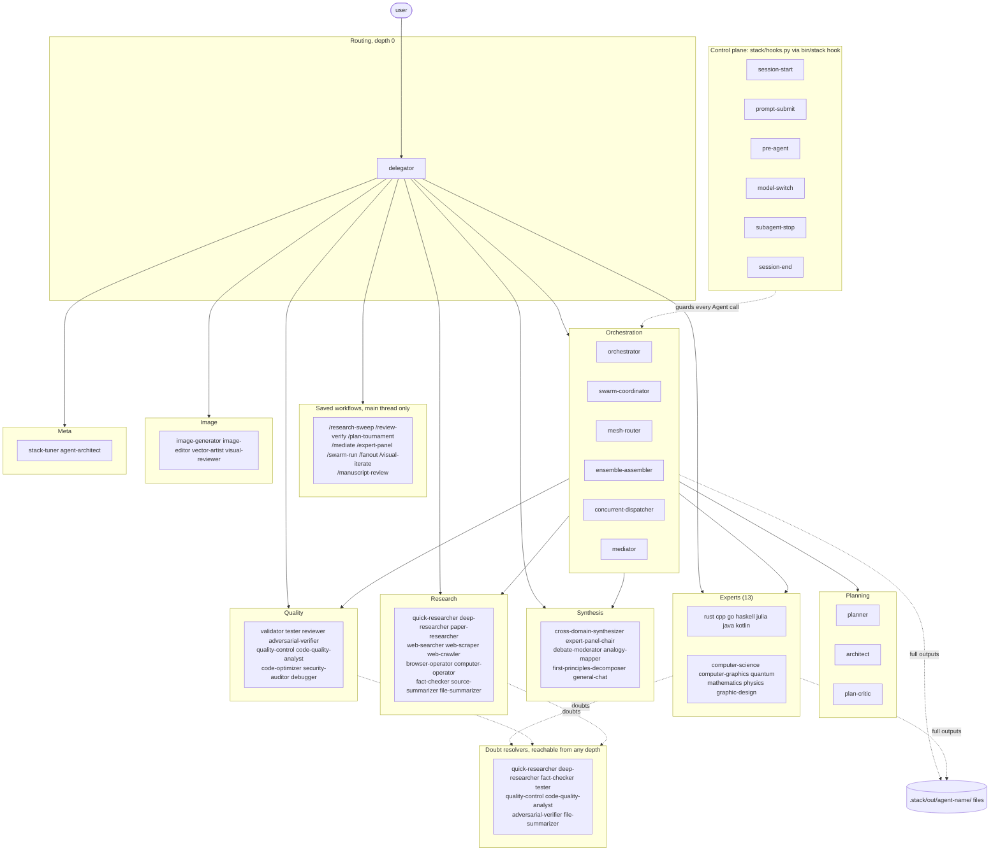
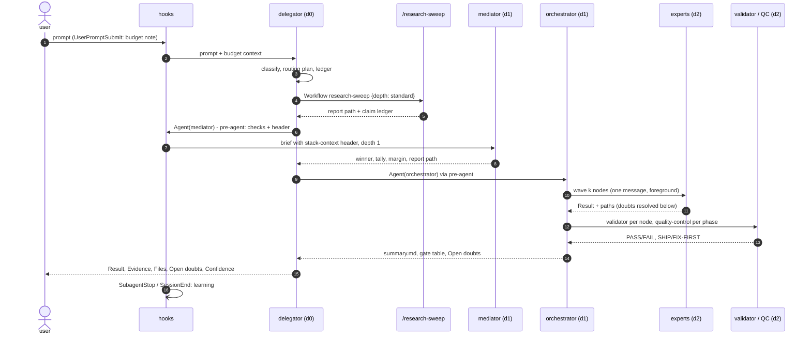

# Overview and request lifecycle

Under the hood, one session becomes a hierarchical multi-agent system. The repository contains 63 subagents in nine groups (`.claude/agents/<group>/<name>.md`), 234 skills
(`.claude/skills/<name>/SKILL.md`), nine saved workflows (`.claude/workflows/<name>.js`), eight hooks wired in
`.claude/settings.json`, MCP servers (`config/mcp.servers.json`, inlined into the agents that use them, so each
connects only while such an agent runs), and the stdlib-only Python tooling that the hooks run
(`stack/`, CPython 3.13 via uv). No code in this repository answers a request itself. The code sets the rules
under which agents route, delegate, verify and report.

The design rests on a few invariants. Each one is enforced by a hook, a setting or a preloaded skill:

| Invariant | Enforced by |
|---|---|
| One router talks to the user: the `delegator` runs as the main thread at depth 0 | `bin/claude-stack` / `bin/stack-sdk run` pin `--agent delegator` |
| Nesting is capped at depth 8 | `CLAUDE_CODE_MAX_SUBAGENT_SPAWN_DEPTH=8` (native) plus the `pre-agent` hook (`CLAUDE_STACK_MAX_DEPTH=8`) |
| Every subagent knows its depth, parent, remaining depth, spawn count, token budget and output directory | the `<stack-context>` header that `pre-agent` prepends to every child prompt |
| Only three models exist, and each agent runs on its tier | `config/models.json`, `availableModels` + `enforceAvailableModels`, `pre-agent` strips per-call `model`/`effort`, `PreModelSwitch` hook |
| The whole tree shares one spawn budget and one token budget | `config/policy.json` → `max_spawns_per_session` (128), `token_budget` |
| Large outputs live in files, and only summaries and paths travel up the tree | `output-contract` skill, `context_policy` (60 lines / 3,000 chars) |
| Agents verify uncertain facts or escalate them as doubts, never guess | `doubt-escalation` skill, preloaded everywhere |
| Nothing reaches the user without a gate | `validator` per node, `quality-control` per phase and at the end |

Every agent preloads the three protocol skills `delegation-protocol`, `doubt-escalation` and `output-contract`,
plus at most three role skills. These skills make the behaviour below uniform: each agent reads the same header the
same way, writes briefs with the same template, and returns the same five-section contract.

## Two runtimes

The same agent files, skills, workflows, hooks and MCP servers run in two runtimes. The rules that must hold in
both ([docs/CONVENTIONS.md](../CONVENTIONS.md) section 11) are listed with their enforcement in
[Runtime-compatibility rules](sdk.md#runtime-compatibility-rules); the table below shows how each runtime implements them.

| | Interactive: `bin/claude-stack` | Agent SDK: `bin/stack-sdk run "PROMPT"` |
|---|---|---|
| Entry | `exec claude --agent delegator --model claude-opus-5-5 --effort <frontmatter effort>` (args from `bin/stack agents main-args delegator`) | `python -m stack_sdk run` → `build_options(StackRunConfig(...))` → `claude_agent_sdk.query()` |
| Main agent | `STACK_MAIN_AGENT` (default `delegator`); `--model`, `--effort`, `--agent` refused with exit 2 | `--agent` (default `delegator`, or `none`); `--model`/`--effort` only with `--agent none`, and only a tier model |
| Agent discovery | `.claude/agents` on disk | in repo: from disk (`--agents-source filesystem`); elsewhere: sent as `AgentDefinition`s (`programmatic`) |
| Main-thread prompt | the delegator body replaces the system prompt | in repo: `--agent`; elsewhere: Claude Code preset with the delegator body appended |
| Hooks | `.claude/settings.json` command hooks (`bin/stack hook <name>`) | in repo: the same settings hooks; elsewhere: the same handlers as Python callbacks (`stack_sdk/hooks.py`: PreToolUse `Agent\|Task`, SubagentStop, UserPromptSubmit) |
| Permissions | interactive prompts | `permission_mode="dontAsk"`, `--permission-prompts none`, explicit allow-list (settings allow-list minus `Bash(...)` entries, core tools, `Agent`, `Workflow`, `Skill`, every `mcp__<.mcp.json server>`) |
| Subagent results | foreground when the caller passes `run_in_background: false` | forced: `CLAUDE_CODE_DISABLE_BACKGROUND_TASKS=1` and `CLAUDE_STACK_FOREGROUND=1` (the hook rewrites every Agent call to `run_in_background: false`); `--background` turns it off |
| Questions to the user | the delegator asks in plain text at the end of its turn | none mid-run: the delegator proceeds on its stated default and reports it |
| Budget pacing | hooks only | hooks, plus `task_budget = max_prompt_tokens` (400M) as an API hint and optional `--max-budget-usd` |
| Learning trigger | `SessionEnd` hook detaches `learn run` | the runner calls `engine.run_after_session()` on the finished transcript (the SDK has no SessionEnd callback) |

Both runtimes export `CLAUDE_STACK_MAIN_AGENT`. The hooks use it to name the depth-0 parent and to pin the main
thread's model and effort. A third way to start the delegator is `./install.sh --main-agent`, which writes
`"agent": "delegator"` into `~/.claude/settings.json` for every session.

## Agent layers



| Layer | Agents | Pattern |
|---|---|---|
| Routing | `delegator` | main thread; one routing decision per request; never does heavy work |
| Orchestration | `orchestrator`, `swarm-coordinator`, `mesh-router`, `ensemble-assembler`, `concurrent-dispatcher`, `mediator` | DAG waves with gates, sharded swarms with a coverage ledger, blackboard mesh, expert ensembles, mechanical fan-out, voting |
| Planning | `planner`, `architect`, `plan-critic` | task DAGs with acceptance criteria, design trade-offs, red-teaming |
| Experts | 15 domain experts | each preloads its craft hub skill; `context7` for live library docs |
| Synthesis | `cross-domain-synthesizer`, `expert-panel-chair`, `debate-moderator`, `analogy-mapper`, `first-principles-decomposer`, `general-chat` | combine several experts' outputs into one higher-level answer |
| Research | 11 agents | Exa, Jina, Spider, Playwright, computer use (host and sandboxed), arXiv/SSRN |
| Quality | 9 agents | find, then verify, then gate |
| Image | `image-generator`, `image-editor`, `vector-artist`, `visual-reviewer` | produce, then review, then revise against a scored rubric |
| Writing | 6 agents | fiction projects: scaffold, draft, copyedit, prose style, developmental review; `chat-aide` / `/polish` for messages |
| Meta | `stack-tuner`, `agent-architect` | operate the learner; extend the stack |

A spawn rule makes the orchestration group (plus `expert-panel-chair` and `debate-moderator`) unavailable below
depth 6 (`spawn_rules.orchestrators_until_depth`). Deep levels are left to leaves because a coordinator needs
depth beneath it to do its job.

## The control plane: eight hooks

Six command hooks form the control plane: `SessionStart` (`session-start`), `UserPromptSubmit` (`prompt-submit`),
`PreToolUse` on `Agent|Task` (`pre-agent`), `PreModelSwitch` (`model-switch`), `SubagentStop` (`subagent-stop`,
async) and `SessionEnd` (`session-end`). Each is `"$CLAUDE_PROJECT_DIR"/bin/stack hook <name>`, reads JSON on stdin
and dispatches through `HANDLERS` in `stack/hooks.py`. The handlers fail open, so a broken hook never wedges a
session; only deliberate `deny` decisions from `pre-agent` and exit 2 from `model-switch` block anything.

| Hook | Role in a request | Details |
|---|---|---|
| `session-start` | applies pending learned values; status line: depth limit, missing keys, applied or recent self-tuning | [session-start](hooks.md#session-start-status-line) |
| `prompt-submit` | per-prompt token-budget note for the main thread | [prompt-submit](hooks.md#prompt-submit-per-prompt-budget-note) |
| `pre-agent` | depth guard, spawn rules, token and spawn budgets, `<stack-context>` header, tier stripping, foreground forcing | [pre-agent](hooks.md#pre-agent-depth-guard-spawn-rules-budgets-and-tier-stripping), [The stack-context header](delegation.md#the-stack-context-header) |
| `model-switch` | keeps the main thread on its tier model | [PreModelSwitch guard](hooks.md#5-premodelswitch-guard) |
| `subagent-stop` | records the effort in effect, debounced ingest, mid-session learning | [subagent-stop](hooks.md#subagent-stop-telemetry-and-mid-session-learning) |
| `session-end` | detaches the learner | [session-end](hooks.md#session-end-detached-learner) |
| `post-web` | scans every web-tool result for prompt injection, warns and taints the agent | [Web content safety](web-safety.md#web-content-safety-prompt-injection) |
| `pre-tool` | narrow tools for web agents; taint guard on risky Bash, file writes and web forms | [Web content safety](web-safety.md#web-content-safety-prompt-injection) |

The wiring table, timeouts and the fail-open contract are in [Hook wiring](hooks.md#hook-wiring); token accounting
(`stack/budget.py`) is in [Token budgets](hooks.md#token-budgets).

## Lifecycle of one request

The walkthrough follows the request the delegator's own definition uses as its example:

> Research the top Rust async runtimes, then prototype our ingest service on the best one and benchmark it.

Runtime names, file names and timestamps below are illustrative. Agents, hooks, headers, file layouts and rules are
the real ones.



### 1. Session start and prompt submission

`bin/claude-stack` resolves `--agent delegator --model claude-opus-5-5 --effort high`, exports
`CLAUDE_STACK_MAIN_AGENT=delegator` and starts `claude`. The `env` block in `.claude/settings.json` then applies:
depth 8 for both the native limit and the stack's guard, 20 concurrent subagents, 16 concurrent workflow agents and
`MAX_MCP_OUTPUT_TOKENS` 40000 (see [`.claude/settings.json`](installation.md#claudesettingsjson)).

`SessionStart` adds the status line. When the user submits the prompt, `UserPromptSubmit` adds the token-budget
note. The delegator has no `<stack-context>` header, so it assumes `depth=0` and `remaining_depth=8`.

### 2. Classification and route selection

The delegator maps each request to one primary class from the table below. Secondary classes become later steps.

| Class | Default route | Typical spawns |
|---|---|---|
| chat / explanation | answer directly if under ~150 words, else `general-chat` | 0-1 |
| quick fact | `quick-researcher` | 1-2 |
| deep research | `deep-researcher`; `/research-sweep` for standard or exhaustive depth | 5-40 |
| literature | `paper-researcher` | 1-5 |
| web extraction | `web-scraper` / `web-crawler` / `browser-operator` | 1-3 |
| single coding change | language expert, then `validator` | 2-4 |
| multi-phase project | `orchestrator` | 8-60 |
| bug | `debugger` | 2-6 |
| code review | `/review-verify`, or `reviewer` for a small diff | 1-2 (`reviewer`); `/review-verify` 6 + 3 x findings, typically 20-80 |
| large homogeneous job | `swarm-coordinator`, `/swarm-run`, `/fanout` | N+2 |
| cross-domain problem | `ensemble-assembler` | 4-10 |
| contested decision | `mediator` / `/mediate` | 10-16 |
| estimate / forecast | `/expert-panel` (`expert-panel-chair`) | 8-20 |
| interdependent reasoning | `mesh-router` | 10-40 |
| plan / architecture | `planner`, `architect`, `/plan-tournament` | 1-12 |
| image / vector | `image-generator`, `image-editor`, `vector-artist` (+ `graphic-design-expert`) | 1-3 |
| desktop / browser task | `computer-operator`, `browser-operator` | 1 |
| stack maintenance | `stack-tuner`, `agent-architect` | 1-3 |

Route selection then climbs a cost ladder only as far as some signal forces it:

```text
answer directly -> one leaf -> one expert + validator -> orchestrator or a saved workflow -> ensemble / mediator / mesh
```

Signals that force a climb are high ambiguity, a large blast radius, output that is hard to verify, and explicit
stakes. A checkable question gets verification, never a vote. The example request is a *multi-phase project* with
two secondary classes: *deep research* and a *contested decision* (which runtime). For any route above one leaf,
the delegator shows a routing plan of 3-8 lines before dispatching:

```text
Route: multi-phase project (research -> decide -> build -> verify)
1. /research-sweep depth=standard on runtime trade-offs (foreground: step 2 consumes it) ~15-25 spawns
2. mediator, 5 voters, Schulze, picks the runtime from the sweep report    ~11 spawns
3. orchestrator: prototype + criterion benchmarks, validator gates          ~10-20 spawns
Returns: report path, decision table, prototype path, benchmark summary. Budget ~60 of 128.
```

The delegator keeps its ledger in `.stack/out/delegator/<YYYYMMDD-HHMM>-ledger.md`, one row per route
(`| route | agents | expected spawns | actual | status |`). It does not use TodoWrite. Before any route expected to
exceed ~40 spawns, it establishes the session's spawn count from its children's `spawns_this_session` or from
`bin/stack depth` and compares it with `max_spawns_per_session`. It never lets one route take more than half the
remaining budget without telling the user.

It asks the user a question only when the ambiguity would change the route or the cost by an order of magnitude,
and then asks once, in plain text, with a default. Under `bin/stack-sdk run` it proceeds on that default instead.

### 3. Briefs and dispatch

Children never see the conversation. Every brief is self-contained and follows the `delegation-protocol` template:

```text
GOAL / CONTEXT / INPUTS (paths, never pasted content) / CONSTRAINTS / ACCEPTANCE / OUTPUT / DOUBTS
```

It quotes the user's own words for requirements that matter and names an output location under
`.stack/out/<agent>/`. Independent parts go out as several Agent calls in one message, up to 20, which run
concurrently. A step that consumes another step's result runs after it with `run_in_background: false`. In the
example the three routes are sequential, because each one consumes the previous one's output.

### 4. Research phase: `/research-sweep`

Saved workflows can be launched only by the main thread, because Claude Code removes the Workflow tool from
subagents. The delegator therefore calls `Workflow research-sweep` with `{question, depth: "standard"}`. The workflow
is deterministic JavaScript that runs up to 16 agents at once and does deduplication and tallies in code. Its
phases are:

| Phase | Agents | Work |
|---|---|---|
| Plan | `deep-researcher` | decomposes the question into sub-questions |
| Sweep | `web-searcher`, `paper-researcher`, `web-crawler` | covers each sub-question |
| Extract | `source-summarizer` | extracts atomic cited claims |
| Verify | `fact-checker` | checks the highest-risk claims after dedup across sub-questions |
| Critic | `quality-control` | completeness critic; turns gaps into new sub-questions until a round finds nothing new |
| Synthesize | `deep-researcher` | writes the report |

At `standard` depth the limits are 6 sub-questions, the web+papers+crawl modalities, 2 crawl domains, 20 verified
claims and 2 critic rounds. The report lands at `.stack/out/research-sweep/<slug>.md`, with `plan.md`, `claims.md`
and `sources.md` under `.stack/out/research-sweep/<slug>/`. The delegator counts every agent the workflow launches
as a spawn in its ledger.

### 5. Decision phase: `mediator`

The delegator spawns `mediator`. `pre-agent` assigns it depth 1 (`remaining_depth="7"`) and prepends the header.
The mediator runs its full protocol in run mode:

1. Writes `frame.md` under `.stack/out/mediator/<stamp>-<slug>/`, recording the question, weighted criteria, the
   equivalence rule, and the voting rule (Schulze, declared before anyone generates a solution).
2. Spawns N = 5 diverse voters (for example `computer-science-expert`, `architect`, `rust-expert`, `go-expert`,
   `first-principles-decomposer`) in one message. They run at depth 2 and are told not to spawn, which keeps them
   independent. Each writes `solutions/<voter>.md`.
3. Anonymises the solutions in code. Labels S1..Sn come from the `shasum -a 256` order of the normalised text, and
   the label-to-author map is kept in `private/map.json`.
4. Runs blind critique: each voter returns `ballots/<voter>.json` containing a ranking, an approval set and
   `p_correct` per solution.
5. Computes the tally with `.claude/skills/mediator-voting/scripts/tally.py --method schulze`, then checks
   robustness with `--method all`, `--no-self` and leave-one-voter-out.

The Schulze margin is `(p[w][r] - p[r][w]) / W`, where `W` is the total voter weight and `p` holds the
strongest-path strengths between the winner `w` and the runner-up `r` (the runner-up is the second-tier candidate
with the smallest strongest-path deficit). A margin below 0.20, no Condorcet winner, or a winner that changes under
the leave-one-voter-out or `--no-self` check triggers one debate round of rebuttals of 300 words or fewer, followed by a pairwise re-vote
(all rules and thresholds: [mediate](workflows.md#mediate)).

The winner becomes the base of the final answer, and compatible runner-up strengths are grafted onto it with
citations. The mediator returns the decision, rule, margin, dissent and the path to `report.md`. These ~11 spawns
come from the 5 solve and 5 critique calls plus the mediator itself.

### 6. Build phase: `orchestrator` and its DAG

The delegator spawns `orchestrator` at depth 1. The brief contains the user's words, the sweep report path, the
mediator's report path and the acceptance criteria. The orchestrator opens a run directory and routes everything
that crosses a phase boundary through it:

```text
.stack/out/orchestrator/<YYYYMMDD-HHMM>-ingest-prototype/
  plan.md  dag.json  ledger.md  summary.md  nodes/<id>/
```

Planning follows a size rule. A goal of 4 nodes or fewer with a known pattern gets its DAG written by the
orchestrator directly. Larger goals go to `planner`, and to `architect` when the shape of the system is undecided.
The DAG is red-teamed by `plan-critic` when it has 8 or more nodes or any irreversible node. Before execution, every
node is validated for:

- `id` and `owner` (an exact agent name);
- `inputs` and `write_set`;
- `acceptance` and `verify`.

`.claude/skills/planning-dag/scripts/dag.py` rejects cycles, unknown dependencies and write conflicts between nodes
that could run concurrently, and computes waves and the critical path. One node of an illustrative plan:

```json
{"id": "B1", "phase": "verify", "owner": "code-optimizer", "deps": ["I1", "I2"],
 "inputs": ["nodes/P1/design.md", "crates/ingest/src/lib.rs"],
 "write_set": ["crates/ingest/benches/ingest.rs"],
 "acceptance": ["throughput reported as criterion point estimate with 95% interval",
                "cargo test -p ingest still exits 0 after the bench harness is added"],
 "verify": "cargo bench -p ingest --bench ingest", "risk": "medium"}
```

The wave rule is `wave(n) = 0` for a node without dependencies, else `1 + max(wave(dep))`. Nodes whose write-sets
overlap never share a wave. For the example:

```text
wave 0  P1  design of the ingest pipeline on the chosen runtime        architect
wave 1  I1  pipeline crate          write_set crates/ingest/src/        rust-expert
        I2  load fixtures           write_set crates/ingest/fixtures/   rust-expert
wave 2  T1  tests                   write_set crates/ingest/tests/      tester
        B1  criterion benchmarks    write_set crates/ingest/benches/    code-optimizer
gates   validator after every implementing node; quality-control + reviewer at phase ends; final quality-control
```

Each wave goes out as a single message of Agent calls, all with `run_in_background: false`, because the gate needs
every result before the next wave starts. A message holds up to ~8 heavy calls or 20 light ones, with critical-path
nodes first.

### 7. Expert work

The `rust-expert` node runs at depth 2 (`remaining_depth="6"`), on its tier (`claude-opus-5-5`) at its learned
effort. Any `model`/`effort` the orchestrator might have passed was stripped by the hook. Its preloaded `rust-craft`
skill and its `context7` MCP server supply idioms and live API documentation. It works only inside its write-set,
proves the change with the compiler, `cargo clippy` and `cargo test`, and writes its full report to `nodes/I1/`. The
Result it returns is 15 lines or fewer, plus paths.

The `code-optimizer` node measures before drawing conclusions:

1. `cargo bench -- --save-baseline before`;
2. then a comparison against that baseline;
3. reports criterion's point estimate with its confidence interval, never a single run.

### 8. Doubt escalation inside a node

Suppose `rust-expert` finds that the design depends on claim C14 from the sweep report, a statement about the chosen
runtime's scheduler. It does not guess. It first triages: can three of its own tool calls settle the question? If
not, it rates impact and uncertainty with the matrix in [Doubt escalation](delegation.md#doubt-escalation), escalates when
`P(wrong) x cost-of-wrong > cost-of-check`, and routes the doubt to the cheapest adequate resolver for its type: a
claim to verify goes to `fact-checker` (MEDIUM).

Here the expert sends one brief to `fact-checker` at depth 3:

```text
DOUBT (type: claim)
Question: Is claim C14 in .stack/out/research-sweep/<slug>.md (L88) correct for the current release?
Decision that depends on it: per-core sharding in I1 (if true) vs a shared work queue (if false)
Known so far: C14 cites one vendor blog post; no second source in sources.md
Inputs: .stack/out/research-sweep/<slug>/claims.md (C14), sources.md
Answer form: verdict supported|contradicted|unverifiable + primary-source URL + access date
Budget: at most 4 searches
Do not expand scope. Return per output-contract.
```

`fact-checker` may spawn only `@research_leaves` (`spawn_rules.callers`), so any `web-searcher` it starts runs at
depth 4, and a `source-summarizer` below that at depth 5. That is the reason the depth limit is 8 rather than the
native default of 3.

The escalation limits (at most 3 doubts in flight and 6 escalations per task, no re-escalation by a resolver,
adoption of answers with confidence 0.8 or more, an answer below 0.6 leaves the doubt open) are in [Doubt escalation](delegation.md#doubt-escalation).

### 9. Verification and gates

After every implementing node, the orchestrator spawns `validator` (MEDIUM, depth 2). The validator:

- freezes a criteria matrix before running anything;
- snapshots `git rev-parse HEAD` and the tool versions;
- runs the project's own commands (`cargo build --locked`, `cargo clippy -- -D warnings`, `cargo test`) with exit
  codes and logs.

Each criterion gets one status:

| Status | Meaning |
|---|---|
| PASS | ran and met the expected result |
| FAIL | ran and did not meet it |
| FLAKY | failed, then passed on an identical rerun; counts as FAIL for a must |
| BLOCKED | could not run |
| UNVERIFIABLE | no objective check exists |
| SKIPPED | a should-criterion, never a must |

Numeric checks pass when `|actual - expected| <= atol + rtol x |expected|`. A stochastic metric such as a benchmark
needs at least 5 runs, and passes only when the whole 95% interval satisfies the bound. The validator never fixes
code or relaxes a tolerance.

The orchestrator records each verdict in `ledger.md`:

```text
| wave | node | owner (model/effort) | attempt | verdict | evidence path | note |
| 1    | I1   | rust-expert (opus/high) | 1    | PASS    | nodes/I1/validator.md |  |
```

No dependent node starts on a FAIL. A failing node climbs a failure ladder:

1. Retry the same owner once with the failure evidence.
2. Escalate to `debugger`, or to an ADVANCED-tier owner, or to `security-auditor`/`code-optimizer` when the failure
   is in their domain.
3. Ask `planner` for a DAG patch.

A re-plan is triggered when a node fails its gate twice, a hidden dependency appears, or an assumption in `plan.md` is
falsified. After two re-plans the orchestrator returns Open doubts instead.

At the end of the implement and verify phases, the orchestrator sends three checks in one message:

- `quality-control` checks the phase output against the requirements traced to it;
- `reviewer` reviews the phase diff;
- `security-auditor` joins when the diff crosses a security boundary.

`adversarial-verifier` takes each high-severity finding. It defaults to *refuted* when evidence is insufficient.

### 10. The quality-control gate

The final gate is `quality-control` (ADVANCED) on the whole deliverable against the original request, quoted
verbatim. It splits the request into requirements R1..Rn, each tagged `explicit`, `implicit` or `contract`, and
builds a traceability matrix (`requirement -> where satisfied -> evidence -> status`). It re-runs the cheapest
build/test command itself and batches claim checks to `fact-checker` and `validator`. Then it applies a mechanical
verdict:

```text
coverage            = met explicit requirements / explicit requirements
claim verification  = verified load-bearing claims / load-bearing claims
SHIP       iff 0 Blockers, 0 Majors, coverage = 100%, every load-bearing claim verified or disclosed as an Open doubt
FIX-FIRST  otherwise, with a punch list QC-1.. (severity, requirement, location, fix, owner, re-check step)
```

After a FIX-FIRST, the owner fixes the items and the gate re-checks only the punch list plus a regression scan.
After two FIX-FIRST cycles on the same Blocker, it stops and escalates to the parent. The gate never edits the
deliverable, because an edited deliverable no longer has an independent check.

The orchestrator writes `summary.md` and returns its contract. The gate table lists node, owner, verdict and
evidence path, and every requirement maps to a node and an evidence file.

### 11. File offloading throughout

Every agent offloads any output longer than ~60 lines or ~3,000 characters, and any reusable artefact, to a file in
its `out_dir`, and replies with the Result, the path and a section map with line anchors; callers read Status and
Confidence first, then only the sections they need, and hand anything over ~100 lines to `file-summarizer`
([File offloading](delegation.md#file-offloading)). The delegator applies the same rule to any child reply over ~60 lines. This
keeps the longest-lived context, the main thread, small. For the example run, the main-thread context ends up
holding paths and short summaries only:

```text
.stack/out/delegator/<stamp>-ledger.md
.stack/out/research-sweep/<slug>.md  and  .stack/out/research-sweep/<slug>/{plan,claims,sources}.md
.stack/out/mediator/<stamp>-runtime-choice/{frame.md,solutions/,ballots/,ballots.json,tally.json,report.md,private/map.json}
.stack/out/orchestrator/<stamp>-ingest-prototype/{plan.md,dag.json,ledger.md,summary.md,nodes/P1..B1/}
.stack/out/quality-control/<stamp>-<slug>.md     (matrix and punch list)
```

### 12. The final answer

The delegator integrates the children's results:

1. Reads each child's Result, Open doubts and Confidence.
2. Opens files only for the lines it will cite.
3. Routes any disagreement between children to the right resolver: a fact to `fact-checker`, code behaviour to
   `tester`, a contested claim to `adversarial-verifier`. It never resolves a disagreement by preference.
4. Requires a `quality-control` SHIP verdict for deliverables with moderate or higher stakes before calling them
   done.
5. Answers in the five-section output contract.

| Section | Content in this example |
|---|---|
| Result | `Status: done\|partial\|blocked`, the chosen runtime and why, prototype status, benchmark headline with its interval |
| Evidence | which agent or workflow established what: sweep report anchors, mediator margin and robustness, validator logs, QC verdict |
| Files | the report, decision report, run directory and crate paths (each checked with `ls`) |
| Open doubts | `[type\|impact] question - consequence - what would resolve it - route`, for example an untested platform, or the push to a remote that the stack never performs |
| Confidence | a band and number, capped by the weakest load-bearing child |

Confidence follows the calibration rules of the [Output contract](delegation.md#output-contract).

Heavy routes also report spawn usage. `bin/stack depth` prints `<session> spawns=N max_depth=D by_depth={...}` for
recent sessions.

### 13. After the answer

While the run is in progress, each `SubagentStop` has already recorded the effort in effect and fed the debounced
ingester. When the session ends, `session-end` detaches a full `learn run`. Under the SDK, `_learn_after()` calls
`engine.run_after_session()` with `~/.claude/projects/<project-key>/<session_id>.jsonl` instead. The learner
updates per-agent posteriors in `~/.claude/stack-data/` and records the session in `history.jsonl`. The next session's
`SessionStart` hook may then rewrite `maxTurns`/`effort` in agent frontmatter, within the bounds in
`config/learning.json` ([Bayesian self-tuning](learning.md#bayesian-self-tuning)), and its note lists those changes.

## Depth map of the example

```text
d0  delegator                                   main thread, no header
wf  ├─ research-sweep agents                    launched by the Workflow tool on the main thread: deep-researcher,
    │                                           web-searcher, paper-researcher, web-crawler, source-summarizer,
    │                                           fact-checker, quality-control
d1  ├─ mediator                                 remaining_depth 7
d2  │   └─ 5 voters x (solve + critique)        told not to spawn
d1  └─ orchestrator                             remaining_depth 7
d2      ├─ planner / architect
d2      ├─ rust-expert (I1, I2)
d3      │   └─ fact-checker                     doubt C14
d4      │       └─ web-searcher                 spawn_rules: fact-checker -> @research_leaves
d5      │           └─ source-summarizer        spawn_rules: web-searcher -> summarizers only
d2      ├─ tester (T1), code-optimizer (B1)
d2      ├─ validator (per node)
d3      │   └─ tester                           spawn_rules: validator -> @doubt
d2      ├─ reviewer, security-auditor
d3      │   └─ adversarial-verifier             per high-severity finding
d2      └─ quality-control (phase and final gates)
d3          └─ fact-checker, validator          claim and command batches
```

## How limits change behaviour mid-request

Every limit shows up in two places: in the `<stack-context>` header, so agents can plan around it, and as a hook
denial, so they cannot get around it. The agent-side rules for `remaining_depth`, spawn headroom and the `soft` and
`hard` budget levels are in [Depth semantics](delegation.md#depth-semantics), [Spawn budget](delegation.md#spawn-budget) and
[Token budgets as seen by delegation](delegation.md#token-budgets-as-seen-by-delegation); per-call `model`/`effort` is stripped, so
an agent picks a cheaper or stronger agent type instead; a hook's internal error fails open and the spawn proceeds
unchanged.

A denial is final for that call. Agents never route around one through another agent. A batch runner such as
`concurrent-dispatcher` stops launching as soon as it sees a denial that starts with `Stack depth limit reached`,
`Stack spawn budget exhausted`, `Token budget exhausted` or `Spawn policy:`, and reports what completed.
