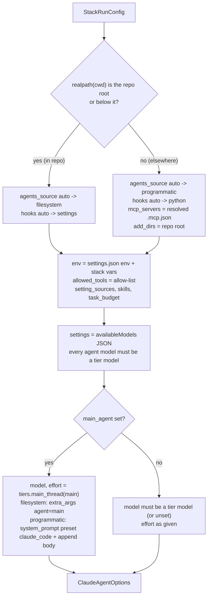

# Claude Agent SDK integration

The same agents, skills, saved workflows, hooks and MCP servers run interactively (`bin/claude-stack`)
and programmatically through the Claude Agent SDK for Python (`claude-agent-sdk`, declared as
`claude-agent-sdk>=0.2.168` in `pyproject.toml` and locked at 0.2.168 in `uv.lock`). The bridge is the
`stack_sdk/` package. It adds no second set of definitions: the markdown files under `.claude/agents/`,
`config/mcp.servers.json` (whose servers are inlined into those files), `.mcp.json`, `.claude/settings.json`,
`config/models.json` and `config/policy.json` stay the single
source of truth, and `stack_sdk` translates them into `ClaudeAgentOptions`. In this section `<repo>`
means the absolute path of the repository (`stack.paths.REPO`).

| File | Role |
|---|---|
| `stack_sdk/__init__.py` | Exports `load_agents`, `load_all`, `StackRunConfig`, `build_options` |
| `stack_sdk/agents.py` | Converts agent frontmatter + body into SDK `AgentDefinition` objects |
| `stack_sdk/mcp.py` | Resolves `.mcp.json` (session-wide servers, empty by default) for sessions whose working directory is outside the repo |
| `stack_sdk/hooks.py` | Runs the stack's hook handlers as in-process SDK `HookMatcher` callbacks |
| `stack_sdk/options.py` | `StackRunConfig` and `build_options()`: placement detection, defaults, model pinning |
| `stack_sdk/__main__.py` | The `stack-sdk` CLI (`run`, `agents`, `check`, `mcp`) and post-run learning |
| `bin/stack-sdk` | Shell launcher: sources `bin/_pyenv.sh`, sets `PYTHONPATH=<repo>`, runs `python -m stack_sdk` |
| `docs/SDK.md` | Short reference for the same material |
| `tests/test_sdk.py` | Offline tests (no API calls) for conversion, options and the Python hooks |

`bin/_pyenv.sh` picks the interpreter ([`bin/_pyenv.sh`](installation.md#bin_pyenvsh)); the SDK runner needs the uv
environment. `pyproject.toml` also registers `stack-sdk = "stack_sdk.__main__:main"` as a console script.

## How a run is assembled

`build_options(cfg)` takes a `StackRunConfig` and returns a `ClaudeAgentOptions`. Every key whose value
is `None` is dropped before construction, so SDK defaults apply to anything the stack does not set.



A `stack-sdk run` call then flows like this:

```
bin/stack-sdk run "PROMPT"
  └─ bin/_pyenv.sh ─► python -m stack_sdk run
       ├─ build_options(StackRunConfig(...))
       ├─ query(prompt, options) ─► claude CLI (system binary or the SDK's bundled one)
       │     ├─ PreToolUse  Agent|Task ─► pre-agent      (settings command hook or Python callback)
       │     ├─ SubagentStop           ─► subagent-stop  (learner telemetry)
       │     └─ UserPromptSubmit       ─► prompt-submit  (token budget note)
       ├─ print assistant TextBlocks, keep the ResultMessage
       ├─ summary to stderr, or JSON to stdout with --json
       └─ _learn_after() ─► stack.learn.engine.run_after_session(<transcript>.jsonl)
```

## Two placements

`stack_sdk.options.in_repo(cwd)` returns true when `os.path.realpath(cwd)` equals `<repo>` or starts with
`<repo>` followed by a path separator. Inside the repo the CLI already discovers everything from disk;
elsewhere the runner has to hand over what the other project's directory does not contain.

| Aspect | In this repo (`cwd` inside it) | Elsewhere (any other directory) |
|---|---|---|
| Agents | Discovered by the CLI from `.claude/agents/` (`setting_sources` includes `project`) | Sent as `options.agents` (`{name: AgentDefinition}` for every agent) |
| Main thread | `extra_args={"agent": "delegator"}`, i.e. `--agent delegator`; the body replaces the system prompt | `system_prompt={"type": "preset", "preset": "claude_code", "append": <delegator body>}` |
| MCP servers | Inline servers in the agent files, connected while each agent runs; project `.mcp.json` (empty by default), read by the CLI (SDK sessions load project servers without an approval prompt) | Inline servers in `options.agents`, which load without the trust check; `options.mcp_servers` = `load_mcp_servers()`: a copy of `.mcp.json` with absolute launcher paths (empty by default) |
| Hooks | `.claude/settings.json` command hooks (`bin/stack hook <name>`) | The same handlers as Python callbacks (`stack_sdk/hooks.py`) for `PreToolUse`, `SubagentStop`, `UserPromptSubmit` |
| Env | `options.env` (built from settings `env`); project settings also apply it | `options.env` is the only carrier, since the other project's settings do not contain it |
| Extra directories | none | `add_dirs=[<repo>]`, so skill files and configs referenced by path stay readable |
| Skills and saved workflows | `.claude/skills/`, `.claude/workflows/` in the repo | User scope (`~/.claude/skills/`, `~/.claude/workflows/`, linked by `bin/stack install --user`), loaded because `setting_sources` includes `user` |
| Permission deny rules | Repo `.claude/settings.json` `permissions.deny` applies | Not forwarded; only the allow-list and the model allowlist are passed |
| Model allowlist | `options.settings` JSON (and project `availableModels`) | `options.settings` JSON |
| Learning | `SessionEnd` command hook, plus the runner's post-run ingest | The runner's post-run ingest (`_learn_after`) |

The `auto` choices can be overridden independently: `agents_source` takes `"auto"`, `"filesystem"`
or `"programmatic"` and `hooks` takes `"auto"`, `"settings"`, `"python"` or `"none"`. The main-thread
mechanism follows the agent source, not the placement: with `filesystem` the CLI resolves
`--agent <name>` itself, with `programmatic` the body is appended to the `claude_code` preset.

If the stack is also installed user-wide (`bin/stack install --user`), `~/.claude/settings.json`
already carries the same command hooks and `setting_sources` loads them. Use `--hooks settings`
(Python: `hooks="settings"`) for out-of-repo runs in that setup so each event is handled once.

## Agent definitions under the SDK

`stack_sdk.agents.load_agent(path, use_tiers=True)` reads one agent file with `stack.frontmatter`, maps
the frontmatter onto `claude_agent_sdk.AgentDefinition`, and returns a `LoadedAgent(name, path, group,
definition, dropped)`. `group` is the directory relative to `.claude/agents/` (for example
`orchestration`), or `""` at the top level. The set of accepted keys is not hard-coded: it is
`SDK_FIELDS = {f.name for f in dataclasses.fields(AgentDefinition)}`, so a field added by a newer SDK
release is passed through without code changes, and anything the installed SDK cannot model is
reported instead of being rejected by the constructor.

| Frontmatter | `AgentDefinition` field | Conversion |
|---|---|---|
| `name` | (dictionary key) | `str(fm["name"])` |
| `description` | `description` | `str(...)`, `""` when missing |
| body after the closing `---` | `prompt` | `.strip()` |
| `tools` | `tools` | list via `stack.doctor._as_list` |
| `disallowedTools` | `disallowedTools` | list (for example `file-summarizer` gets `["Agent"]`) |
| `model` | `model` | replaced by `tiers.model_for(name)` when the agent has a tier in `config/models.json` |
| `skills` | `skills` | list |
| `memory` | `memory` | as is |
| `mcpServers` | `mcpServers` | list |
| `initialPrompt` | `initialPrompt` | as is (applies only when the agent is the main thread) |
| `maxTurns` | `maxTurns` | `int(value)` |
| `background` | `background` | `true`, `yes` or `1` (case-insensitive) means `True` |
| `effort` | `effort` | as is |
| `permissionMode` | `permissionMode` | as is |
| `color` | none | dropped (cosmetic) |
| `hooks`, `isolation`, `autoCompactWindow`, `omitClaudeMd` | none | dropped; `stack-sdk check` reports them as problems |

Rules applied during conversion:

- Values that are `None`, `""` or `[]` are skipped, so the SDK default applies.
- `_as_list` accepts YAML lists and comma-separated strings, and keeps `Agent(a, b)` groups intact
  when splitting on commas.
- With `use_tiers=True` (the default) the model is the tier model, which honours the `ADVANCED_MODEL`,
  `MEDIUM_MODEL` and `LOW_MODEL` environment overrides. The tiers are `ADVANCED_MODEL` =
  `claude-opus-5-5`, `MEDIUM_MODEL` = `claude-sonnet-5-5`, `LOW_MODEL` = `claude-haiku-5-5`. This keeps the
  SDK path correct even if frontmatter has not been re-rendered with `bin/stack agents tiers --apply`.
- `effort` and `maxTurns` come from frontmatter unchanged, because the Bayesian learner owns them.
- `load_all()` walks every `.md` file under `<repo>/.claude/agents/` (`paths.all_agent_files()`) and
  raises `ValueError("duplicate agent name ...")` if two files declare the same `name`.
- `load_agents()` returns `{name: AgentDefinition}`, ready for `ClaudeAgentOptions(agents=...)`.

## MCP servers outside the repository

The stack servers are not session servers: each agent definition, filesystem or programmatic, carries its
catalog servers inline ([Lazy loading](mcp.md#lazy-loading)), and their launchers find the stack through
`$CLAUDE_PROJECT_DIR`, `$PWD` or the `~/.claude/stack` symlink, so they need no rewrite. What follows applies to
`.mcp.json` servers only (none unless `bin/stack mcp enable` added one).

Inside the repo the CLI reads `.mcp.json` itself. Elsewhere, `stack_sdk.mcp.load_mcp_servers(include=None,
path=None)` reads `<repo>/.mcp.json` (or `path`), optionally keeps only the names in `include`, and
rewrites each entry recursively with `_resolve()`:

- Every `${CLAUDE_PROJECT_DIR}` placeholder, with or without a `:-default` part, is replaced with
  `<repo>`. The regex is `\$\{CLAUDE_PROJECT_DIR(?::-[^}]*)?\}`. Without this, `bin/mcp-run`,
  `bin/image-router` and `bin/mcp-headers` would be looked up relative to the other project.
- Dictionary keys that start with `_` (for example `_note`) are removed at every level.
- An entry without `type` gets `"type": "stdio"`.

Relative arguments without a placeholder are left alone. Playwright's `--output-dir=.stack/playwright`
therefore writes under the target project's working directory.

```json
"fal":          { "type": "http", "url": "https://mcp.fal.ai/mcp",
                  "headersHelper": "\"<repo>/bin/mcp-headers\" fal" },
"brave-search": { "type": "stdio", "command": "<repo>/bin/mcp-run",
                  "args": ["npx", "-y", "@brave/brave-search-mcp-server", "--transport", "stdio"] }
```

No secret ever appears in this structure. The SDK passes MCP configuration to the CLI on its command
line, so authentication stays behind `headersHelper` (`bin/mcp-headers` prints the auth headers for
remote servers from keys in `~/.claude/stack.env` on each connection) and behind `bin/mcp-run` (which
parses `~/.claude/stack.env` and starts the stdio server with the keys in its environment). Both read
the file at connection time. `stack_sdk.mcp.project_servers()` returns the raw `mcpServers` map and is
also used to build the `mcp__<name>` allow-list entries.

## Defaults for unattended runs

The defaults target a run with nobody watching: nothing may block on a prompt, and every parent must
receive its children's results.

| Option | Default | Source | Why |
|---|---|---|---|
| `permission_mode` | `"dontAsk"` | `StackRunConfig.permission_mode` | Anything not on the allow-list is denied instead of prompting, so the run never hangs |
| `allowed_tools` | see the formula below | `options.py` | Under `dontAsk` this list is the stack's whole capability set |
| `extra_args["permission-prompts"]` | `"none"` | added only when the mode is `dontAsk` | No permission prompts at all, so a denied call is not retried in a loop |
| `cli_path` | `shutil.which("claude")` when found, else the SDK's bundled CLI | `cli="system"` | Same CLI version as interactive sessions; `cli="bundled"` forces the SDK's own |
| `setting_sources` | `["user", "project", "local"]` | `cfg.setting_sources or [...]` | Explicit, so local settings are not silently dropped |
| `skills` | `"all"` | `options.py` | Enables every skill the CLI discovers (`Skill` is also allowed) |
| `env` | settings `env` + stack variables (below) | `options.py` | Depth, concurrency and runner flags reach the CLI and every hook and MCP server it starts |
| `settings` | `{"availableModels": [...], "enforceAvailableModels": true}` | `tiers.allowed_models()` | Same tier allowlist Claude Code enforces from project settings, also when they are not loaded |
| `task_budget` | `{"total": max_prompt_tokens}` = `{"total": 400000000}` | `budget.limits()` | API task budget as a pacing hint; the hooks enforce the hard limits |
| `max_budget_usd` | `None` | `--max-budget-usd` | Optional stop at an estimated cost in USD, on top of the token budgets. On a Claude subscription nothing is billed per call: the figure is a list-price estimate of usage, not a charge |
| `max_turns` | `None` | Python only | Optional turn cap for the main thread |
| `model`, `effort` | the main agent's tier model and effort | `tiers.main_thread()` | See the next subsection |

The allow-list is built as:

```
allowed_tools = sorted(set(
      [t for t in settings.json permissions.allow if not t.startswith("Bash(")]
    + UNATTENDED_TOOLS
    + ["mcp__" + name for name in .mcp.json mcpServers]
    + cfg.extra_allowed_tools))

UNATTENDED_TOOLS = (Read, Grep, Glob, Edit, Write, NotebookEdit, Bash, WebFetch, WebSearch,
                    TodoWrite, Agent, Workflow, Skill, ToolSearch, Monitor, TaskStop)
```

The `Bash(...)` patterns from settings (`Bash(bin/stack *)`, `Bash(./bin/stack *)`) are dropped because
the unrestricted `Bash` entry already covers them. With the current configuration the list is `Agent`,
`Bash`, `Edit`, `Glob`, `Grep`, `Monitor`, `NotebookEdit`, `Read`, `Skill`, `TaskStop`, `TodoWrite`,
`ToolSearch`, `WebFetch`, `WebSearch`, `Workflow`, the nine `Workflow(<name>)` entries of the settings allow-list
(`expert-panel`, `fanout`, `manuscript-review`, `mediate`, `plan-tournament`, `research-sweep`, `review-verify`,
`swarm-run`, `visual-iterate`), `Write`, and
`mcp__context7`, `mcp__desktop-sandbox`, `mcp__exa`, `mcp__fetch`, `mcp__image`, `mcp__jina`, `mcp__neural-memory`, `mcp__spider` (from `permissions.allow`;
`.mcp.json` adds none). Allowing
`Workflow` pre-authorises saved workflows, because Workflow availability in Python SDK sessions follows
the CLI.

`options.env` is the settings `env` block plus the runner's variables:

| Variable | Value | Origin and purpose |
|---|---|---|
| `CLAUDE_CODE_MAX_SUBAGENT_SPAWN_DEPTH` | `8` | settings `env`: native nesting limit |
| `CLAUDE_STACK_MAX_DEPTH` | `8` | settings `env`: limit used by the `pre-agent` depth guard |
| `CLAUDE_CODE_MAX_CONCURRENT_SUBAGENTS` | `20` | settings `env` |
| `CLAUDE_CODE_WORKFLOW_MAX_CONCURRENT_AGENTS` | `16` | settings `env` |
| `MAX_MCP_OUTPUT_TOKENS` | `40000` | settings `env` |
| `CLAUDE_STACK_MAIN_AGENT` | main agent name, or `main` with `--agent none` | lets hooks identify the depth-0 caller and its pinned effort |
| `CLAUDE_CODE_PRINT_BG_WAIT_CEILING_MS` | `0` | removes the exit-time wait ceiling, so long workflows are never dropped when the CLI exits |
| `CLAUDE_CODE_DISABLE_BACKGROUND_TASKS` | `1` when `foreground=True` | under the SDK subagents otherwise default to the background |
| `CLAUDE_STACK_FOREGROUND` | `1` when `foreground=True` | tells the `pre-agent` hook to rewrite every Agent call to `run_in_background: false` |
| anything in `cfg.extra_env` | as given | applied last, so it overrides everything above |

Foreground execution trades speed for context: each parent gets its children's final messages before
it takes its next step, so it never polls or guesses. `--background` (`foreground=False`) leaves both
foreground variables unset.

`task_budget_tokens` defaults to `budget.limits()["max_prompt_tokens"]`. That is 400,000,000 from
`config/policy.json` `token_budget.max_prompt_tokens`, or a higher value the learner has applied in
`<data_dir>/budgets.json`, since learned limits may only raise the configured ones.

## Model allowlist and main-thread pinning

Only the three tier models may run anywhere. `build_options` passes them as SDK settings and also
checks every loaded agent:

```python
allowed = tiers.allowed_models()          # ["claude-haiku-5-5", "claude-opus-5-5", "claude-sonnet-5-5"]
kwargs["settings"] = json.dumps({"availableModels": allowed, "enforceAvailableModels": True})
for name, ag in loaded.items():
    if ag.definition.model not in allowed:
        raise ValueError("agent %s uses %r, not an allowed tier model" % (name, ag.definition.model))
```

The main thread is pinned to its agent's tier model and effort. `main_agent` defaults to `"delegator"`.
`tiers.main_thread(name)` returns the tier model (falling back to frontmatter `model`) and the
frontmatter `effort`, and raises if the model is not allowed. For the delegator that is
`claude-opus-5-5` at effort `high`. `options.model` and `options.effort` are set from it.

| Situation | Result |
|---|---|
| `main_agent` set, `model` or `effort` also set | `ValueError`: the main thread runs on its tier model and effort; change `config/models.json` instead |
| `main_agent` not a known agent | `ValueError("unknown main agent ...")` |
| `main_agent=None` (`--agent none`), `model` set | `model` must be one of the tier models, otherwise `ValueError` |
| `main_agent=None`, no `model` | the CLI default model, still restricted by `availableModels` |

This mirrors the interactive launcher. `bin/claude-stack` runs `bin/stack agents main-args delegator`
and gets `--agent delegator --model claude-opus-5-5 --effort high`. It refuses `--model`, `--effort` and
`--agent`, and the `PreModelSwitch` hook blocks `/model`. The SDK's Python callbacks have no
`PreModelSwitch` event, and an unattended run has no `/model`, so pinning the options and enforcing
`availableModels` is enough.
Subagents run on their tier models, either through `AgentDefinition.model` or rendered frontmatter.
The `pre-agent` hook strips per-call `model` and `effort` while `config/policy.json` `enforce_tiers` is
`true`.

## Hooks as Python callbacks

Command hooks in `.claude/settings.json` fire only when the CLI loads this repo's project settings.
For any other working directory, or when `setting_sources` excludes `project`, `stack_sdk/hooks.py`
registers the same handlers as SDK callbacks. Each callback calls `stack.hooks.run_handler(name, input)`
through `asyncio.to_thread`. That handler is the same code `bin/stack hook <name>` runs, so behaviour
cannot drift between runtimes, and the thread keeps file locks and transcript ingestion off the
event loop.

```python
def python_hooks(timeout: float = 30.0) -> dict[str, list[HookMatcher]]:
    return {
        "PreToolUse": [HookMatcher(matcher="Agent|Task", hooks=[pre_agent], timeout=timeout)],
        "SubagentStop": [HookMatcher(hooks=[subagent_stop], timeout=120.0)],
        "UserPromptSubmit": [HookMatcher(hooks=[prompt_submit], timeout=timeout)],
    }
```

| Settings hook (event, timeout) | Handler | SDK callback (timeout) | What it does |
|---|---|---|---|
| `PreToolUse` `Agent\|Task`, 10 s | `pre-agent` | `pre_agent` (30 s) | depth guard, spawn rules, token budgets, spawn budget, `<stack-context>` header, strips `model`/`effort`, forces foreground |
| `SubagentStop`, async, 120 s | `subagent-stop` | `subagent_stop` (120 s) | records the effort in effect, debounced and lock-protected ingest for the learner |
| `UserPromptSubmit`, 20 s | `prompt-submit` | `prompt_submit` (30 s) | adds the session and prompt token-budget note as context |
| `SessionStart`, 10 s | `session-start` | none | applies pending learned values; status line (missing keys, recent self-tuning); no SDK event |
| `SessionEnd`, 5 s | `session-end` | none; the runner calls `_learn_after` | final ingest, posterior update and `history.jsonl` line |
| `PreToolUse` Bash/writes/web forms, 10 s | `pre-tool` | `pre_tool` (30 s) | narrow tools for web agents, taint guard |
| `PostToolUse` web tools, 10 s | `post-web` | `post_web` (30 s) | prompt-injection scan, warning, taint |
| `PreModelSwitch`, 10 s | `model-switch` | none; the model is pinned in the options | keeps the main thread on its tier model |

The SDK's Python hooks cover 10 events: `PreToolUse`, `PostToolUse`, `PostToolUseFailure`,
`UserPromptSubmit`, `Stop`, `SubagentStop`, `PreCompact`, `Notification`, `SubagentStart` and
`PermissionRequest`. There is no `SessionStart`, `SessionEnd` or `PreModelSwitch`: the runner covers
`SessionEnd`, the pinned options cover `PreModelSwitch`, and the `SessionStart` status line has no
equivalent outside the repo. The `pre-agent` checks are documented in
[pre-agent](hooks.md#pre-agent-depth-guard-spawn-rules-budgets-and-tier-stripping). Callbacks convert the SDK's typed input to a plain `dict` (`_plain`) and return
`{}` when the handler returns `None`. `run_handler` fails open: an exception is appended to
`<data_dir>/hook-errors.log` (`$CLAUDE_STACK_DATA` or `~/.claude/stack-data`) and the call proceeds.
The depth guard denies only when it is certain a limit is exceeded.

Environment scope: the callbacks run inside the runner's Python process, so the handlers read that
process's `os.environ`, not `options.env`. `options.env` goes to the CLI subprocess and to everything
the CLI starts, including command hooks and MCP servers. With `--hooks python`, or `auto` outside the
repo, this has three effects:

- `CLAUDE_STACK_MAX_DEPTH` falls back to the handler default of 8, which equals the configured value.
- With `CLAUDE_STACK_MAIN_AGENT` unset, the main thread appears as `parent="main"` in the
  `<stack-context>` header. The spawn rules list neither `main` nor `delegator`, so routing permissions
  do not change.
- With `CLAUDE_STACK_FOREGROUND` unset, the hook does not rewrite `run_in_background`. Foreground
  execution then rests on `CLAUDE_CODE_DISABLE_BACKGROUND_TASKS=1` in the CLI environment.

Exporting `CLAUDE_STACK_MAIN_AGENT` and `CLAUDE_STACK_FOREGROUND=1` in the shell that starts the runner
gives the callbacks the same inputs the command hooks see. With `--hooks settings` the command hooks
run as CLI children and inherit `options.env` directly.

## Learning after a run

SDK hooks have no `SessionEnd`, so the runner feeds the finished session to the learner itself. After
the `ResultMessage` arrives, `_learn_after(opts, session_id)` builds the transcript path and calls the
learner synchronously:

```
transcript = <projects_root>/<project_key_for_directory(cwd)>/<session_id>.jsonl
projects_root = $CLAUDE_PROJECTS_ROOT or ~/.claude/projects
stack.learn.engine.run_after_session(transcript)   # ingest -> update posteriors -> record history.jsonl (apply only if apply_on is session_end)
```

`project_key_for_directory` comes from `claude_agent_sdk`, so the path matches what the CLI wrote.
The call is skipped when the file does not exist, and any exception is printed as
`learning skipped: ...` to stderr and never changes the exit code. `run_after_session` returns early
when learning is disabled in `config/learning.json`. Ingestion is idempotent, so the in-repo case is
safe, where the `SessionEnd` command hook also detaches `bin/stack learn run --transcript <path>`.
During the run, `subagent-stop` ingests at most once per `ingest_debounce_seconds` (60) and refreshes
posteriors every `midsession_update_minutes` (30). A Python program that calls `query()` itself
does not get this step; it can make the same `run_after_session` call, or run
`bin/stack learn run --transcript <path>`, after the result. SDK runs have no `SessionStart` hook, so the
recommended values are applied when the run ends (`apply_on: "session_end"`) and before the next run starts, or by `bin/stack learn start`.

## Command-line interface

```bash
bin/stack-sdk run "Survey neural SDF rendering in 2026 and write a cited report"   # delegator as main thread
bin/stack-sdk run --cwd ~/code/other-project "Review the auth module"             # stack used from elsewhere
bin/stack-sdk run --agent tester --max-budget-usd 0.50 --json "..."                # one agent as main thread
bin/stack-sdk agents [--json]   # every agent as an AgentDefinition
bin/stack-sdk check [--cwd DIR] # build options for both placements and validate them (no API call)
bin/stack-sdk mcp               # MCP servers as resolved for out-of-repo sessions (no secrets)
```

`run` flags and the `StackRunConfig` field each one sets:

| Flag | Default | Sets |
|---|---|---|
| `PROMPT` (positional) | required | the `query()` prompt |
| `--agent NAME` | `delegator` | `main_agent`; `none` gives `main_agent=None` |
| `--cwd DIR` | current directory | `cwd`, which also decides the placement |
| `--agents-source` | `auto` | `agents_source`: `auto`, `filesystem`, `programmatic` |
| `--hooks` | `auto` | `hooks`: `auto`, `settings`, `python`, `none` |
| `--permission-mode` | `dontAsk` | `permission_mode`: `default`, `acceptEdits`, `plan`, `bypassPermissions`, `dontAsk`, `auto` |
| `--model ID` | unset | `model`; only with `--agent none`, and it must be a tier model |
| `--effort LEVEL` | unset | `effort`: `low`, `medium`, `high`, `xhigh`, `max`; only with `--agent none` |
| `--max-budget-usd X` | unset | `max_budget_usd` |
| `--task-budget TOKENS` | `max_prompt_tokens` | `task_budget_tokens` |
| `--background` | off | `foreground=False` |
| `--cli` | `system` | `cli`: `system` or `bundled` |
| `--json` | off | print only a JSON summary, including `result` |

`run` prints each `TextBlock` of every `AssistantMessage` as it arrives, unless `--json` is set. At the
end it prints `-- <subtype> | turns <n> | $<cost> | session <id>` to stderr. With `--json` it prints
`session_id`, `subtype`, `is_error`, `terminal_reason`, `num_turns`, `duration_ms`, `total_cost_usd`,
`model_usage` and `result`. For the terminal subtypes `error_max_turns` and `error_max_budget_usd` it prints
`stopped at max_turns: the run is partial; resume with the session id` or
`stopped at max_budget_usd: usage totals may be incomplete` on stderr. The exit code is 1 when
no `ResultMessage` arrives or `is_error` is true, and 0 otherwise. `max_turns`, `setting_sources`,
`extra_allowed_tools` and `extra_env` have no flags and are available from Python only.

`agents` prints one line per agent (name, model, effort, maxTurns, `mcp=`, `dropped=`). With `--json` it
prints objects with `name`, `group`, `model`, `effort`, `maxTurns`, `mcpServers`, `skills`,
`disallowedTools`, `prompt_chars` and `dropped`. Example lines (effort and maxTurns are learner-owned and
drift over time):

```
deep-researcher              claude-opus-5-5    high     240  mcp=exa,jina,spider dropped=color
delegator                    claude-opus-5-5    high     300  mcp=- dropped=color
file-summarizer              claude-haiku-5-5   low       40  mcp=- dropped=color
```

`check` builds options for `in-repo` (`<repo>`) and for `elsewhere` (`--cwd`, default `~`), and prints
`describe(opts)` for each without `allowed_tools`. The summary is secret-free: `cwd`, `model`, `effort`,
`setting_sources`, `permission_mode`, `skills`, `task_budget`, `max_budget_usd`, `main_agent_via`
(`--agent`, `system_prompt.append` or `default`), `programmatic_agents`, `mcp_servers`, `python_hooks`,
`cli_path` (`bundled` when unset), `extra_args` and `env`. `check` then reports a problem for any
placement whose `build_options` raised, for any agent with an empty description or prompt, and for any
agent with dropped keys other than `color`. It prints `<n> problem(s)` and exits 1 if any were found.
The `stack-authoring` skill makes `bin/stack-sdk check` exiting 0 part of the acceptance bar for a new
agent, next to an SDK smoke run with `bin/stack-sdk run --agent <name> --max-budget-usd 0.50 --json`.

`mcp` prints `load_mcp_servers()` as JSON.

## Using it from Python

`StackRunConfig` fields and defaults:

| Field | Default | Meaning |
|---|---|---|
| `cwd` | `None` (current directory) | working directory; decides the placement |
| `main_agent` | `"delegator"` | depth-0 agent; `None` for a plain Claude Code main thread |
| `agents_source` | `"auto"` | `"filesystem"` or `"programmatic"` |
| `hooks` | `"auto"` | `"settings"`, `"python"` or `"none"` |
| `setting_sources` | `None` → `["user", "project", "local"]` | CLI setting sources |
| `permission_mode` | `"dontAsk"` | adds `--permission-prompts none` when `"dontAsk"` |
| `foreground` | `True` | sets the two foreground variables |
| `cli` | `"system"` | `"system"` or `"bundled"` |
| `model` | `None` | only with `main_agent=None`; must be a tier model |
| `effort` | `None` | only with `main_agent=None` |
| `max_budget_usd` | `None` | stop at an estimated USD cost (a usage estimate on a subscription) |
| `task_budget_tokens` | `None` → `max_prompt_tokens` | API task budget |
| `max_turns` | `None` | main-thread turn cap |
| `extra_allowed_tools` | `[]` | appended to the allow-list |
| `extra_env` | `{}` | merged into `options.env` last |

```python
import asyncio
from claude_agent_sdk import AssistantMessage, ResultMessage, TextBlock, query
from stack_sdk import StackRunConfig, build_options

async def main() -> None:
    opts = build_options(StackRunConfig(
        cwd="/path/to/project",              # outside the repo: programmatic agents, Python hooks
        max_budget_usd=5.0,
        max_turns=200,
        extra_allowed_tools=["mcp__postgres"],  # a server from the target project's own .mcp.json
    ))
    async for msg in query(prompt="Review the auth module and fix critical issues", options=opts):
        if isinstance(msg, AssistantMessage):
            for block in msg.content:
                if isinstance(block, TextBlock):
                    print(block.text)
        elif isinstance(msg, ResultMessage):
            print(msg.subtype, msg.total_cost_usd, msg.session_id)

asyncio.run(main())
```

`extra_allowed_tools` matters under `dontAsk`: the allow-list names only this repo's servers, so a
server the target project defines in its own `.mcp.json` would otherwise be denied. This script does
not trigger post-run learning; call `run_after_session` as shown in "Learning after a run".

To use only the agents in an application that builds its own options, call
`from stack_sdk import load_agents` and pass `ClaudeAgentOptions(agents=load_agents(), ...)`.
`load_agents(use_tiers=False)` keeps the frontmatter `model` instead of resolving tiers. The other
helpers are usable on their own: `stack_sdk.mcp.load_mcp_servers(include=["exa", "jina"])` and
`stack_sdk.hooks.python_hooks(timeout=30.0)`.

## Runtime-compatibility rules

Every agent, skill and workflow follows `docs/CONVENTIONS.md` section 11 so that interactive Claude Code
and the SDK produce the same behaviour:

| Rule | Why | Enforcement |
|---|---|---|
| Workflow only from the main thread | the tool is removed from subagents | native; subagents fan out with Agent calls or return `Workflow name=<w> args={...}` as an Open doubt |
| No questions from subagents | AskUserQuestion is unavailable in subagents, and under the SDK without a permission callback | convention; subagents return Open doubts and the main thread asks in plain text |
| Results before continuing | SDK subagents default to the background | `run_in_background: false` on Agent calls; the runner sets `CLAUDE_CODE_DISABLE_BACKGROUND_TASKS=1`, and the hook rewrites the flag when it sees `CLAUDE_STACK_FOREGROUND=1` |
| Tiers are authoritative | a per-call override would bypass tier and learned effort | `pre-agent` strips `model`/`effort`; `build_options` rejects non-tier models; `bin/claude-stack` refuses `--model`, `--effort` and `--agent` |
| No interactive-only features without a fallback | built-in computer use and Claude in Chrome do not exist under the SDK or `-p` | agents use Playwright, the `desktop-sandbox` server (sandboxed computer use), or the optional `peekaboo` server with the user's quoted approval (`bin/stack mcp enable peekaboo`), or report the item blocked; agent teams and slash commands typed into prompts are never relied on |
| Self-contained bodies | subagents see only their body and the brief, not the Claude Code system prompt or the parent conversation | convention; `initialPrompt` applies only to main threads |
| No interactive approvals | `dontAsk` with `--permission-prompts none` denies anything off the allow-list without asking | no step may need an interactive approval; irreversible actions (push, publish, delete, send) are returned as Open doubts for the user |

## SDK limits

- Session start and end have no SDK hook events. The runner does the post-run ingest, and the
  `SessionStart` status line (missing keys, recent self-tuning) is not shown in out-of-repo SDK runs.
- Built-in computer use is interactive-only. `computer-operator` uses the `desktop-sandbox` server for work that needs no personal state; otherwise it uses `peekaboo` (only with the user's quoted approval) or reports the
  task as blocked.
- Saved-workflow availability in Python SDK sessions follows the CLI. The runner pre-authorises the
  `Workflow` tool and every saved workflow through the allow-list.
- The SDK pins its own bundled CLI. `cli="system"` avoids version skew with interactive sessions.
  After `uv lock --upgrade-package claude-agent-sdk`, rerun the tests, because the `AgentDefinition`
  fields and the hook event set come from the installed SDK.

## SDK tests

`tests/test_sdk.py` makes no API calls. Both test classes are skipped when `claude_agent_sdk` cannot
be imported, for example under a system interpreter without the uv environment. Run them with
`uv run --python 3.14 python -m unittest tests.test_sdk`, or as part of
`uv run --python 3.14 python -m unittest discover -s tests`.

| Test | Asserts |
|---|---|
| `test_every_agent_converts` | one definition per agent file; non-empty description and prompt; `model` equals the tier model from `config/models.json`; `effort` and `maxTurns` equal the frontmatter values; no dropped key except `color`; every agent preloads `delegation-protocol` |
| `test_tier_env_override` | `LOW_MODEL=claude-haiku-test` changes `file-summarizer`'s model |
| `test_disallowed_tools_list` | `file-summarizer.disallowedTools == ["Agent"]` |
| `test_in_repo_uses_filesystem_and_settings` | `--agent delegator`, no programmatic agents, no Python hooks, `project` in `setting_sources`, model `claude-opus-5-5`, `task_budget == {"total": 120_000_000}`, `skills == "all"`, `dontAsk` with `permission-prompts: none`, `CLAUDE_CODE_DISABLE_BACKGROUND_TASKS=1`, `mcp__exa` and `Workflow` allowed |
| `test_elsewhere_is_self_contained` | `delegator` in `options.agents`; `claude_code` preset with the body appended (starts with "You are the delegator"); `CLAUDE_CODE_MAX_SUBAGENT_SPAWN_DEPTH=8`; Python hooks on exactly `PreToolUse`, `SubagentStop`, `UserPromptSubmit`; no `CLAUDE_PROJECT_DIR` left in any MCP entry; HTTP servers carry no `headers` and use `<repo>/bin/mcp-headers`; stdio commands are absolute or `npx` |
| `test_main_thread_is_pinned_and_models_restricted` | a `model` override with a main agent raises; a non-tier model with `main_agent=None` raises; the pinned pair is `("claude-opus-5-5", "high")`; `availableModels == ["claude-haiku-5-5", "claude-opus-5-5", "claude-sonnet-5-5"]` |
| `test_hook_strips_per_call_model_and_forces_foreground` | with `CLAUDE_STACK_FOREGROUND=1`, `run_handler("pre-agent", ...)` removes `model` and `effort` and sets `run_in_background` to `False` |
| `test_python_pre_agent_hook_denies_over_depth` | with `CLAUDE_STACK_MAX_DEPTH=1` and a calling `planner` whose `agent-z.meta.json` has `spawnDepth` 1, the async `pre_agent` callback returns `permissionDecision: "deny"` |
