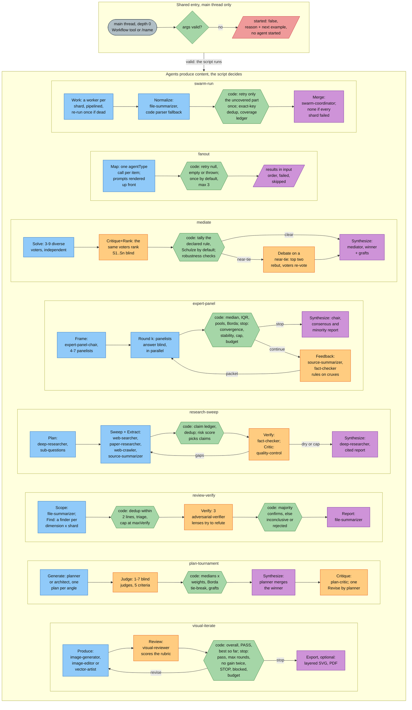

# Saved workflows

## Workflows diagram

The first eight saved workflows in one picture (`manuscript-review` has its own diagram in
[its section](#manuscript-review)): the shared entry (main thread, Workflow tool, argument validation)
and one row per workflow with its producers, judges, the decision the script computes in code, and its stop
rule. Each workflow has its own, more detailed diagram in [docs/DIAGRAMS.md](../DIAGRAMS.md#8-workflows-one-by-one)
(also a static [SVG](../diagrams/all-workflows.svg) for viewers without Mermaid).



A saved workflow is a plain JavaScript script in `.claude/workflows/<name>.js` that the Workflow runtime executes
with deterministic control flow. Agents only produce content (solutions, ballots, findings, claims, plans);
everything that decides an outcome — vote tallies, quantiles, stopping rules, dedup, coverage ledgers, survival
votes — is computed in the script. That split makes every result reproducible from the agents' structured returns
and auditable after the fact.

| Workflow | Use it for | Agents it drives | Main output |
|---|---|---|---|
| `fanout` | one agent per homogeneous item, no cross-item merge | any one `agentType` | ordered `results` + `failed` list |
| `swarm-run` | more than 6 shards that need dedup and provable coverage | worker type, `file-summarizer`, `swarm-coordinator` | `merged.json`, `ledger.md` |
| `mediate` | choose one of several defensible answers with an auditable rationale | 3-9 voters, `mediator` | `report.md`, `ballots.json` |
| `expert-panel` | calibrated group estimate, probability, ranking or assessment (Delphi) | `expert-panel-chair`, 3-7 panelists, `source-summarizer`, `fact-checker` | `report.md`, `rounds.md` |
| `research-sweep` | multi-source, cited, fact-checked research report | `deep-researcher`, `web-searcher`, `paper-researcher`, `web-crawler`, `source-summarizer`, `fact-checker`, `quality-control` | report at `outFile`, `claims.md`, `sources.md` |
| `review-verify` | code review where false positives are costly | `file-summarizer`, `reviewer`, `security-auditor`, `code-optimizer`, `adversarial-verifier` | `report.md` |
| `plan-tournament` | competing plan shapes, expensive wrong pick | `planner` or `architect`, 1-7 judges, `plan-critic` | `plan.md`, `plan.json`, `scores.md` |
| `visual-iterate` | produce or edit an image or vector and iterate until a visual rubric passes | `image-generator`, `image-editor`, `vector-artist`, `visual-reviewer` | best attempt, per-round review trail, optional layered SVG and PDF |
| `manuscript-review` | full editorial pass over a markdown fiction manuscript, report-only | `writing-project-builder`, `copy-editor`, `prose-stylist` (per chapter), `manuscript-reviewer` | `reviews/<stamp>-manuscript-review.md` + one copyedit and one style report per chapter |

## Launching

- **Main thread only.** Claude Code removes the Workflow tool from every subagent. A subagent that wants a
  workflow either fans out with parallel Agent calls itself or returns the recommendation
  `Workflow name=<w> args={...}` as an Open doubt; agent bodies distinguish the two cases by the presence of
  the `<stack-context>` header that the `pre-agent` hook prepends to subagent prompts (docs/CONVENTIONS.md
  sections 4 and 11).
- **Invocation.** The Workflow tool with `name` (the script's `meta.name`) and `args`, or the slash command
  `/<meta.name>` (for example `/review-verify`).
- **Permissions.** `.claude/settings.json` `permissions.allow` carries one `Workflow(<name>)` rule per saved
  workflow (`swarm-run`, `fanout`, `mediate`, `expert-panel`, `research-sweep`, `review-verify`,
  `plan-tournament`, `visual-iterate`), so launches do not prompt:

  ```json
  "permissions": { "allow": [ "Workflow(swarm-run)", "Workflow(fanout)", "Workflow(mediate)", "..." ] }
  ```

  Unattended SDK runs (`bin/stack-sdk run`) use `permission_mode="dontAsk"`; the runner's allow-list
  `UNATTENDED_TOOLS` in `stack_sdk/options.py` includes `Workflow`, and it sets
  `CLAUDE_CODE_PRINT_BG_WAIT_CEILING_MS=0` so long workflows are not dropped at exit.
- **Args.** An object or a JSON string. Every script validates them first and, when a required field is missing,
  returns `{started: false, reason, next}` without starting a single agent (`next` is a ready-to-use example).
  `expert-panel`, `research-sweep`, `plan-tournament` and `review-verify` also accept a bare non-JSON string as
  their primary field (`question`, `question`, `goal`, `target`); `mediate` accepts a bare string as `problem`
  unless it starts with `{`; `fanout` and `swarm-run` require JSON.
- **Concurrency.** `CLAUDE_CODE_WORKFLOW_MAX_CONCURRENT_AGENTS=16` (settings `env`). The runtime caps a
  workflow at 1000 agents; the scripts size their own caps to stay under it.
- **Installation.** `./install.sh --user` symlinks each `.js` into `~/.claude/workflows/` so the workflows are
  available in every project.
- **Learning.** `stack/learn/ingest.py` tags every subagent transcript found under
  `<session>/subagents/workflows/...` with a `workflow` field, so per-agent posteriors include workflow runs. The
  `SubagentStop` ingest is debounced (`ingest_debounce_seconds` = 60 in `config/policy.json`) so a large workflow
  does not re-parse the session once per agent.

## Runtime contract

| Global | Behaviour the scripts rely on |
|---|---|
| `agent(prompt, opts)` | runs one subagent; `opts`: `label`, `phase`, `agentType`, `model`, `effort`, `schema`. With `schema` (root `type: "object"` with `properties`) it returns a parsed object, otherwise text |
| `parallel(thunks)` | barrier over an array of zero-argument functions; a thunk that throws yields `null` |
| `pipeline(items, ...stages)` | each item flows through the stages independently; a stage is `(prev, item, index)`; a throwing stage yields `null` for that item |
| `phase(title)`, `log(msg)` | progress UI; every dropped or capped unit of work is logged |
| `args`, `budget` | caller args; `budget.total` and `budget.remaining()` (token budget, may be unset) |

Rules from docs/CONVENTIONS.md section 7, enforced by `bin/stack doctor`: the first statement is
`export const meta = { name, description, whenToUse, phases }` as a pure literal; no imports, no TypeScript;
`Date.now()`, `Math.random()` and `new Date()` are forbidden (they throw in the runtime, which is what makes a
run replayable); `pipeline()` is the default and barriers are used only for cross-item dedup, votes or early
exits.

Shared conventions across the scripts (`visual-iterate` follows the same patterns; its specifics are in
[visual-iterate](#visual-iterate)):

- **Null-safe calls.** Every `agent()` goes through a `call()` wrapper that catches throws. `fanout`, `mediate` and
  `swarm-run` return `{value, error}` and treat `null` or blank text as an error (`agent returned null`,
  `agent returned empty text`, `agent threw: <300 chars>`); the other scripts return `null` and record a note.
- **Tiers are authoritative.** Stack agents run on their tier model and learned effort from `config/models.json`.
  Only the untiered `general-purpose` agent accepts a per-call `model` (`opus|sonnet|haiku`) and, in `fanout`,
  `swarm-run` and `mediate`, an `effort` (`low|medium|high|xhigh|max`); anything else is logged and ignored.
  `expert-panel` accepts a model for `general-purpose` panelists but never an effort; `research-sweep`,
  `review-verify`, `plan-tournament` and `visual-iterate` pass no model or effort at all.
- **Run directories.** Everything lands under `.stack/out/<workflow>/<slug>[-<runTag>]/`. `runTag` (reduced to
  at most 24 slug-safe characters) keeps repeated runs of the same input apart; without it every script except
  `fanout`, `mediate` and `review-verify` logs that the directory is shared.
  `mediate` and `swarm-run` slugs are the first six words (40 chars) plus the first 6 hex digits of an FNV-1a hash
  of the full text, so different problems with the same opening words do not collide.
- **Context policy.** When a report file was written, the return value carries digests and paths, not the full
  ledgers, rounds or verdict evidence.
- **Token-budget gates** (only when `budget.total` is set):

  | Script | Skipped step | Threshold (remaining tokens) |
  |---|---|---|
  | `fanout` | retries | 20000 |
  | `swarm-run` | retries and XSHARD follow-ups | 40000 |
  | `mediate` | debate round | 60000 |
  | `expert-panel` | rounds 2+ (stop rule `budget`) | 60000 |
  | `research-sweep` | critic rounds | 150000 |
  | `visual-iterate` | new rounds / layered export | 150000 / 60000 |

- **Text similarity.** Several scripts compare free text with token Jaccard: lower-case, non `[a-z0-9.%]`
  characters become spaces, tokens shorter than 3 characters are kept only if they contain a digit
  (`review-verify` also keeps `_` and drops a stop-word list such as `the`, `missing`, `potential`).

## fanout

Generic concurrent map: one agent of one type per item, prompt rendered from a template.

| Arg | Type | Default | Validation |
|---|---|---|---|
| `items` | array (or JSON string) | required | non-empty |
| `agentType` | string | required | a stack agent name |
| `promptTemplate` | string | required | tokens `{{item}}`, `{{item.a.b}}`, `{{index}}` (0-based), `{{n}}` (1-based), `{{total}}` |
| `schema` | JSON Schema object (or string) | none | root `type: "object"`, non-empty `properties`, `required` ⊆ `properties` |
| `model`, `effort` | string | agent default | `general-purpose` only |
| `retry` | int | 1 | floored, min 0, capped at 3 |
| `maxItems` | int | 400 | hard cap 900, then `floor(990 / (1 + retry))` |
| `outDir`, `runTag` | string | `.stack/out/fanout/<slug(agentType-template, 40)><-tag>` | |

All prompts are rendered before any agent starts, so template mistakes cost nothing: a template without
`{{item}}` gets `ITEM:\n{{item}}` appended (warning); a field path that resolves to `undefined` for every item
aborts with `started: false`; one that is empty for some items is a warning. Objects render as indented JSON.
Each prompt gets an output clause: write the full deliverable to `<outDir>/<n>.md` (zero-padded to the width of
`total`) and return short structured fields or at most ~40 lines / 3k characters.

Phases: **Map** (`pipeline(work, first, again)`): first attempt per item; **Retry**: while an item has an error
and `attempts <= retry`, re-run the same prompt. Items over `maxItems` are not run and are returned in `skipped`
with a log line telling the caller to launch a second run. Free-text results over 3000 characters are clipped
with a pointer to the file.

Return: `{started, agentType, outDir, structured, total, attempted, succeeded, results: [{index, ref, attempts,
file, result}], failed: [{index, ref, attempts, reason}], skipped, template_warnings}`, sorted by input index.
`ref` is the first of `id|name|path|file|url|title|key` (or the first 40 characters of the item). Agent count:
between `N` and `N × (1 + retry)`.

## swarm-run

One worker per shard with a fixed output contract, per-shard normalisation, one retry of exactly the uncovered
remainder, then exact-key dedup and a coverage ledger in code, and a `swarm-coordinator` merge.

| Arg | Type | Default | Notes |
|---|---|---|---|
| `task` | string | required | shared by every shard: goal, acceptance criteria, item format |
| `shards` | array of `string` or `{id, brief \| scope \| units[]}` | required | `.claude/skills/swarm-execution/scripts/shard_plan.py` prints ready-made shards |
| `agentType` | string | `general-purpose` | prefer a tiered stack agent |
| `model` | string | `sonnet` for `general-purpose` | an untiered worker would otherwise inherit the main-loop model |
| `effort` | string | agent default | `general-purpose` only |
| `merge` | string | union + dedup by key, keep highest severity, list conflicts | merge instructions |
| `key` | string | path::symbol::class, canonical URL, arXiv id / DOI, hypothesis id, rounded parameter tuple | dedup key spec |
| `retry` | int | 1 | capped at 1; `0`/`false` disables |
| `maxShards` | int | 150 | hard cap 165 |
| `outDir`, `runTag`, `resume` | | `.stack/out/swarm-run/<slug>`, none, `false` | `resume` reuses shard files whose first line says `STATUS ok` |

Shard validation: empty briefs are rejected; missing ids become `s01`, `s02`, ... (width `max(2, digits)`);
duplicate ids are renamed `<id>-2`, `<id>-3`; shards beyond `maxShards` are reported as capped, never silently
dropped. The cap of 165 is the worst case of 6 agents per shard (work, normalise, two retry workers and two
normalisers) plus 5 XSHARD follow-ups and 1 merge, which stays under 1000.

Worker contract (every worker prompt): `SCOPE`, `OUT OF SCOPE` (at most 5 reads outside scope), write details to
`<outDir>/shards/<id>.md`, and start the result with

```text
SHARD <id> STATUS <ok|partial|failed> COVERED <n>/<m> ITEMS <k>
ITEM <key> | <summary> | <severity> | <location>
UNCOVERED: <unit>            (under Evidence, one per unchecked unit)
XSHARD: <question> -> <unit or path>   (Open doubt; never chased)
```

with no subagent spawning and a budget of about 40 tool calls.

```text
pipeline per shard:  Work ──> Normalize ──> Retry ─┐
                                                   ├─ barrier ─> dedup + ledger (code) ─> XSHARD follow-ups ─> Merge
```

- **Work.** One call; a dead worker (null, empty or thrown) is re-run once with the same brief, which consumes the
  shard's retry.
- **Normalize.** `file-summarizer` extracts a record (`shard_id, status, units_total, units_covered, uncovered,
  items, xshard, file, notes`) from the return (truncated at 24000 characters, with the shard file as backup) and
  writes `<outDir>/results/<id>.json`. If it fails, a code parser reads the status line and the
  `ITEM`/`UNCOVERED`/`XSHARD` lines (`normalized_by: "code"`). Sanitising clamps `covered <= total` and demotes `ok`
  to `partial` when `covered < total`.
- **Retry** (status not `ok`, retry enabled, first attempt not already re-run, budget ≥ 40000): a `failed` shard
  with ≥ 8 uncovered units is bisected into `<id>-r1a`/`<id>-r1b`; otherwise `<id>-r1` covers only the uncovered
  units; with no unit list it is a second whole-shard attempt told to grep first. Effort is bumped one level when
  one was set. Coverage combination: for a remainder retry the units are disjoint, so
  `covered = min(total, clamp(covered₁, 0, total − |uncovered|) + Σ min(coveredᵢ, unitsᵢ))`; for a whole-shard retry
  `covered = max(covered₁, covered₂)` (never the sum). Status becomes `ok` at full coverage, `partial` above zero,
  `failed` otherwise.
- **Dedup (code).** Key = `normKey(key)` (trim, lower-case, collapse whitespace, strip trailing `/`), falling back
  to the summary. Duplicates keep the highest severity (`critical > high > medium > low > info`), the longest
  summary, the first non-empty location and the union of shards; output is sorted by severity, then by number of
  shards, then by key.
- **Coverage ledger (code).** Shards that report unit counts contribute `units_total`/`units_covered`; shards
  without counts count as one unit (covered if `ok`); capped shards add one uncovered unit each. The ledger table
  (`shard | units | agent / model / effort | attempts | status | covered | items | file | note`) and the line
  `Coverage c/t units (p%)` are authoritative for the merge.
- **Early exit.** If every shard failed, the merge is skipped and the return has `merged: null`.
- **XSHARD follow-ups.** Doubts are grouped by normalised target; a target named by ≥ 3 doubts gets one follow-up
  worker (at most 5, most-asked first) that answers with evidence and writes `<outDir>/xshard/<slug>.md`.
- **Merge.** `swarm-coordinator` in merge mode does semantic dedup (differently worded keys), lists conflicts
  without resolving them, folds in follow-up answers and writes `merged.json`, `merged.md` and `ledger.md` (with
  the reconciliation `covered + uncovered + dropped = total`), spot-checking 2-3 entries. Items are inlined when
  they fit in 3000 characters (`offload_chars`); otherwise the coordinator is given a `jq` recipe over
  `results/*.json` plus the inlined items of code-normalised shards (which have no JSON file). With zero items and
  no follow-up answers no merge agent runs. If the merge agent fails, the code-level dedup is returned.

Return: `{started, outDir, merged: {summary, merged_path, ledger_path, unique_items, semantic_duplicates_removed,
top_items, conflicts, xshard_open, spot_check, raw_items, unique_by_key, items (first 100), items_truncated,
xshard_followups}, perShard, failed, coverage: {shards_*, units_total, units_covered, pct, retries, raw_items,
unique_by_key, line, ledger}}`. Nominal agent count `2S + 1`.

## mediate

Diverse voters solve independently, rank the anonymised solutions blind, and the rule declared before solving
is tallied in code, with robustness checks, an optional debate on near-ties and a `mediator` synthesis.

| Arg | Default | Notes |
|---|---|---|
| `problem` (alias `question`, `task`) | required | objects are JSON-stringified |
| `criteria` | correctness, then robustness, then simplicity and total cost | array becomes a numbered list |
| `method` | `schulze` | `schulze`, `borda`, `plurality`, `approval`, `logpool`; aliases `condorcet`, `log-pool`, `log_pool`, `logarithmic`, `opinion-pool` |
| `nearTie` | per method (below) | number in `[0, 1)` |
| `debate` | `true` | |
| `voters` | 5 defaults | 3-9 entries `{agentType, perspective?, weight? (≥ 0, default 1), model?, effort?}`; all-zero weights refused |
| `outDir`, `runTag` | `.stack/out/mediate/<slug>` | |

Default voters: `computer-science-expert` (formal guarantees), `mathematics-expert` (rigor, counterexamples),
`architect` (failure modes, 10x scale), `first-principles-decomposer` (rebuild from invariants, challenge the
framing), `general-purpose` with `sonnet`/`high` (pragmatic practitioner). A voter sharing agent/model/effort with
another triggers a diversity warning, because correlated voters inflate apparent agreement.

1. **Solve.** Every voter answers in `{summary (≤ 25 words), answer, key_arguments, assumptions, failure_modes,
   confidence}` with no spawning. A voter whose solution fails still votes. Fewer than 2 solutions ends the run.
2. **Anonymise.** Role phrases ("as an expert, ..."), hyphenated stack agent names (`[agent]`), common agent
   terms only when followed by "agent"/"subagent", and model words `claude|anthropic|opus|sonnet|haiku|fable`
   with versions (`[model]`) are redacted, except terms that occur in the problem or criteria. Labels `S1..Sn`
   follow the sorted FNV-1a hash of the normalised answer and arguments, so labels do not reveal authorship;
   identical hashes are logged (clones distort plurality and Borda).
3. **Critique+Rank.** Each voter sees all solutions (answers capped at 9000 characters) in an order rotated by its
   own index to spread position bias, and returns a full ranking, approvals, `P(best)` per label (summing to 1),
   a strength and a flaw per label, and a rationale. Normalisation: unknown or duplicate labels dropped, unranked
   labels form a tied last tier, probabilities renormalised (missing ones set to 0), ballots without usable
   probabilities excluded from the log pool.
4. **Tally (code; mirrors `.claude/skills/mediator-voting/scripts/tally.py`).** With ballot weight `w`, total
   weight `W`, `n` candidates:

   | Rule | Score | Margin (winner `w`, runner-up `r`) | Near-tie below |
   |---|---|---|---|
   | plurality | each top-tier candidate gets `w / size(top tier)` | `(s_w − s_r) / W` | 0.2 |
   | approval | `w` per approved label | `(s_w − s_r) / W` | 0.2 |
   | borda | `n − 1 − position`, tied tiers share the average | `(s_w − s_r) / (W (n − 1))` | 0.1 |
   | schulze | pairwise `d[x][y]` = weight ranking x above y; link `p[x][y] = d[x][y]` if `d[x][y] > d[y][x]` else 0; Floyd-Warshall widest paths `p[j][k] = max(p[j][k], min(p[j][i], p[i][k]))`; tiers = candidates beaten by no remaining candidate | `(p[w][r] − p[r][w]) / W` | 0.2 |
   | logpool | per voter clip `P` to `[0.02, 0.98]`, renormalise; score = weighted mean of `log P` over voters who rated it; softmax | `q_w − q_r` | 0.1 |

   The Schulze winner set is the unbeaten tier, not a count of path wins (the code comment gives
   `2×A>B>C, 2×B>C>A, 1×C>A>B` as a profile where counting wins wrongly names B alone). The Schulze runner-up is
   the second-tier candidate with the smallest strongest-path deficit; `pairwise_margin = (d[w][r] − d[r][w]) / W`
   and the Condorcet winner are reported too. Robustness: every other rule is also run (method agreement and
   `method_sensitive`), a **no-self** run (Borda gives a voter's own solution the midpoint `(n − 1)/2`; plurality,
   approval, pairwise and log pool exclude it), a **leave-one-out** run per ballot (`loo_stability` = share of runs
   with the same winner) and each voter's rank of its own solution.
5. **Near-tie** if any of: a tie; margin below threshold; the no-self winner differs; Schulze without a Condorcet
   winner; `pairwise_margin` below threshold; `loo_stability < 1`.
6. **Debate** (near-tie, `debate` true, budget ≥ 60000, a runner-up exists). The top two (for a multi-way tie, the
   two best by Borda) are rebutted by their own authors (≤ 300 words, concessions, decisive criterion); then every
   voter whose ballot counted re-votes `{prefer, p_prefer ∈ [0.5, 1], reason}`. The pairwise result is a weighted
   majority, or for `logpool` a two-way geometric pool of `p_prefer` clipped to `[0.5, 0.98]`; it is also computed
   without the two authors. The winner stays provisional ("STILL NEAR-TIE") when the re-vote margin is below 0.2
   or dropping one re-vote flips it; the synthesis then reports a tie-break cascade (runnable evidence, pooled `p`,
   fewer unresolved objections, cheaper to reverse) without changing the winner.
7. **Dissent (code).** Ballots that ranked the winner last (with their flaw), ballots giving the winner `P < 1/n`,
   and minority first choices with their strengths.
8. **Synthesize.** `mediator` saves `<outDir>/ballots.json`, runs `tally.py <ballots> --method <m>` (repo path,
   else `~/.claude/stack/...`) and reports `match`, the exact discrepancy (logged, never acted on) or
   `unavailable:`; writes the final answer on the winner with grafts only from runner-up ideas the voters rated as
   strengths and that do not contradict the winner (a declared tie is presented faithfully, not resolved); lists
   `verification_needed`; writes `<outDir>/report.md`; and sets confidence (`high` only with margin above
   threshold, `loo_stability` 1, a rule- and no-self-stable winner). If synthesis fails, the winning answer is
   returned unmodified.

Return: `{started, outDir, method, winner, tie, decided_by, winner_author, ranking, margin, near_tie,
near_tie_reasons, tally: {declared, all_methods, robustness, ballots}, debate, dissent, final, synthesis,
solutions, voters, ballot_issues}`. Agent count: `2V + 1`, plus `2 + V` with a debate.

## expert-panel

Delphi panel: anonymous independent answers, feedback statistics computed in code, revision rounds until
convergence or stable dissent, then a chair synthesis with an explicit minority report.

| Arg | Default | Notes |
|---|---|---|
| `question` | required | |
| `kind` | the given `kind`, else the chair's, else the caller hint, else `open` | `quantity`, `probability`, `choice`, `open`; `estimate: true` hints `quantity`, `options` hints `choice` (hints go to the chair) |
| `experts` | chair selects 4-7 | `agentType` strings or `{agentType, perspective?, model?}`; unknown types dropped, at most 2 per type, at most 7; fewer than 3 valid → chair selects |
| `rounds` | 3 | clamped to 1-4 (later rounds add conformity, not accuracy) |
| `unit`, `options`, `evidence` | | evidence paths go to every panelist identically |
| `checkCruxes`, `maxCruxChecks` | `true`, 3 | clamped 0-6 per round |
| `clusterThreshold` | 6 | arguments above this are clustered by an agent |
| `iqrThreshold` | 0.25 (quantity), 0.10 (probability) | |
| `consensusShare` | 0.75 | clamped 0.5-1, for `choice` |
| `frame`, `force`, `runTag` | `true`, `false` | run dir `.stack/out/expert-panel/<slug>` |

**Frame** (`expert-panel-chair`, runs when `frame` is not false or fewer than 3 experts were given): restates the
question as one resolvable proposition or quantity with unit, horizon, definitions, resolution and option ids,
and selects the panel from a roster of 27 agent types (at least one skeptic for estimates). A non-empty `doubt`
stops the run with the proposed question unless `force: true`. `choice` with fewer than 2 options is refused.
If the chair's panel has fewer than 3 usable members the default panel is used: `computer-science-expert`,
`mathematics-expert`, `architect`, `first-principles-decomposer`, `plan-critic`. Panelists are labelled `P1..Pn`.

**Round 1 / Revise.** All panelists answer in parallel with at most 5 tool calls and no spawning; answer schema
by kind: `estimate {p10, p50, p90, unit}` (sorted if out of order), `probability` (clamped to `[0, 1]`), `ranking`
(mapped to option ids), plus `answer`, `key_arguments` (≤ 3), `cruxes` (`CHECKABLE:` prefix when a lookup could
settle them) and `confidence`. Revision rounds add `moved`, `moved_because`, `hold_reason`; a missing answer
carries the previous one forward, flagged. Fewer than 3 answers in round 1 ends the run with `completed: false`.

**Feedback statistics** (type-7 quantiles, identical to Python `statistics.quantiles(method='inclusive')`):

- quantity: median and IQR of the P50s; `rel_iqr = IQR / |median|`; consensus quantiles = per-level median of
  P10/P50/P90; Vincentized mean = per-level mean; linear pool = quantiles of a mixture sampled at 40 midpoints per
  panelist from a piecewise-linear quantile function through (0.1, P10), (0.5, P50), (0.9, P90), tails
  extrapolated with the adjacent slope.
- probability: median and IQR; log-odds pool `σ(mean(logit(clip(p, 0.01, 0.99))))` (no extremizing, because
  panelists share one evidence pack); linear pool = mean.
- choice: first-choice counts; Borda `m − 1 − position` (unranked = 0); winner by Borda, then first choices, then
  option order; modal share.

**Stopping rules** (`checkStop`, evaluated after each round):

| Rule | quantity | probability | choice | open |
|---|---|---|---|---|
| convergence | `n ≥ 3` and `rel_iqr ≤ 0.25` | `n ≥ 3` and `IQR ≤ 0.10` | `n ≥ 3` and modal share `≥ 0.75` | — |
| stability (round ≥ 2) | relative median change `≤ 0.05` and ≤ 1 panelist moved > 10% | median change `≤ 0.025` and ≤ 1 moved > 0.05 | same Borda winner and ≤ 1 first choice changed | ≤ 1 panelist `moved` |
| cap / budget | round = `rounds`; or remaining tokens < 60000 before a new round | | | |

**Packet for the next round** (only if not stopping): arguments are scrubbed (hyphenated agent names become
"a panelist", self-identifying role phrases are removed, 400 characters max), tagged with their side (above,
below or at the median, or "for X"), clustered by `source-summarizer` when there are more than
`clusterThreshold` of them (else Jaccard dedup at 0.7). Checkable cruxes (panelist-marked plus summarizer picks,
Jaccard dedup at 0.6, minus cruxes already ruled on) go to up to `maxCruxChecks` parallel `fact-checker` calls
returning `supported | partially_supported | contradicted | unverifiable` with sources. The packet shows the
statistics, up to 3 arguments from above and 3 from below the median plus 3 others (8 for non-numeric kinds), up
to 6 cruxes, and the rulings as "chair's notes". Moving toward the median without a new reason is named herding
in the revise prompt.

**Herding check** (≥ 2 rounds; a "new reason" is a moved answer whose `moved_because` has ≥ 15 characters):
"convergence by conformity" when the IQR shrank by more than 50% (numeric), the modal share rose by more than 0.3
(choice) or at least 2 panelists moved (open), with fewer than 2 new reasons. **Minority**: numeric positions
outside the final IQR and farther from the median than the threshold (relative for quantity), or a first choice
other than the winner. **Stable dissent**: stopped by stability while dispersion is still above threshold.

**Synthesize** (`expert-panel-chair`, synthesis mode) writes `question.md`, `rounds.md`, `packets/r<k>.md` and
`report.md` into the run dir, quoting the code statistics, and labels confidence `conformist` (herding), `split`
(stable dissent or a minority with a distinct checkable crux) or `earned`. If it fails, the consensus string is
assembled from the code aggregates and confidence is computed (`split` level 0.5, otherwise 0.65).

Return: `{started, completed, question, kind, panel, consensus, aggregate, rounds, stop: {rule, detail,
after_round}, herding, dissent, minority, crux_rulings, confidence, final_answers, report_path, run_dir, notes}`.
Agent count: frame (0-1) + `n × rounds` + per non-final round up to 1 clustering and `maxCruxChecks` fact-checks
+ 1 synthesis.

## research-sweep

Plan, sweep per sub-question across modalities, extract cited claims, deduplicate and fact-check them in code,
loop a completeness critic until dry, then write a cited report.

| Arg | Default | Notes |
|---|---|---|
| `question` | required | |
| `depth` | `standard` | `quick`, `standard`, `exhaustive`; unknown → `standard` |
| `outFile` | `.stack/out/research-sweep/<slug><-tag>.md` | working dir `.stack/out/research-sweep/<slug><-tag>/` |
| `scope` | proposed by the planner | |
| `domains` | none | host or host/path; added to priority-1 sub-questions as crawl seeds (ignored at `quick`) |
| `maxSubQuestions`, `verifyCap`, `criticRounds` | from depth | clamped 1-16, 0-120, 0-6 |

| Depth | sub-questions | modalities | sources kept | read | claims/SQ | crawl domains × pages | verify cap × lenses | critic rounds | gaps/round |
|---|---|---|---|---|---|---|---|---|---|
| quick | 4 | web, papers | 6 | 4 | 8 | 0 | 8 × 1 | 1 | 2 |
| standard | 6 | web, papers, crawl | 10 | 6 | 12 | 2 × 30 | 20 × 1 | 2 | 3 |
| exhaustive | 10 | web, papers, crawl | 15 | 10 | 20 | 3 × 60 | 50 × 2 | 4 | 5 |

1. **Plan.** `deep-researcher` (≤ 4 orientation searches) writes `plan.md` and returns MECE sub-questions `SQ1..`
   with answer type, modalities, seed domains, 3-6 queries (at least one contrarian), what settles it and
   priority 1-3. `web` is always added; sub-questions are sorted by priority and cut to the depth cap, and the cut
   ones become reported gaps. If planning fails, the whole question is swept as one sub-question.
2. **Sweep + Extract** (`pipeline` per sub-question, three stages):
   - search: `web-searcher` (Exa neural and advanced search, Jina keyword search, WebSearch fallback; top
     `maxSources`, primary sources first; writes `web.md`; proposes up to 3 authoritative domains) in parallel with
     `paper-researcher` when `papers` applies (Jina arXiv/SSRN search, reads the best 2-3 or 3-5; writes `papers.md`).
   - crawl: candidate domains = seed domains + the searcher's domains, normalised to host/path, de-duplicated by
     prefix, capped at `crawlDomains`. Site-wide crawls of general platforms (`wikipedia.org`, `youtube.com`,
     `x.com`, `twitter.com`, `linkedin.com`, `facebook.com`, `reddit.com`, `medium.com`, `quora.com`,
     `stackoverflow.com`, `news.ycombinator.com`, `google.com`, `amazon.com`, `arxiv.org`, `github.com`,
     `substack.com`) are skipped unless a path prefix is given. `web-crawler` uses Spider (credits checked once,
     depth ≤ 3, robots.txt respected) and saves `crawl/<host>/index.md`.
   - extract: sources are pooled papers → crawl → web (primary first, then score), canonicalised (fragment and
     `utm_*`/`ref`/`fbclid`/`gclid` removed, `http` → `https`, `www.` and trailing `/` stripped, host lower-cased),
     de-duplicated and cut to 25. `source-summarizer` reads the best `readTop`, extracts at most `maxClaimsPerSq`
     atomic claims (`kind`, `importance` key/supporting, `volatility`, sources with quotes under 15 words,
     caveat), contradictions and gaps, and writes `claims.md`. Claims without a source are dropped.
3. **Ledger (code, barrier).** A claim merges into an existing one when both have the same sorted multiset of
   numbers and token Jaccard ≥ 0.72; the merge unions sub-question ids and sources and keeps the higher importance
   and volatility. `origins` = number of distinct registrable domains among the sources (two-letter ccTLDs with
   `co|com|ac|gov|org|net|edu|or|ne|go` keep three labels), which measures source independence.
4. **Verify.** Risk score per unverified claim:

   ```text
   risk = 3·[importance = key] + 2·[kind = quantitative] + 2·[origins < 2] + 1·[volatility = high] + 2·[touches a reported contradiction]
   ```

   Candidates are key claims or risk ≥ 3, highest risk first, up to `verifyCap`. Each goes through
   `fact-checker` lenses in parallel: `primary-source` (trace the exact number to its origin) and, at
   `exhaustive`, `counter-evidence`. Verdicts combine to `disputed` (contradicted plus any support),
   `contradicted`, `partially_supported`, `supported` or `unverifiable`; a corrected claim and staleness (newest
   evidence older than 12 months for high volatility, 3 years for medium) are recorded, and supporting evidence
   URLs are added as sources.
5. **Critic (loop until dry).** `quality-control` sees per-sub-question coverage (claims, supported key claims,
   status counts, single-origin key claims, extractor gaps) and the contradicted claims, and returns gaps as new
   answerable questions with severity. Minor gaps are only reported; non-minor gaps similar (Jaccard ≥ 0.6) to an
   earlier gap or sub-question are ignored. The loop is **dry** when no fresh gap remains or the verdict is `dry`
   with no critical gap. Otherwise the top `gapsPerRound` (critical first) become sub-questions `G<round>.<i>`,
   are swept through the same pipeline, merged into the ledger and verified with a cap of
   `max(2, ceil(verifyCap / 3))`. Extractor gaps not answered by a supported claim (Jaccard ≥ 0.5) are kept as
   residual gaps.
6. **Synthesize.** `deep-researcher` writes `claims.md`, `sources.md` and the report (answer first with
   confidence, findings per sub-question cited `[S#]`, contradictions, gaps and unverified claims, methodology
   with every cap that dropped work, references). Contradicted claims never appear as fact, disputed claims show
   both sides, single-origin key claims and stale claims are flagged. A ledger over 70000 characters is reduced to
   key or verified claims inline.

Return: `{started, completed, question, scope, report_path, summary, key_findings, open_questions, confidence,
claims_path, flagged_claims, gaps, contradictions, sub_questions, stats, run_dir, notes}` (the full ledger only if
synthesis failed).

## review-verify

Scope the target, run one finder per dimension and shard, deduplicate, then let three adversarial verification
lenses try to refute each finding; a finding survives only on a majority of confirmations.

| Arg | Default | Notes |
|---|---|---|
| `target` | required | git range (`A..B`, `A...B`), commit, path, or `worktree` |
| `dimensions` | `correctness, security, concurrency, performance, api-design, tests` | also built in: `error-handling`, `readability`; any other name gets a generic `reviewer` brief |
| `context` | none | intent or spec, ≤ 4000 characters |
| `votes` | 3 | clamped 1-5, even values raised by 1; survive with `floor(votes/2) + 1` confirmations |
| `minSeverity` | `minor` | `nit < minor < major < blocker` |
| `maxVerify` | 40 | 1-200 |
| `maxFiles` | 200 | 1-2000, lowest-churn files cut first |
| `shardLines` | 1500 (4000 for a path target) | 200-100000 |
| `maxFinders` | 48 | raised to the number of dimensions if lower |
| `outFile` | `.stack/out/review-verify/<slug><-tag>/report.md` | `false` disables the report |

| Dimension | Finder | Verification lenses (first `votes` used) |
|---|---|---|
| correctness, concurrency, tests, error-handling | `reviewer` | correctness, reproducibility, scope, correctness, reproducibility |
| security | `security-auditor` | security, reproducibility, scope, security, correctness |
| performance | `code-optimizer` | performance, reproducibility, scope, performance, correctness |
| api-design | `reviewer` | correctness, scope, reproducibility, correctness, scope |
| readability | `reviewer` | scope, correctness, reproducibility, scope, correctness |

1. **Scope.** `file-summarizer` resolves the target (`git rev-parse`, `git diff --numstat --find-renames`, `C^..C`
   for a single commit, `git ls-files` for paths, `git diff HEAD` plus untracked files for `worktree`), excludes
   generated, vendored and lock files and binaries, and writes `scope.txt`. `unresolved` ends with
   `started: false`; no files ends with an empty, completed result. If scoping fails each finder resolves the
   target itself, unsharded.
2. **Shards.** Files sorted by path are packed until the line budget (weight `max(1, added + removed)`) or 30 files;
   while `shards × dimensions > maxFinders` the budget grows by ×1.5.
3. **Find.** One finder per dimension × shard, in parallel, read-only, at most 25 findings each:
   `file, line (new version), end_line, title, failure_scenario, severity, fix, evidence, confidence,
   pre_existing`. Findings without a file, line or failure scenario are dropped ("no scenario, no finding").
4. **Dedup (barrier).** Two findings merge when they are in the same file within 2 lines and the title or the
   failure scenario has token Jaccard ≥ 0.5; the merge keeps the highest severity and confidence, the longer
   scenario, the union of dimensions and counts `reported_by`. Triage: below `minSeverity` → unverified; the rest
   sorted by severity, `reported_by`, confidence and capped at `maxVerify` (the overflow is listed, never
   confirmed).
5. **Verify** (`pipeline` per finding). The lens set comes from the finding's most specialised dimension
   (priority `security > performance > concurrency > correctness > error-handling > api-design > tests >
   readability`). Each lens is one `adversarial-verifier` told to refute and to default to `refuted:insufficient`;
   verdicts: `confirmed:reproduced`, `confirmed:derived`, `refuted:counterexample`,
   `refuted:failed-reproduction`, `refuted:out-of-scope`, `refuted:misattributed`, `refuted:unfalsifiable`,
   `refuted:insufficient`. Decision with `NEED = floor(votes/2) + 1`:

   ```text
   confirmed     if confirms ≥ NEED
   inconclusive  if confirms + failed_lenses ≥ NEED      (a crashed verifier never counts as a refutation)
   rejected      otherwise
   final severity = median of the confirming verifiers' severities (the higher middle value for an even count)
   score = 100·severity + 10·reproduced + round(9·mean confidence of confirms) + min(reported_by − 1, 3)
   ```

   `refuted:misattributed` verdicts with a `true_cause` are returned as new, unverified leads.
6. **Report.** `file-summarizer` writes the ranked confirmed findings with per-lens verdict tables, inconclusive,
   rejected and unverified lists, leads and notes. The data payload is kept under 120000 characters by dropping
   verdict evidence for rejected findings first, then for all.

Return: `{started, completed, coverage_complete, target, scope, dimensions, confirmed, inconclusive, rejected,
unverified, leads, stats, report_path, notes}`; `coverage_complete` is true only when no finder failed, no file was
cut and every unverified finding is below the severity floor. Agent count: `1 + dimensions × shards +
verified × votes`, plus 1 report agent unless `outFile` is `false`.

## plan-tournament

One generator per strategic angle writes a complete plan; blind judges score every plan; the ranking is computed
in code; the winner is merged with grafts, red-teamed once and revised once.

| Arg | Default | Notes |
|---|---|---|
| `goal` | required | |
| `angles` | `mvp-first, risk-first, performance-first, user-first` | 2-6, de-duplicated case- and separator-insensitively; built in also `cost-first`, `security-first`, `incremental-migration`, `simplicity-first`; custom phrases get "optimise primarily for: X" |
| `judges` | 3 | clamped 1-7 (fewer than 3 is logged as unreliable) |
| `context` | none | string (≤ 6000 characters) or array of paths to read first |
| `systemLevel` | inferred | regex on goal + context (architecture, distributed, microservices, platform, database, replication, re-platform, ...); true → generator `architect`, else `planner` |
| `weights` | feasibility 0.25, risk 0.2, cost 0.15, verifiability 0.2, completeness 0.2 | non-negative, renormalised to sum 1; invalid → defaults |

1. **Generate** (barrier, because judges compare all candidates). Candidates `A..F` write
   `<run>/candidates/<L>.md` in planning-dag form (success criteria, assumptions with falsifying checks, task DAG
   with owners and checkable acceptance criteria, critical path, milestones, risks, cost, rollout/rollback, plus an
   ADR section when system-level) without naming their strategy. Failed candidates are excluded; fewer than 2 ends
   the run with `completed: false`.
2. **Judge.** Judges come from a fixed pool in order: `plan-critic`, `quality-control`, `architect`, `validator`,
   `planner`, `security-auditor`, `fact-checker`, each with a persona. Judge `j` sees the candidates rotated by `j`
   and reversed for odd `j`; strategy names, "MVP" and "tournament" are stripped from summaries. Each scores every
   candidate 1-10 on the five criteria against anchored rubric levels (1/5/10), ranks them, and names
   `best_ideas` and `fatal_flaw`.
3. **Aggregate (code).**

   ```text
   median_k(c)  = median of judges' scores for criterion k (clamped to [1, 10])
   weighted(c)  = Σ_k weight_k · median_k(c)
   borda(c)     = Σ_judges (m − 1 − position)
   spread(c)    = max − min of per-judge weighted totals
   order: weighted ↓, borda ↓, fatal flaws ↑, spread ↑, letter
   ```

   Flags: close call when the margin over the runner-up is < 0.5; winner flagged when more than half of the valid
   judges name a fatal flaw in it; high disagreement when spread > 2. The graft pool holds judge-nominated ideas
   from non-winners, then author `key_ideas` from runners-up within 2 weighted points, de-duplicated at Jaccard
   0.6 and capped at 12 (16 on a close call).
4. **Synthesize.** `planner` starts from the winner's file, grafts ideas that improve a criterion (especially the
   winner's weakest) without breaking its critical path, fixes every named fatal flaw, and writes `plan.md` (with a
   Grafts table), `plan.json` (`{tasks: [{id, title, owner, depends_on, acceptance, estimate}]}`) and `scores.md`.
   If it fails, the winner's file is returned unmerged.
5. **Critique.** `plan-critic` red-teams the plan (missing steps, unverifiable criteria, premortem, single points of
   failure, late risks, estimate optimism, irreversible steps without rollback) and returns issues `K1..` with
   severity `blocker | major | minor` and a verdict `ship | revise | rethink`.
6. **Revise (once).** When there is a blocker or major issue or the verdict is not `ship` (and synthesis
   succeeded), `planner` copies the plan to `plan-v1.md`, fixes every blocker and major issue in place, appends a
   revision log and updates `plan.json`. Declined serious issues are logged; `rethink` sets `needs_rethink`.

Return: `{started, completed, plan_path, plan: {version, summary, critical_path, task_count, grafts_applied,
grafts_rejected, flaws_fixed, json_path, previous_version_path}, winner, ranking, scores, scores_path, margin,
close_call, weights, judges, critique, needs_rethink, generator, run_dir, notes}`. Agent count:
`angles + judges + 2` (+1 when revised).

## visual-iterate

Produce or edit a raster or vector deliverable, have `visual-reviewer` score it against the brief, hand its revision
instructions to the next round, and keep the best attempt until the rubric passes. Each round depends on the
previous review, so the loop is sequential. Main thread only, deterministic (no `Date`/`Math.random`), null-safe.

| Arg | Type | Default | Notes |
|---|---|---|---|
| `brief` | string | required | what the output must show, size or aspect, style, text, what must not change; clipped at 6000 characters (reference a file for longer specs); a bare string is taken as the brief |
| `kind` | `image` \| `vector` | required | raster (PNG/JPEG/WebP) or SVG |
| `mode` | `generate` \| `edit` | `edit` when `source` is given, else `generate` | `edit` requires `source`; `generate` with a `source` uses it as the first reference instead |
| `source` | path or URL | none | the image or SVG to change; data URIs are refused; an SVG source needs `kind: vector` |
| `references` | array of paths or URLs | none | de-duplicated, data URIs dropped, at most 8 |
| `output` | `{layered?: bool, pdf?: bool}` | flat output, no PDF | unknown keys are logged and ignored |
| `threshold` | number | 8 | clamped to 1-10 |
| `maxRounds` | int | 4 | rounded and clamped to 1-6 |
| `runTag` | string | none | appended to the slug (24 characters) |

The producer is chosen by `kind` and `mode`: `image-generator` (image, generate), `image-editor` (image, edit),
`vector-artist` (vector, either mode). Reviews and logs go to `.stack/out/visual-iterate/<slug>`, images to
`.stack/images/visual-iterate/<slug>` (slug = the brief slugified to 40 characters, plus the run tag).

```text
round r:  Produce ──> Review ──> pass? ── yes ──────────────────────────> Export (optional) ──> return
             ^                     │
             └──── revisions ──── no, while r < maxRounds, budget left, no reviewer STOP and fewer than 2 non-improving rounds
```

- **Produce.** One producer call per round with a schema (`status` ok|blocked|failed, `outputs`, `primary`,
  `ops_used`, `approach`, `missing_env`, `notes`). The producer starts with `image_ops_status`, makes 1-3 candidates
  into its own directory (round 1 from the brief, source and references; later rounds from the previous best plus
  the reviewer's revision instructions), checks them once itself and returns the paths. It runs in external review
  mode: it never spawns `visual-reviewer`, never runs its own multi-round loop and never launches a workflow. Vector
  manipulation is done by editing the SVG text unless `svg_transform` is exposed and the change is a wholesale
  restyle. A producer that reports `blocked` (an unconfigured operation) stops the run at once with an Open doubt that
  names the exact `IMAGE_<OP>_URL` / `_KEY` / `_MODEL` variables to set (GEN or REF, EDIT, VECTOR or TRACE when the
  producer named none); no other provider is tried. A failed producer, or one that returns no paths, counts as a
  non-improving round.
- **Review.** One `visual-reviewer` call per round with a schema (`scores` per criterion, `profile`, `overall`,
  `pass`, `verdict` PASS|REVISE|STOP, `revisions` up to 10, `best_path`, `not_applicable`, `blockers`, `keep`,
  `report`, `summary`). The reviewer judges only (it never
  calls a generation or editing operation and never modifies a candidate), inspects up to 4 candidates with
  `image_info`, `svg_inspect`, `svg_render` and Read, scores the best one, writes the full review to disk and returns
  revision instructions (prompt deltas, edit instructions with regions, mask suggestions, SVG fixes), never general
  praise. The workflow recomputes the score in code with the visual-review weight profile (the profile table in
  [The visual-reviewer agent](agents.md#the-visual-reviewer-agent), same criterion keys) that the first review picks; the
  profile is then fixed for the run (an unknown name falls back to `edit` for raster edits, else `default`), and
  `technical` gets +10 when layered output is requested. Criteria the profile marks `-` drop out, `typography` may be
  marked not applicable, and `references` only when there is no reference and no source; the remaining weights are
  renormalised. A reported overall that differs from the recomputed one by more than 0.05 is logged and the
  recomputed value is used. **PASS** requires both the rubric (overall ≥ threshold, every applicable criterion scored
  and ≥ 6, no blocker) and the reviewer's own `pass` with verdict `PASS`; a disagreement either way is logged and
  counts as not passed.
  A `best_path` that is not one of the candidates falls back to the producer's pick.
- **Best attempt and stall.** A round becomes the new best by the skill's best-so-far order: a pass first, then no
  applicable criterion below 6, then the higher overall, then fewer blocking revisions, the later round on a full tie.
  It counts as an improvement only when there is no best yet, when it passes where the best did not, or when it
  raises the best overall by at least 0.3 (`MIN_GAIN`, the skill's plateau rule); a failed review is also
  non-improving. Two consecutive non-improving rounds (`STALL_LIMIT`) stop the loop.
- **Stop reasons:** `pass`, `max-rounds`, `no-improvement`, `reviewer-stop` (the reviewer's `STOP` verdict before the
  last round), `blocked`, or `budget` (with a token budget set, no round starts below 150000 remaining tokens).
- **Export** (only with `output.layered` or `output.pdf`, a reviewed best attempt, no block, and at least 60000
  tokens left). The producer (or `image-editor` when a raster best attempt must be split into layers) exports the
  best attempt under `<image dir>/final/` without changing how it looks. A
  vector is layered with `svg_layerize` (`by="group"`, `color` for a traced raster source, or `mapping` when the brief
  names parts), checked with `svg_layers`, and compared with the original through `svg_render`. A raster is split
  into layers that suit the brief (a subject cutout with `image_remove_background`, masks with `image_segment`, the
  full attempt as the bottom layer) and assembled with `layers_compose` at its pixel size. `export_pdf` then writes a
  PDF with one Optional Content Group per top-level layer (`layered=true`), or a single-layer PDF (a raster is first
  wrapped in a one-layer SVG). The export returns `status`, `layered_svg`, `pdf`, `layers` (bottom first) and
  `missing_env`.

Return: `{started, pass, rounds, stop_reason, kind, mode, producer, exporter, threshold, max_rounds, rubric: {profile,
weights, min_criterion, min_gain, stall_limit}, scores, trend, best: {round, path, overall, pass, verdict, scores,
not_applicable, blockers, revisions, keep, summary, review_file, review_json}, history, outputs: {best, layered_svg,
pdf, layers, export_status, candidates, reviews, review_jsons, image_dir, run_dir}, blocked, open_doubts, notes}`.
`history` holds one entry per round (producer status and outputs, profile, scores, recomputed and reported overall,
`pass`, `reviewer_pass`, `verdict`, `improved`, `new_best`, review file).
`open_doubts` covers a blocked operation, a best attempt below the threshold (accept it, sharpen the brief, raise
`maxRounds` or lower `threshold`), no reviewed attempt, and a blocked export. Agent count: `2 × rounds`, plus 1 for
the export.

## manuscript-review

Run a complete editorial pass over a markdown fiction project without touching a chapter file: validate and index
the project, copyedit and analyse the prose of every chapter in parallel, then merge everything with a
developmental pass into one prioritized report. Main thread only, deterministic, null-safe.

| Arg | Type | Default | Notes |
|---|---|---|---|
| `project` | path | required | the folder with `manuscript.md` (a bare string is taken as the project) |
| `chapters` | `"all"` \| array of numbers | `"all"` | 3-digit chapter numbers (`"001"`); unknown numbers are logged |
| `checks` | array | `["copyedit","style","developmental"]` | any subset; unknown values stop the run with a message |
| `maxChapters` | int | 120 | capped at 400 (2 analysts per chapter + 2 fixed agents stay under the 1000-agent cap) |

```text
Index (writing-project-builder: manuscript.py validate + index, date stamp)
  └─> Analyze, pipelined per chapter: copy-editor ║ prose-stylist   (report-only, one report each)
        └─> Synthesize (manuscript-reviewer: developmental pass + merge) ──> reviews/<stamp>-manuscript-review.md
```

- **Index.** `writing-project-builder` runs `manuscript.py validate` and `index` read-only and returns the chapter
  list and one `date +%Y%m%d-%H%M` stamp that every report of the run uses. Validation errors that make chapters
  ambiguous (no `manuscript.md`, duplicate numbers) return `{started:false}` with the errors.
- **Analyze.** Per chapter, `copy-editor` (orthography, punctuation, grammar, consistency; `prose_check.py
  mechanics`) and `prose-stylist` (show-not-tell, purple prose, generic or AI-sounding prose, filter words, rhythm;
  `prose_check.py style` and `readability`) run in parallel, write `reviews/<stamp>-copyedit-NNN.md` and
  `reviews/<stamp>-style-NNN.md`, and return counts per category, at most 5 top issues and strengths.
- **Synthesize.** The script tallies categories across chapters; `manuscript-reviewer` receives the tallies and
  the per-chapter summaries (2500 characters each, report paths for detail), runs `prose_check.py consistency` once
  for cross-chapter name and term variants, does the developmental pass when requested, and writes the merged report.
- **Return.** `{started, completed, project, stamp, checks, chapters, report, verdict, priorities, totals,
  chapterReports, failures, notes}`. Manuscript text never leaves the machine: the agents use no MCP servers.

## Dry-run harness

`tests/wf_harness.mjs` executes a workflow script without starting any agent:

```bash
node tests/wf_harness.mjs .claude/workflows/mediate.js '{"problem":"Pick a consensus algorithm","method":"borda"}' 2
```

It strips `export` from `meta`, builds the body as an `AsyncFunction` over the runtime globals and stubs them:

- `agent()` records `{label, phase, agentType, model, effort}`, throws past 1000 calls or on an empty prompt, checks
  that a schema root is an object with `properties` and that every `required` key exists, and returns a value
  synthesised from the schema (first `oneOf`/`anyOf` branch, `const`, random `enum` member, arrays of
  `max(minItems, min(maxItems ?? 3, 3))` items, integers and numbers inside `minimum`/`maximum`, strings
  `<field>-<0..3>`), or `stub text for <label>` without a schema.
- `parallel()` requires an array of functions (≤ 4096) and maps a throwing thunk to `null`; `pipeline()` threads each
  item through its stages as `(prev, item, index)` and maps a throwing stage to `null`; `budget.total` is `null`;
  a nested `workflow()` throws.
- `Date.now()`, `new Date()` (no arguments) and `Math.random()` throw exactly as in the real runtime. Randomness in
  the stub values comes from a seeded LCG (`seed = (seed · 1103515245 + 12345) mod 2³¹`), the optional third
  argument, so different seeds exercise different branches (ties, near-ties, retries, failed statuses).

Output is one JSON line `{ok, agents, phases, logs, result | error}` with strings longer than 400 characters
clipped. `tests/test_workflows.py` runs it for every script: with no args each must return
`{started: false}` with zero agents, and every fixture in `tests/workflow_args.json` must succeed with seeds 1, 2
and 3, start at least one agent and return an object. Run it with
`uv run --python 3.13 python -m unittest discover -s tests`.

`bin/stack doctor` adds static checks per script (`meta` first and a pure literal, no forbidden time or randomness
calls, no imports, known `agentType` and tier `model` literals, unique names); the full list is in [Doctor](installation.md#doctor).
